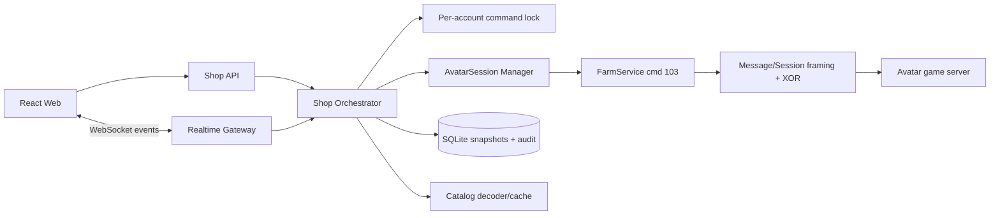

# Kế hoạch tích hợp giao dịch sạp AvatarHD vào web

**Phạm vi:** Tích hợp Siêu thị/gian hàng cá nhân của AvatarHD vào web `avatar-web` trong dự án `learning-reverse`.  
**Mục tiêu:** Người dùng có thể xem trạng thái sạp, xem kho và giới hạn giá, đăng bán, rút hàng, mua hàng, mở slot và theo dõi kết quả giao dịch từ giao diện web.

## 1. Bối cảnh hiện tại

Web đã có backend TypeScript duy trì phiên kết nối tới game, lớp `FarmService` đóng gói cmd 103, các lớp `Session/Message/Reader/Writer`, WebSocket và giao diện quản lý nhiều tài khoản. Vì vậy, không nên để trình duyệt tự kết nối trực tiếp tới server game. Backend phải là lớp duy nhất giữ thông tin đăng nhập, socket game, key phiên và thực hiện các lệnh giao dịch.

Các điểm mã nguồn sẽ làm nền cho tích hợp là:

| Khu vực | Thành phần hiện có | Vai trò trong tích hợp |
|---|---|---|
| Giao thức | `server/src/proto/*` | Framing, XOR key, reader/writer, packet fixtures |
| Game session | `server/src/session/*` | Quản lý phiên theo tài khoản, reconnect và trạng thái |
| Farm protocol | `server/src/game/farmService.ts` | Đóng gói cmd 103 và các lệnh inventory |
| Farm decoder | `server/src/game/farmData.ts` | Giải mã item, cây, vật nuôi, inventory |
| WebSocket | `server/src/ws.ts` và `server/src/session/*` | Đẩy snapshot/trạng thái giao dịch tới giao diện |
| UI tài khoản | `web/src/accounts/*` | Nơi tích hợp panel Sạp/Kho/Giao dịch |
| Catalog | `server/shop-catalog.json` | Hiển thị tên, ID và metadata hàng hóa |

## 2. Hai phương án khả thi

| Phương án | Mô tả | Đánh đổi | Chi phí/vận hành | Độ phức tạp |
|---|---|---|---|---|
| **A — Gateway giao dịch đầy đủ** | Backend giữ phiên game và thực hiện trực tiếp mọi thao tác cmd 103; web chỉ gọi API và nhận event | Trải nghiệm đầy đủ, đồng bộ tốt; cần xử lý concurrency, reconnect và giao dịch thật | Cần backend chạy ổn định với socket dài hạn; phải theo dõi tài khoản và packet | Cao |
| **B — Read-only trước, write sau** | Giai đoạn đầu chỉ đọc sạp/kho/catalog; sau khi xác minh packet live mới bật đăng bán, rút và mua | An toàn hơn, giảm rủi ro mất hàng/XU; thời gian có chức năng đầy đủ dài hơn | Có thể triển khai trên hạ tầng hiện tại trước; chỉ cần nâng yêu cầu khi bật write | Trung bình |
| **C — Browser gửi lệnh trực tiếp** | Trình duyệt tự giữ socket hoặc gửi raw packet tới game | Không nên dùng: lộ thông tin phiên, khó kiểm soát giao dịch, dễ race condition và không audit được | Không giải quyết được yêu cầu bảo mật và persistence | Thấp lúc đầu, rất cao về rủi ro |

**Khuyến nghị:** Chọn **B làm MVP**, sau đó nâng dần thành **A**. Không chọn C. Lý do là cmd 103 đã có schema client-side nhưng một số ý nghĩa nghiệp vụ vẫn chưa được xác minh đầy đủ: phí, `type/step`, `value` ở RX sub4/sub5 và thời điểm server cập nhật tiền/inventory.

## 3. Kiến trúc mục tiêu



Nguyên tắc chính là **một tài khoản game chỉ có một command đang ghi dữ liệu tại một thời điểm**. Các lệnh đọc có thể xếp hàng nhẹ, nhưng đăng bán, rút hàng, mua hàng và mở slot phải dùng per-account lock để tránh hai thao tác cùng sửa một slot hoặc dùng cùng một inventory snapshot cũ.

Nếu backend triển khai trong môi trường autoscale/stateless, cần chuyển phần giữ socket game sang một process ổn định có khả năng duy trì kết nối dài hạn. Không nên dùng tác vụ định kỳ để giữ kết nối hoặc polling liên tục. Khi dùng hạ tầng persistent/reserved, cần tính riêng chi phí vận hành trước khi bật production; giai đoạn MVP có thể triển khai trên backend GCP hiện có trong repository nếu môi trường đó giữ được process và WebSocket ổn định.

## 4. Mô hình dữ liệu đề xuất

### 4.1. Snapshot sạp

| Bảng/đối tượng | Trường chính | Mục đích |
|---|---|---|
| `shop_snapshot` | `accountId`, `capturedAt`, `isMyShop`, `numSlot`, `canOpenSlot`, `refreshTime`, `refreshPrice` | Trạng thái tổng quan lần gần nhất |
| `shop_slot` | `accountId`, `slot`, `idShop`, `verShop`, `idItem`, `num`, `price`, `isSale`, `isTimeOut`, `snapshotId` | Trạng thái từng slot |
| `shop_price_rule` | `accountId`, `idItem`, `minPrice`, `maxPrice`, `capturedAt` | Giới hạn giá từ RX sub8 |
| `inventory_snapshot` | `accountId`, `capturedAt`, `itemsJson`, `money` | Đối chiếu trước/sau giao dịch |
| `shop_transaction` | `id`, `accountId`, `type`, `slot`, `idShop`, `idItem`, `num`, `price`, `status`, `idempotencyKey`, `createdAt`, `completedAt` | Audit và chống gửi lặp |
| `protocol_exchange` | `transactionId`, `direction`, `cmd`, `subType`, `bodyHex`, `capturedAt`, `redacted` | Debug packet, không lưu credential/key |

`bodyHex` chỉ nên lưu body logic đã giải mã, không lưu raw socket ciphertext nếu không cần. Các trường nhạy cảm như mật khẩu, token đăng nhập và key XOR phải tuyệt đối không ghi vào log hoặc database giao dịch.

### 4.2. Trạng thái giao dịch

```text
queued -> sending -> awaiting_reply -> reconciling -> succeeded
                                      \-> failed
                                      \-> unknown
```

Trạng thái `unknown` bắt buộc phải có. Nếu socket đứt sau khi server đã nhận lệnh, web không được tự động gửi lại lệnh mua/đăng bán/rút hàng. Thay vào đó, hệ thống phải reconnect, đọc lại sạp và inventory, rồi đánh dấu giao dịch là `succeeded` hoặc `failed` sau khi đối chiếu.

## 5. Lớp protocol adapter

Tách cmd 103 thành module riêng thay vì để UI gọi thẳng `FarmService`:

```text
ShopProtocolAdapter
  openOwnShop()
  openOtherShop(idShop, ...)
  requestPriceRules()
  unlockSlot(type)
  addListing(slot, idItem, num, price)
  withdrawListing(slot)
  buyListing(idShop, idItemOrVersion)
  refreshShop()
```

Adapter phải đảm nhiệm bốn việc:

1. Đóng gói body cmd 103 đúng big-endian.
2. Gắn request context để biết response RX sub-type nào đang chờ.
3. Decode response sub-type 0–8 thành các event có kiểu rõ ràng.
4. Không trả kết quả thành công chỉ dựa vào việc `session.send()` không ném exception.

Các schema cần triển khai trong MVP:

| Direction | Sub-type | Schema cần code hóa |
|---|---:|---|
| TX | `0/1` | `i8 type, i8 step, i16 idItem` |
| TX | `2` | `i8 2, i8 type` |
| TX | `3` | `i8 3, i8 slot, i16 idItem, i32 num, i32 price` |
| TX | `4` | `i8 4, i8 slot` |
| TX | `5` | `i8 5, i32 idShop, i16 idItemOrVersion` |
| TX | `7/8` | `i8 subType` |
| RX | `0` | `i8 count` + records item của sạp mình + `bool canOpenSlot` |
| RX | `1` | `i8 status, i16 count` + records sạp ngoài |
| RX | `2` | `i8 state, i8 type, i32 value`, sau đó tùy state đọc slot/bool |
| RX | `3` | `i8 slot, i16 idItem, i32 num, i32 price` |
| RX | `4` | `i8 slot, i8 result`, nhánh tiếp theo tùy result |
| RX | `5` | `i16 idItem, i32 value` |
| RX | `6/7` | Không có body thêm |
| RX | `8` | `i16 count` + `i16 idItem, i32 minPrice, i32 maxPrice` |

Parser phải có fixture cho các trường hợp `count=0`, slot không bán có `isTimeOut`, status lỗi, packet thiếu byte và packet có trailing bytes. Đặc biệt, RX sub0 chỉ đọc `isTimeOut` khi `isSale=false`; đọc dư một boolean sẽ làm lệch parser.

## 6. Backend API và event realtime

### 6.1. API đọc

```text
GET  /api/accounts/:accountId/shop
GET  /api/accounts/:accountId/shop/price-rules
GET  /api/accounts/:accountId/inventory
POST /api/accounts/:accountId/shop/refresh
```

API đọc trả về snapshot cùng `capturedAt`, trạng thái phiên, độ tuổi dữ liệu và cảnh báo nếu snapshot đã cũ.

### 6.2. API ghi

```text
POST /api/accounts/:accountId/shop/slots/unlock
POST /api/accounts/:accountId/shop/listings
POST /api/accounts/:accountId/shop/listings/:slot/withdraw
POST /api/accounts/:accountId/shop/purchases
```

Mọi API ghi phải nhận `idempotencyKey`, `expectedVersion` hoặc `expectedSnapshotAt`. Ví dụ đăng bán phải kiểm tra snapshot inventory và slot chưa thay đổi; nếu đã cũ, trả `409 STALE_STATE` để web bắt người dùng refresh thay vì tự ghi đè.

### 6.3. WebSocket events

```text
shop.snapshot.updated
shop.priceRules.updated
shop.transaction.queued
shop.transaction.progress
shop.transaction.succeeded
shop.transaction.failed
shop.transaction.unknown
inventory.snapshot.updated
account.session.changed
protocol.warning
```

WebSocket chỉ đẩy trạng thái và kết quả đã được server chuẩn hóa; không đẩy raw credentials hoặc key phiên.

## 7. Luồng nghiệp vụ trên web

### 7.1. Xem sạp của mình

Web gọi `GET /shop`. Backend kiểm tra snapshot; nếu quá cũ, gửi `openShop()` và chờ RX sub0. Khi nhận RX sub0, backend lưu slot, `numSlot`, `canOpenSlot`, đánh dấu `isMyShop=true`, sau đó gọi `getShopItems()` để nhận RX sub8 và cập nhật price rules. Cuối cùng backend gọi `getInventory()` để đối chiếu số lượng trong kho.

### 7.2. Đăng bán

Người dùng chọn slot, item, số lượng và giá. UI hiển thị `minPrice/maxPrice`, tồn kho hiện tại và cảnh báo phí nếu server đã xác minh được. Khi bấm xác nhận, backend chụp inventory/slot snapshot, tạo transaction, khóa tài khoản, gửi TX sub3, chờ RX sub3, rồi gọi `getInventory()` và `openShop()` để reconcile. Chỉ khi slot và inventory sau giao dịch khớp kỳ vọng mới đánh dấu `succeeded`.

### 7.3. Rút hàng

UI gửi slot và hiển thị xác nhận rõ rằng mặt hàng sẽ rời gian hàng. Backend gửi TX sub4, chờ RX sub4, đọc lại inventory và sạp. Không retry tự động nếu timeout; chuyển sang `unknown` và reconcile sau reconnect.

### 7.4. Mua hàng

UI phải hiển thị `idShop`, `verShop`, `idItem`, số lượng và tổng giá theo snapshot. Backend kiểm tra snapshot chưa quá cũ, gửi TX sub5, chờ RX sub5, sau đó thực hiện refresh theo `openShop(type=1, step=1, idItem)`, đọc inventory và money. Vì ý nghĩa chính xác của trường `value` và thời điểm cộng hàng chưa được xác minh đầy đủ, MVP nên hiển thị “đang đối chiếu kết quả” thay vì khẳng định thành công ngay khi nhận RX sub5.

## 8. Giao diện web

Tạo một `ShopPanel` trong khu vực account dashboard, chia thành bốn tab:

| Tab | Nội dung |
|---|---|
| **Sạp của tôi** | Grid slot, trạng thái bán/hết hạn/trống, số lượng, giá, nút rút hàng |
| **Mua hàng** | Danh sách sạp ngoài, filter theo item/giá, hiển thị `idShop/verShop` ở phần chi tiết |
| **Đăng bán** | Chọn item từ inventory, số lượng, giá, validation min/max, preview phí |
| **Giao dịch** | Timeline transaction, packet phase, kết quả reconcile, lỗi và nút refresh |

Mọi thao tác ghi phải có modal xác nhận. Trong modal cần hiển thị tài khoản đang thao tác, slot/item, số lượng, giá, XU dự kiến và cảnh báo “không gửi lại nếu đang xử lý”. Khi session không online, các nút ghi bị khóa; khi snapshot stale, nút xác nhận chuyển thành “Cập nhật dữ liệu”.

## 9. An toàn và kiểm soát rủi ro

Không cho phép frontend gửi raw command hoặc tự truyền `idShop/idItem` không qua validation. Backend phải kiểm tra quyền sở hữu account, giới hạn số lượng, số slot, range giá, session ownership và trạng thái transaction.

Các thao tác mua, đăng bán, rút hàng và mở slot phải mặc định ở chế độ **manual confirmation**. Chưa bật auto-retry cho write command. Chỉ retry các lệnh đọc như `getInventory`, `getShopItems` và `refreshShop`, đồng thời giới hạn backoff.

Cần có feature flag:

```text
SHOP_READ_ENABLED=true
SHOP_WRITE_ENABLED=false
SHOP_PURCHASE_ENABLED=false
SHOP_LIVE_ACCOUNT_ALLOWLIST=...
```

MVP chỉ bật read; sau khi có packet fixture và test account mới bật từng loại write riêng. Production phải có audit log, rate limit theo account, command lock, timeout, circuit breaker khi game server lỗi và nút dừng khẩn cấp theo account.

## 10. Lộ trình triển khai

| Giai đoạn | Phạm vi | Tiêu chí hoàn thành |
|---|---|---|
| **P0 — Protocol harness** | Adapter cmd 103, fixtures TX/RX, decode sub0–8, packet logger đã che dữ liệu nhạy cảm | Test byte-level pass; không kết nối live |
| **P1 — Read-only** | Shop snapshot, inventory snapshot, price rules, UI xem sạp | Xem đúng sạp mình/sạp khác; refresh không tạo write |
| **P2 — Đăng bán và rút hàng** | TX/RX sub3/sub4, lock, reconcile, audit, confirm modal | Test account thực hiện được với rollback/reconcile |
| **P3 — Mua hàng và slot** | TX/RX sub5/sub2, kiểm soát `verShop`, money/inventory reconcile | Không gửi lặp khi timeout; xác định được success/failure/unknown |
| **P4 — Production hardening** | Metrics, alert, rate limit, multi-account isolation, feature flags, backup DB | Có runbook sự cố và triển khai canary |

## 11. Kiểm thử bắt buộc

### Unit test

Kiểm tra byte payload cho từng TX sub-type, big-endian, số âm `-1`, overflow số lượng/giá, và framing command 103 với body length 1–12 byte.

### Decoder fixture test

Tạo fixture RX cho sub0 có item đang bán và item hết hạn, sub1 có nhiều sạp, sub2 cả hai state, sub3 cập nhật slot, sub4 cả hai result, sub5 refresh item, sub6/7 body rỗng và sub8 count bằng 0/nhiều item.

### Integration test

Dùng fake `Session` để kiểm tra thứ tự command: đăng bán phải là `TX sub3 → RX sub3 → getInventory`; mua hàng phải là `TX sub5 → RX sub5 → openShop refresh → inventory/money reconcile`. Kiểm tra hai request ghi đồng thời cùng account bị serialize.

### Live test có kiểm soát

Chỉ dùng tài khoản test, số lượng nhỏ và không bật auto-retry. Lưu snapshot trước/sau. Sau mỗi test phải xác nhận inventory, slot, XU và trạng thái transaction. Nếu socket đứt giữa chừng, kiểm tra hệ thống chuyển sang `unknown` và không tự gửi lại lệnh.

## 12. Các quyết định cần xác nhận trước khi bắt đầu code

1. **MVP có bật giao dịch thật ngay hay bắt đầu read-only?** Khuyến nghị read-only trước.
2. **Web phục vụ một tài khoản hay nhiều tài khoản đồng thời?** Nếu nhiều tài khoản, command lock và quota phải được thiết kế ngay từ đầu.
3. **Backend production sẽ chạy ở môi trường GCP hiện có hay cần chuyển sang hạ tầng process dài hạn khác?** Kết nối socket game không phù hợp với một process stateless thường xuyên bị recycle.
4. **Có tài khoản test để xác minh RX sub4/sub5, phí và money/inventory không?** Đây là điều kiện để bật write/purchase an toàn.

## Kết luận

Kiến trúc phù hợp nhất là **server-side transaction gateway**: web chỉ quản lý intent và hiển thị trạng thái, còn backend giữ phiên game, đóng gói cmd 103, serialize lệnh theo account, reconcile inventory/sạp sau mỗi write và phát event realtime cho UI. Nên triển khai theo lộ trình **P0 → P1 read-only → P2 listing/withdraw → P3 purchase/slot → P4 hardening**, với feature flag và xác nhận thủ công cho mọi giao dịch làm thay đổi dữ liệu.

## References

[1]: `avatar-web/server/src/game/farmService.ts` — các hàm cmd 103 và lệnh inventory.

[2]: `avatar-web/server/src/proto/session.ts` — framing, length và XOR key theo phiên.

[3]: `avatar-web/server/src/proto/message.ts`, `writer.ts`, `reader.ts` — Message và kiểu dữ liệu big-endian.

[4]: `avatar-web/server/src/session/avatarSession.ts`, `manager.ts`, `routes.ts` — quản lý phiên tài khoản và route hiện có.

[5]: `avatar-web/server/src/ws.ts` — WebSocket backend.

[6]: `avatar-web/web/src/accounts/*` — các panel và runtime quản lý tài khoản hiện có.

[7]: `avatar-re/notes/farm.md`, `avatar-re/il2cpp_out/dump.cs` — schema cmd 103 và cấu trúc ShopScr/ItemShop đã reverse.
