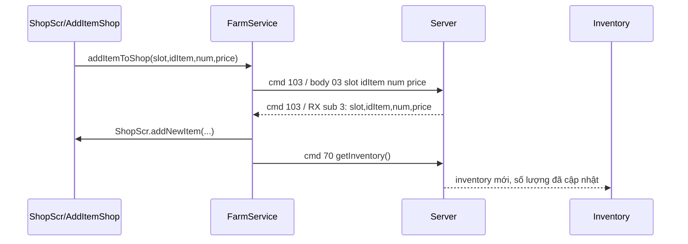
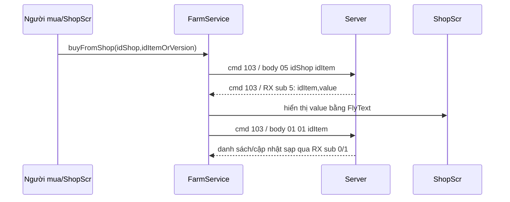
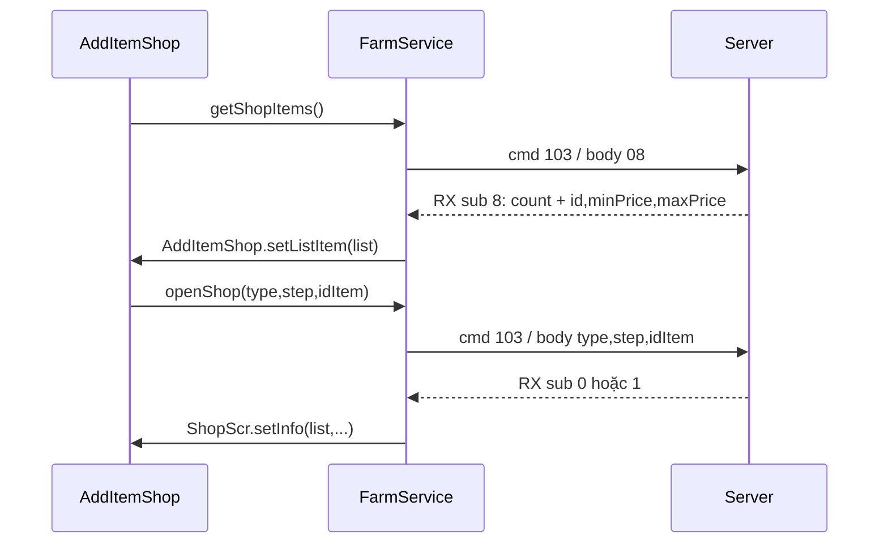

# Phân tích kỹ thuật giao thức `OPEN_SHOP_FARM` — cmd 103 trong AvatarHD

**Tác giả:** Manus AI  
**Phạm vi:** APK AvatarHD 3.4.4 và mã reverse-engineering trong dự án `learning-reverse`.  
**Mức độ xác minh:** Các payload TX được xác minh bằng mã `FarmService` và disassembly native; các payload RX được xác minh bằng jump-table của `FarmMsgHandler.onMessage` và disassembly các nhánh cmd 103. Chưa thực hiện giao dịch live trên tài khoản người dùng.

## 1. Kết luận nhanh

`103` là hằng số dùng cho `OPEN_SHOP_FARM`, nhưng thực chất đây là **container command**: byte đầu tiên của body là một **sub-type từ 0 đến 8**. Cmd 103 phục vụ cả sạp cá nhân, không chỉ thao tác “mở” sạp.

| Nhóm | Sub-type | Chức năng chính |
|---|---:|---|
| Mở/xem | `0`, `1` | Nhận danh sách mặt hàng của sạp mình hoặc sạp khác |
| Slot | `2` | Hỏi giá/mở khóa slot |
| Đăng bán | `3` | Thêm một mặt hàng vào slot |
| Rút hàng | `4` | Lấy mặt hàng trong slot về kho |
| Mua hàng | `5` | Mua một mặt hàng từ sạp |
| Giao diện | `6`, `7` | Làm mới trạng thái hiển thị sạp |
| Giới hạn giá | `8` | Nhận danh sách sản phẩm và khoảng giá cho phép |

Điểm quan trọng là **sub-type TX và sub-type RX không đồng nhất một cách máy móc**. Ví dụ TX sub-type `3` là yêu cầu đăng bán, còn RX sub-type `3` là phản hồi cập nhật slot; TX sub-type `8` yêu cầu danh sách sản phẩm, còn RX sub-type `8` trả về danh sách `minPrice/maxPrice`.

## 2. Lớp framing ở mức socket

Trong client TypeScript của dự án, `Message.create(103)` chỉ tạo body logic. Khi `Session.send()` phát gói, framing bên ngoài có dạng:

```text
+----------------+----------------------+-----------------------+
| command: 1 B   | body length: 2 B BE  | body: N bytes         |
+----------------+----------------------+-----------------------+
```

Với cmd 103, độ dài body dùng **2 byte big-endian**, không phải 4 byte. Khi cơ chế key đã hoàn tất, từng byte của command, length và body bị XOR tuần tự với key vòng; chỉ event `traffic` của client mới giữ body đã giải mã trước khi framing/encryption. `Message` và `Session.send()` xác nhận body được viết big-endian, còn `MyWriter` dùng `writeByte`, `writeShort`, `writeInt` lần lượt có độ rộng 1, 2 và 4 byte [1] [2].

Do đó, bảng dưới đây mô tả **body logic trước XOR**. Nếu bắt gói trên socket sau khi key đã thiết lập, byte thực tế sẽ không trùng trực tiếp với bảng cho tới khi giải mã XOR đúng `curW` và key phiên.

## 3. Payload TX: client → server

### 3.1. Mở/xem sạp — `openShop(type, step, idItem)`

```text
cmd 103
body:
  i8  subType = type
  i8  step
  i16 idItem
```

Độ dài body là **4 byte**. Giá trị mặc định trong chữ ký C# là `step=-1`, `idItem=-1`; trên wire, `-1` tương ứng `ff` hoặc `ffff` theo độ rộng trường. Disassembly của `FarmService.doOpenShop` xác nhận chuỗi `writeByte`, `writeByte`, `writeShort` và command `103` [3] [4].

Các call site RX cho thấy ít nhất một nhánh dùng:

```text
type=1, step=0, idItem=-1   // lấy catalog nông sản
type=1, step=1, idItem=<id> // lấy seller listings của nông sản đã chọn
```

Action handler `ShopScr.IActionShop.perform` tại `0x800928` xác nhận UI gửi `doOpenShop(1,0,-1)` khi item đại diện catalog có `itemId=-1`, và gửi `doOpenShop(1,1,itemId)` khi người dùng chọn một nông sản cụ thể. Hai step này lần lượt yêu cầu catalog và seller listings; không phải cùng một snapshot.

### 3.2. Mở khóa slot — `unlockShopSlot(type)`

```text
cmd 103
body:
  i8 subType = 2
  i8 type
```

Độ dài body là **2 byte**. `type` được giữ nguyên từ `ShopScr.IActionUnlockSlot`; disassembly TX xác nhận chỉ có hai lần `writeByte` sau khi tạo message [3] [4].

### 3.3. Đăng hàng vào slot — `addItemToShop(slot, idItem, num, price)`

```text
cmd 103
body:
  i8  subType = 3
  i8  slot
  i16 idItem
  i32 num
  i32 price
```

Độ dài body là **12 byte**. Đây là payload giao dịch quan trọng nhất của người bán. `slot` là vị trí gian hàng, `idItem` là ID nông sản trong kho, `num` là số lượng đăng bán và `price` là giá niêm yết theo đơn vị mà server quy định. Disassembly native xác nhận đúng thứ tự `writeByte`, `writeByte`, `writeShort`, `writeInt`, `writeInt` [3] [4].

Ví dụ logic, không phải byte đã XOR:

```text
03 | 02 | 00 2a | 00 00 00 0a | 00 00 01 f4
    slot  id=42     num=10          price=500
```

Không được suy ra rằng giá cuối cùng luôn là `num × price` chỉ từ payload; việc tính tổng, phí và kiểm tra số dư thuộc server.

### 3.4. Rút hàng khỏi slot — `takeItemBack(slot)`

```text
cmd 103
body:
  i8 subType = 4
  i8 slot
```

Độ dài body là **2 byte**. Lệnh này khác với `SELL_ITEM=67`: nó yêu cầu server đưa mặt hàng chưa bán trong slot về kho người bán [3] [5].

### 3.5. Mua hàng từ sạp — `buyFromShop(idShop, idItem)`

```text
cmd 103
body:
  i8  subType = 5
  i32 idShop
  i16 idItem
```

Độ dài body là **7 byte**. Tên tham số trong port là `idItem`, nhưng RX `ShopScr.ItemShop` có cả `IdShop` và `verShop`; do đó cần thận trọng: đối số thứ hai có thể là định danh phiên bản/mặt hàng theo ngữ cảnh server, dù client-side method được khôi phục với tên `idItem`. Constructor của item sạp cho người mua chứa cả `IdShop`, `verShop`, `Id`, `num`, `price` [6].

### 3.6. Làm mới và lấy danh sách sản phẩm

```text
cmd 103, body: 07          // refreshShop(), subType=7
cmd 103, body: 08          // getShopItems(), subType=8
```

Hai payload chỉ dài 1 byte. Đây là body, chưa tính command byte và length ở framing ngoài [3].

## 4. Payload RX: server → client

`FarmMsgHandler.onMessage` dùng jump-table tại VA `0x14e35d8` cho command 51–103. Entry cmd 103 trỏ tới `0x635f14`; nhánh này đọc một `i8` sub-type rồi dùng jump-table con tại `0x14e36c4`. Chín entry của jump-table con được xác minh như sau:

| RX sub-type | Target native | Callback/điểm tác động chính |
|---:|---:|---|
| `0` | `0x63732c` | Tạo `ItemShop`, `ShopScr.setInfo`, đánh dấu `isMyShop=true`, gọi `getItemShop()` |
| `1` | `0x637538` | Tạo `ItemShop` constructor dành cho sạp ngoài, `ShopScr.setInfo` |
| `2` | `0x637210` | `openSlotInfo` hoặc `addSlot` |
| `3` | `0x6372a0` | `addNewItem`, sau đó `getInventory()` |
| `4` | `0x637110` | Xử lý kết quả rút hàng, `removeItem` |
| `5` | `0x6376b4` | Hiển thị kết quả và gửi `doOpenShop(1,1,idItem)` |
| `6` | `0x635f74` | `ShopScr.refeshShop()` |
| `7` | `0x635f74` | Cùng nhánh UI refresh với sub-type 6 |
| `8` | `0x637760` | Đọc `ListItemShop`, gọi `AddItemShop.setListItem` |

### 4.1. RX sub-type 0 — danh sách sạp của mình

Schema được khôi phục từ disassembly:

```text
i8  count
repeat count:
  i16 idItem
  if idItem == -1:
    slot trống; record kết thúc tại đây
  else:
    i32 num
    i32 price
    bool isSale
    if isSale == false:
      bool isTimeOut
bool canOpenSlot
```

Packet live `0001ffff01` xác nhận `count=1` có thể chứa một slot trống chỉ
gồm sentinel `idItem=-1`, sau đó là `canOpenSlot=true`. Vì vậy `count` là
số slot đã mở; không được pre-validate mọi slot như một record đầy đủ.

Với mỗi slot có item, client gọi constructor đơn giản của `ShopScr.ItemShop`:

```text
ItemShop(idItem, num, price, isSale, isTimeOut)
```

Sau vòng lặp, client gọi:

```text
ShopScr.setInfo(list, count, canOpenSlot)
ShopScr.isMyShop = true
FarmService.getItemShop()
```

Điều kiện đọc `isTimeOut` là bất đối xứng: khi `isSale=true`, native code đặt `isTimeOut=0` mà không đọc thêm byte; khi `isSale=false`, native code đọc thêm một boolean. Đây là điểm phải giữ nguyên khi viết parser, nếu đọc luôn boolean thứ hai sẽ làm lệch toàn bộ body tiếp theo.

### 4.2. RX sub-type 1 — catalog và seller listings

Nhánh native tại `0x637980` đọc `status` để phân biệt hai schema khác nhau.

Với `status=0`, body là catalog nông sản cùng metadata refresh:

```text
i8  status = 0
i16 count
repeat count:
  i16 itemId
  i32 price
i32 timeRefresh
i32 priceRefresh
```

Packet live trước XOR từ account 2:

```text
0100000300020000000500c800000002000700000001000006190000000a
```

Giải mã đủ, không còn trailing bytes:

```text
subType      = 1
status       = 0
count        = 3
items        = [(2, 5), (200, 2), (7, 1)]
timeRefresh  = 1561
priceRefresh = 10
```

Mỗi record catalog tạo `ShopScr.ItemShop(itemId, -1, price, false, false)`. Sau vòng lặp, client đọc hai `int` và gọi `ShopScr.setRefesh(timeRefresh, priceRefresh)`. `priceRefresh=10` chỉ là giá trị opaque do server trả về; chưa có bằng chứng nó là giá theo bất kỳ loại tiền nào.

Với `status=1`, body là seller listings của item đã yêu cầu:

```text
i8  status = 1
i16 count
repeat count:
  i32 idShop
  i16 verShop
  i16 idItem
  i32 num
  i32 price
```

Mỗi record dùng constructor thứ hai của `ShopScr.ItemShop`:

```text
ItemShop(idShop, verShop, idItem, num, price)
```

Sau đó client chuyển danh sách vào `ShopScr.setInfo(list, count, false)`. Constructor thứ hai đặc biệt quan trọng vì nó chứng minh mặt hàng của sạp ngoài có **hai định danh riêng**: ID sạp và version/ID mặt hàng. Packet `status=1` không có `selectedItemId` riêng ngoài `itemId` trong từng listing; phía web phải gắn response với item đã chọn bằng request context, không suy diễn trong decoder.

### 4.3. RX sub-type 2 — thông tin hoặc kết quả slot

Phần đầu body luôn được đọc như sau:

```text
i8 state
i8 type
i32 value
```

Hai nhánh đã xác minh:

| `state` | Đọc thêm | Callback | Diễn giải an toàn |
|---:|---|---|---|
| `0` | Không | `ShopScr.openSlotInfo(type, value)` | Server trả thông tin slot/giá liên quan |
| `1` | `i8 numSlot`, `bool canBuySlot` | `ShopScr.addSlot(numSlot, canBuySlot)` | Server xác nhận/cập nhật số slot và khả năng mở thêm |

Tên `value` được dùng ở đây thay vì khẳng định `price` vì `openSlotInfo(type, price)` nhận nó như giá, nhưng nhánh thành công đọc cùng trường trước khi đọc `numSlot` và `canBuySlot`. Cần thêm packet live hoặc xem thân đầy đủ của server để đặt tên nghiệp vụ chắc chắn.

### 4.4. RX sub-type 3 — xác nhận đăng bán

Schema chính xác:

```text
i8  slot
i16 idItem
i32 num
i32 price
```

Client gọi:

```text
ShopScr.addNewItem(slot, idItem, num, price)
FarmService.getInventory()
```

Việc gọi `getInventory()` ngay sau `addNewItem` là bằng chứng mạnh rằng server đã thay đổi số lượng nông sản trong kho khi đăng bán. UI được cập nhật trước, nhưng nguồn sự thật cuối cùng vẫn là inventory được tải lại từ server.

### 4.5. RX sub-type 4 — kết quả rút hàng

Phần đầu được đọc như sau:

```text
i8 slot
i8 result
```

Hai nhánh native:

```text
result == 0:
  i32 value
  Canvas.addFlyText(value, ...)
  ShopScr.removeItem(slot)

result == 1:
  i16 idItem
  i32 value
  Canvas.addFlyText(value, ...)
  FarmService.getInventory()
  ShopScr.removeItem(slot)
```

`value` có thể là ID thông báo, số lượng hoặc giá trị hiển thị tùy dữ liệu server; mã client không gắn tên miền rõ ràng cho nó. Điều chắc chắn là slot bị xóa khỏi UI, và trong nhánh `result=1` inventory được yêu cầu lại.

### 4.6. RX sub-type 5 — kết quả mua hàng

Schema trực tiếp:

```text
i16 idItem
i32 value
```

Sau khi đọc, client gửi tiếp:

```text
cmd 103, body: 01 01 <idItem:i16>
```

Tức là `doOpenShop(type=1, step=1, idItem)` để cập nhật lại mặt hàng vừa mua. Client đồng thời gọi `Canvas.addFlyText(value, ...)` để hiển thị kết quả. Từ cấu trúc này có thể dựng chắc chắn chuỗi **mua → nhận phản hồi → refresh item**, nhưng chưa thể đặt tên `value` là “tổng tiền”, “số lượng còn lại” hay “mã thông báo” nếu chưa có packet mẫu.

### 4.7. RX sub-type 6/7 — refresh UI

Cả hai sub-type dùng chung target `0x635f74`, chỉ làm:

```text
ShopScr.gI().refeshShop()
```

Không có `readByte/readInt` nào trong nhánh này ngoài byte sub-type đã đọc ở dispatcher. Vì vậy body RX của sub-type 6/7, sau byte sub-type, được coi là rỗng theo bằng chứng hiện tại.

### 4.8. RX sub-type 8 — danh sách sản phẩm và giới hạn giá

Schema chính xác:

```text
i16 count
repeat count:
  i16 idItem
  i32 minPrice
  i32 maxPrice
```

Client tạo `AddItemShop.ListItemShop` và ghi:

```text
ListItemShop.id       = idItem
ListItemShop.minPrice = minPrice
ListItemShop.maxPrice = maxPrice
```

Sau vòng lặp, client gọi `AddItemShop.setListItem(list)`. Đây là nguồn dữ liệu để hộp thoại đăng bán biết sản phẩm nào được phép đưa lên sạp và phạm vi giá được phép nhập.

## 5. Luồng giao dịch đăng bán



Trình tự này cho thấy UI không tự trừ hàng. Client gửi yêu cầu, nhận phản hồi slot, rồi hỏi lại inventory. Nếu packet RX sub3 không về, việc client đã gọi `addItemToShop` chưa đủ để kết luận đăng bán thành công.

## 6. Luồng giao dịch mua hàng



Từ mã client, sau RX sub5 có một lệnh `openShop(1,1,idItem)`. Vì vậy giao dịch không kết thúc về mặt UI ở packet sub5; nó còn có bước refresh để đồng bộ mặt hàng. Việc cập nhật inventory người mua không xuất hiện trực tiếp trong nhánh RX sub5 đã phân tích, nên phải kiểm tra thêm handler tổng quát hoặc bắt cmd 70/68 đi kèm để kết luận chính xác thời điểm cộng hàng cho người mua.

## 7. Luồng mở sạp và lấy giới hạn giá



Ở sạp của mình, RX sub0 tạo các `ItemShop` có trường `isSale/isTimeOut`, đánh dấu `isMyShop=true`, sau đó tự động gọi `getItemShop()` để lấy tiếp danh sách sản phẩm/giới hạn. Điều này giải thích vì sao việc mở sạp có thể tạo nhiều packet liên tiếp thay vì một request–response duy nhất.

## 8. Bảng trạng thái slot

| Trạng thái logic | Dữ liệu client giữ | Chuyển trạng thái bởi |
|---|---|---|
| Slot trống | Không có item hoặc `isSale=false` | RX sub0/sub1, RX sub4 thành công |
| Slot đang đăng bán | `idItem`, `num`, `price`, `isSale=true` | RX sub0 hoặc RX sub3 |
| Slot hết hạn/không bán | `isSale=false`, có thể có `isTimeOut=true` | RX sub0; boolean timeout chỉ đọc có điều kiện |
| Slot đang chờ mở | `openSlotInfo(type,value)` | RX sub2 state 0 |
| Slot đã mở/có thể dùng | `numSlot`, `canBuySlot` | RX sub2 state 1 |
| Danh sách ngoài | `idShop`, `verShop`, `idItem`, `num`, `price` | RX sub1 |

Đây là **mô hình trạng thái phía client**. Server vẫn là nguồn sự thật; các callback UI chỉ cập nhật màn hình và không thay thế kiểm tra số lượng, giá, quyền sở hữu hoặc số dư ở server.

## 9. Các điểm đã xác minh và chưa xác minh

| Nội dung | Trạng thái | Căn cứ |
|---|---|---|
| Cmd 103 là container, byte đầu là sub-type | Đã xác minh | `FarmService`, dispatcher RX và jump-table con |
| TX sub3 có payload slot + id + num + price | Đã xác minh | `farmService.ts`, disassembly `doAddItemShop` |
| RX sub3 đọc slot + id + num + price | Đã xác minh | `0x6372a0`, gọi `ShopScr.addNewItem` |
| RX sub8 đọc id + minPrice + maxPrice | Đã xác minh | `0x637760`, `ListItemShop`, `setListItem` |
| RX sub0/sub1 tạo hai dạng `ItemShop` khác nhau | Đã xác minh | Hai constructor tại `0x800a90` và `0x800b94` |
| RX sub5 kích hoạt refresh `openShop(1,1,id)` | Đã xác minh | `0x6376b4` |
| Phí 10% áp dụng trong trường hợp nào | Chưa xác minh | Chỉ thấy chuỗi metadata `addItemShop_sendPriceWith10precentFee` và nhánh miễn phí |
| `type`/`step` đầy đủ nghĩa nghiệp vụ | Chưa xác minh | Client chỉ để lộ một số call site |
| `value` trong RX sub4/sub5 là tiền, số lượng hay mã thông báo | Chưa xác minh | Native client chỉ truyền vào `Canvas.addFlyText` |
| Server trừ/cộng tiền và inventory ở packet nào | Chưa xác minh đầy đủ | Cần packet capture giao dịch hoặc phân tích handler server |
| Ý nghĩa chính xác của `idItem` trong TX sub5 so với `verShop` | Chưa xác minh | Tên tham số port không phản ánh hết constructor item ngoài |

## 10. Khuyến nghị parser và kiểm thử

Parser cmd 103 nên tách thành hai lớp. Lớp thứ nhất giải mã framing socket, XOR key và lấy body; lớp thứ hai đọc `body[0]` như sub-type rồi dispatch sang schema tương ứng. Không được dùng một schema chung cho mọi response, vì RX sub0 có record biến độ dài do boolean có điều kiện, trong khi RX sub8 có record cố định 10 byte.

Đối với kiểm thử, nên bắt tối thiểu sáu phiên traffic riêng: mở sạp của mình, mở sạp người khác, lấy danh sách giới hạn giá, đăng một item, rút một item và mua một item. Mỗi phiên cần lưu TX/RX body **trước XOR**, số dư XU trước/sau, inventory trước/sau và trạng thái slot trước/sau. Không nên tự động gửi lệnh mua, đăng bán hoặc rút hàng trên tài khoản thật nếu chưa có xác nhận của người dùng, vì đây là các thao tác làm thay đổi dữ liệu game.

## References

[1]: `avatar-web/server/src/proto/message.ts` và `avatar-web/server/src/proto/writer.ts` — cấu trúc Message và encoding big-endian.

[2]: `avatar-web/server/src/proto/session.ts` — framing command/length/body và XOR key theo phiên.

[3]: `avatar-web/server/src/game/farmService.ts` — các phương thức TX của cmd 103.

[4]: `avatar-re/notes/assembly-csharp.cs` — chữ ký C# khôi phục và RVA các hàm `doOpenShop`, `doAddItemShop`, `doBuyItemShop`.

[5]: `avatar-re/notes/farm.md` — bảng opcode farm và ghi chú giao thức đã xác minh.

[6]: `avatar-re/il2cpp_out/dump.cs` — lớp `ShopScr.ItemShop`, `ShopScr`, `AddItemShop` và `FarmMsgHandler`.

[7]: `avatar-re/tools/jumptable.py` và disassembly `libil2cpp.so` — mapping dispatcher `FarmMsgHandler.onMessage`, cmd 103 và jump-table con.

> **Giới hạn:** Báo cáo này mô tả giao thức dựa trên client reverse-engineered. Nó không khẳng định các quy tắc server chưa xuất hiện trong client, chẳng hạn công thức phí, kiểm tra chống gian lận, điều kiện quyền truy cập sạp, hay thứ tự chính xác của các packet inventory/money trong một giao dịch live.
