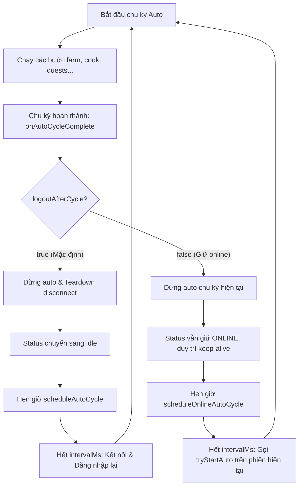

# Thiết kế: Tuỳ chọn "Đăng xuất sau khi chạy xong 1 cycle" cho Auto Farm

- **Ngày tạo**: 2026-08-18
- **Trạng thái**: Chờ duyệt (Pending Review)
- **Phạm vi tác động**:
  - `avatar-web/server/src/autoFarm.ts`
  - `avatar-web/server/src/accounts/autoConfig.ts`
  - `avatar-web/server/src/session/avatarSession.ts`
  - `avatar-web/web/src/types.ts`
  - `avatar-web/web/src/accounts/panels/StatusPanel.tsx`
  - `avatar-web/web/src/accounts/panels/AutoFarmPanel.tsx`

---

## 1. Mục tiêu & Bối cảnh

### Bối cảnh
Hiện tại, khi bật tính năng tự động (Auto Farm), sau khi hoàn thành 1 chu kỳ (1 cycle), hệ thống luôn tự động đóng kết nối game (`teardown()`), đưa trạng thái về `idle`, và hẹn giờ `intervalMs` để tự đăng nhập lại khi tới chu kỳ sau.

Tuy nhiên, người dùng có nhu cầu lựa chọn:
1. **Đăng xuất sau mỗi chu kỳ (Mặc định)**: Chạy xong 1 chu kỳ -> Đăng xuất tạm thời, chờ hết thời gian interval -> Tự đăng nhập lại chạy chu kỳ tiếp theo (giúp tiết kiệm tài nguyên kết nối, giảm tải socket và an toàn phiên).
2. **Giữ online liên tục**: Chạy xong 1 chu kỳ -> Giữ nguyên kết nối game online (với keep-alive ping định kỳ), sau khi hết thời gian interval sẽ kích hoạt chu kỳ tiếp theo ngay trên phiên hiện tại mà không cần đăng xuất / đăng nhập lại.

### Mục tiêu
- Bổ sung tuỳ chọn `logoutAfterCycle` (boolean, mặc định `true`) vào cấu hình Auto Farm của tài khoản (`AutoFarmConfig`).
- Lưu trữ cấu hình bền vững trong SQLite theo từng tài khoản qua API cấu hình tự động hiện có.
- Hiển thị checkbox toggle nhanh trực quan ngay tại card **"Trạng thái"** (dưới hàng nút Bật/Tắt auto) và đồng bộ trong bảng **"Cấu hình tự động nông trại (Auto Farm)"**.
- Xử lý mượt mà vòng đời kết nối trong `AvatarSession` cho cả hai chế độ (ngắt kết nối chờ lượt sau vs giữ kết nối chờ lượt sau).

---

## 2. Phạm vi thay đổi (Scope)

### Trong phạm vi (In-scope)
1. **Server - Config & Parser**:
   - Thêm `logoutAfterCycle?: boolean` vào interface `AutoFarmConfig` và hằng số `DEFAULTS` (`logoutAfterCycle: true`) trong `autoFarm.ts`.
   - Cập nhật parser trong `autoConfig.ts` để kiểm tra và chuẩn hoá kiểu boolean cho `logoutAfterCycle`.
2. **Server - Session Lifecycle (`AvatarSession`)**:
   - Cập nhật hàm `onAutoCycleComplete`:
     - Đọc giá trị `shouldLogout = this.lastAutoConfig.logoutAfterCycle ?? true`.
     - Nếu `shouldLogout === true`: Dừng auto, ngắt kết nối (`teardown()`), đổi status về `idle`, hẹn giờ `scheduleAutoCycle(intervalMs)` để đăng nhập lại chạy vòng kế tiếp (hành vi cũ).
     - Nếu `shouldLogout === false`: Dừng auto hiện tại nhưng **giữ nguyên kết nối game online** (`this.status === 'online'`), hẹn giờ `scheduleOnlineAutoCycle(intervalMs)` để chạy vòng kế tiếp trên phiên đang mở.
   - Xử lý các edge case rớt mạng giữa chừng khi đang chờ ở chế độ online.
3. **Client - Web UI**:
   - Thêm `logoutAfterCycle?: boolean` vào `AutoFarmConfigDto` trong `web/src/types.ts`.
   - Cập nhật `StatusPanel.tsx`:
     - Hiển thị checkbox toggle: `"Đăng xuất sau khi chạy xong 1 vòng (tự đăng nhập lại ở vòng kế)"`.
     - Đọc trạng thái cấu hình hiện tại và tự động lưu (`PUT /api/accounts/:id/auto/config`) khi người dùng thay đổi.
   - Cập nhật `AutoFarmPanel.tsx`:
     - Bổ sung tuỳ chọn này vào bảng cấu hình chi tiết để đảm bảo đồng bộ 2 chiều.

### Ngoài phạm vi (Out-of-scope)
- Không thay đổi các bước thực thi bên trong 1 chu kỳ nông trại (thu hoạch, tưới nước, bắt sâu, cho ăn, nấu ăn...).
- Không thay đổi giao thức gói tin mạng socket giữa game client và server Avatar.

---

## 3. Thiết kế kiến trúc & Kỹ thuật chi tiết

### 3.1. Cấu hình Backend (`AutoFarmConfig` & `autoConfig.ts`)
- **`AutoFarmConfig`**:
  ```ts
  export interface AutoFarmConfig {
    // ... các trường hiện có ...
    /**
     * Tự động đăng xuất sau khi hoàn thành 1 chu kỳ auto và đăng nhập lại khi tới chu kỳ kế tiếp.
     * Mặc định là true. Nếu false, hệ thống sẽ giữ kết nối game online liên tục.
     */
    logoutAfterCycle?: boolean;
  }
  ```
- **Parser `autoConfig.ts`**:
  ```ts
  logoutAfterCycle: (value, key) => {
    if (typeof value !== 'boolean') throw new Error(`${key} phải là boolean`);
    return value;
  }
  ```
- Hỗ trợ lưu trữ JSON vào SQLite cột `auto_config` của bảng `accounts` không cần migrate schema vì cấu hình được lưu dạng JSON text.

### 3.2. Vòng đời phiên trong `AvatarSession`


Chi tiết hàm `scheduleOnlineAutoCycle`:
```ts
private scheduleOnlineAutoCycle(delayMs: number): void {
  this.cancelAutoCycleTimer();
  this.autoCycleTimer = this.setTimeoutFn(() => {
    this.autoCycleTimer = undefined;
    if (!this.wantAuto || this.permanentlyFailed) return;
    if (this.status === 'online') {
      this.tryStartAuto();
    } else {
      // Dự phòng nếu kết nối bị rớt trong lúc chờ
      this.pushLog('phiên bị gián đoạn trong lúc chờ, đang kết nối lại...');
      void this.start().catch((err: Error) => {
        this.pushLog('kết nối lại cho vòng auto kế tiếp lỗi: ' + err.message);
        this.scheduleRetry(this.connectionEpoch);
      });
    }
  }, delayMs);
}
```

### 3.3. Giao diện người dùng (UI)

#### Card "Trạng thái" (`StatusPanel.tsx`)
Bổ sung một hàng điều khiển gọn gàng ngay dưới các nút "Bật auto" / "Tắt auto":
```tsx
<div className="row" style={{ marginTop: '0.35rem' }}>
  <label className="inline" style={{ fontSize: '0.85rem', cursor: 'pointer', display: 'flex', alignItems: 'center', gap: '0.4rem' }}>
    <input
      type="checkbox"
      checked={logoutAfterCycle}
      disabled={savingLogoutOpt || loadingConfig}
      onChange={(e) => void handleToggleLogoutAfterCycle(e.target.checked)}
      style={{ width: 'auto', margin: 0 }}
    />
    Đăng xuất sau khi chạy xong 1 vòng (tự đăng nhập lại ở vòng kế)
  </label>
</div>
```

#### Quản lý trạng thái và đồng bộ API:
- `StatusPanel` tải cấu hình `GET /api/accounts/:id/auto/config` khi load hoặc khi `accountId` thay đổi.
- Khi người dùng bật/tắt checkbox:
  - Cập nhật state UI tức thì.
  - Gửi `PUT /api/accounts/:id/auto/config` kèm `expectedRevision`.
  - Backend cập nhật DB và đồng thời gọi `sessions.peek(accountId)?.updateAutoConfig(...)` để áp dụng ngay vào chu kỳ hiện tại.

---

## 4. Xử lý trường hợp biên (Edge Cases)

1. **Người dùng đổi tuỳ chọn khi chu kỳ đang chạy**:
   - Hàm `updateAutoConfig` cập nhật `this.lastAutoConfig.logoutAfterCycle`. Khi chu kỳ hiện tại hoàn tất, `onAutoCycleComplete` sẽ áp dụng ngay tuỳ chọn mới nhất.
2. **Người dùng bấm "Tắt auto" khi đang đếm ngược chờ chu kỳ kế tiếp**:
   - Hàm `stopAuto()` sẽ gọi `cancelAutoCycleTimer()`, dừng timer chờ và đóng kết nối hoàn toàn.
3. **Mất kết nối game khi đang giữ online giữa 2 chu kỳ (`logoutAfterCycle: false`)**:
   - Khi timer kích hoạt, nếu phát hiện `this.status !== 'online'`, hệ thống tự động fallback gọi `this.start()` để tái kết nối an toàn.
4. **Cấu hình cũ trong cơ sở dữ liệu chưa có trường `logoutAfterCycle`**:
   - Hệ thống tự động fallback về giá trị mặc định là `true` (`this.lastAutoConfig.logoutAfterCycle ?? true`), đảm bảo tương thích 100% ngược.

---

## 5. Kế hoạch kiểm thử (Verification Plan)

### Thủ công & Tích hợp
1. **Kiểm tra lưu cấu hình**:
   - Bật/tắt checkbox trên Card Trạng thái và xác nhận API trả về `200 OK`, refresh lại trang cấu hình vẫn giữ nguyên giá trị.
2. **Kiểm tra chế độ mặc định (`logoutAfterCycle: true`)**:
   - Bật auto -> Sau khi chạy xong 1 vòng -> Trạng thái chuyển về `idle` (đăng xuất) -> Sau `intervalMs` (hoặc test với delay nhỏ) -> Tự động đăng nhập lại và chạy vòng 2.
3. **Kiểm tra chế độ giữ online (`logoutAfterCycle: false`)**:
   - Bỏ tick checkbox -> Bật auto -> Sau khi chạy xong 1 vòng -> Trạng thái vẫn là `đang online` -> Thông báo hiển thị "auto đang chờ vòng tiếp theo" -> Sau `intervalMs` -> Tự động chạy vòng 2 trực tiếp mà không ngắt kết nối.
4. **Kiểm tra tắt auto**:
   - Bấm "Tắt auto" ở cả 2 chế độ và xác nhận hệ thống dừng hoàn toàn, không có timer treo ngầm.
