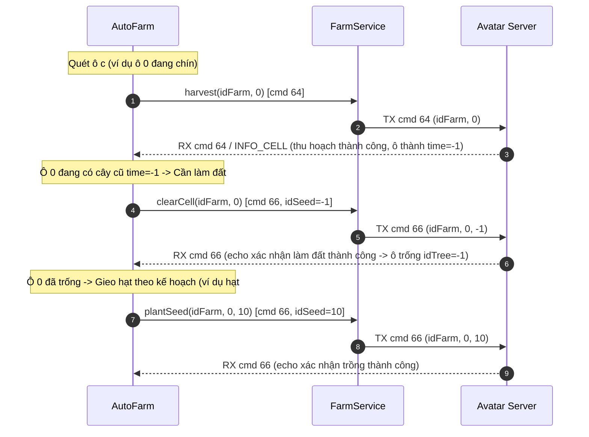

# Thiết kế: Tự Động Làm Đất Phá Bỏ Cây Cũ Trước Khi Trồng Cây Mới

## 1. Mục tiêu & Bối cảnh

### Hiện tượng lỗi
- Sau khi thu hoạch cây (hoặc với ô đất có cây tàn / đã thu hoạch `time = -1`), hệ thống AutoFarm gửi lệnh trồng cây mới (`plantSeed` - cmd 66) trực tiếp vào ô đất.
- Server game Avatar bỏ qua im lặng (`server im lặng — chưa nhận xác nhận: trồng #... ô ...`) và không xác nhận trồng cây.
- Hậu quả: Cây mới không được gieo trồng, ô đất bị kẹt ở trạng thái cũ, gây thiếu nông sản cho các chu kỳ tiếp theo và nhiệm vụ hàng ngày ("Bạn không đủ Hoa tulip").

### Nguyên nhân gốc rễ (Root Cause)
- Cơ chế game Avatar HD: Sau khi thu hoạch, gốc cây cũ / cây đã tàn vẫn nằm trên ô đất (`idTree !== -1`, `time = -1`). Server không cho phép gieo hạt giống mới đè lên ô còn cây cũ.
- Qua phân tích disassembly binary `libil2cpp.so` tại:
  - `FarmMsgHandler.onHarvestTree` @ `0x63b08c` (dòng `0x63b328..0x63b340`): gọi `doPlantSeed(idFarm, indexCell, -1)`
  - `FarmScr.resetAction` @ `0x644674` (dòng `0x644adc..0x644af4`): gọi `doPlantSeed(idFarm, indexCell, -1)`
  - `IActionLamDat.perform` @ `0x784ec0` / `IActionCuocDat.perform` @ `0x7841f0` -> `FarmScr.doLamDat` @ `0x644034`
- **Kết luận kỹ thuật**: Lệnh "Làm đất" / "Cuốc phá bỏ cây cũ" trong Avatar chính là `doPlantSeed` (cmd 66) với tham số `idSeed = -1` (byte `0xFF`).
- Khi gửi `plantSeed(idFarm, cellIndex, -1)`, server sẽ phá bỏ gốc cây cũ, đưa ô đất về trạng thái ô trống thực sự (`idTree = -1`). Sau đó mới có thể gửi `plantSeed(idFarm, cellIndex, newSeedId)` để gieo hạt giống mới.

---

## 2. Phạm vi (Scope)

### In-scope
1. **Backend Service (`avatar-web/server/src/game/farmService.ts`)**:
   - Thêm phương thức `clearCell(idFarm: number, indexCell: number)` gọi `this.plantSeed(idFarm, indexCell, -1)` với comment giải thích rõ ràng.
2. **AutoFarm Controller (`avatar-web/server/src/autoFarm.ts`)**:
   - Trong giai đoạn xử lý từng ô đất (`for (const c of farm.cells)`):
     - Xác định ô cần làm đất: ô vừa thu hoạch hoặc ô đang ở trạng thái spent (`c.idTree !== -1` và `isCellSpent(c)` hoặc `c.time === -1`).
     - Thực hiện hành động "làm đất": gửi `clearCell(idFarm, c.index)` (cmd 66, idSeed = -1), ghi nhận log `làm đất`, và chờ xác nhận `confirm(66, "làm đất ô ${c.index}")`.
     - Cập nhật trạng thái ô sau khi làm đất: `c.idTree = -1`.
     - Sau khi làm đất xong (hoặc ô vốn đã trống `idTree === -1`), tiến hành gieo hạt `plannedSeedId` theo kế hoạch và kho hạt giống hiện có.
3. **Tài liệu Reverse Engineering (`avatar-re/notes/farm.md`)**:
   - Cập nhật mục opcode và ghi chú về `doPlantSeed(idFarm, indexCell, -1)` làm sáng tỏ bí ẩn "làm đất dọn cây" đã ghi nhận trước đây.

### Out-of-scope
- Không thay đổi cấu trúc gói tin cmd 64, 65, 66 trên wire.
- Không thay đổi giao diện frontend AssetsPanel (UI đã hiển thị đúng trạng thái ô trống/vừa thu).

### Edge Cases
1. **Ô đã trống từ trước (`c.idTree === -1`)**: Không cần gửi lệnh làm đất `-1`, gieo hạt trực tiếp.
2. **Ô vừa thu hoạch nhưng không có hạt giống để trồng (kho hết hạt & không autoBuy)**: Vẫn thực hiện làm đất `-1` để ô trở thành ô trống sạch, sẵn sàng trồng sau này.
3. **Ô đang có cây đang lớn (`c.idTree !== -1 && c.time > 0`)**: Không chạm vào trừ khi chín hoặc cần chăm sóc.

---

## 3. Thiết kế Kiến trúc & Giải pháp Kỹ thuật

### A. Sequence Diagram: Luồng Thu Hoạch & Trồng Lại

### B. Danh sách Files & Vai trò

| File | Vai trò | Thay đổi cụ thể |
|---|---|---|
| [farmService.ts](file:///Users/hieunt/learning-reverse/avatar-web/server/src/game/farmService.ts) | Game Network Service | Thêm hàm `clearCell(idFarm: number, indexCell: number)` |
| [autoFarm.ts](file:///Users/hieunt/learning-reverse/avatar-web/server/src/autoFarm.ts) | Backend AutoFarm Loop | Thêm bước làm đất `clearCell` trước khi `plantSeed` cho ô vừa thu hoạch / spent |
| [farm.md](file:///Users/hieunt/learning-reverse/avatar-re/notes/farm.md) | RE Protocol Documentation | Cập nhật giải mã lệnh "Làm đất" `cmd 66 (idSeed = -1)` |

---

## 4. Verification Plan

### Automated Verification
- Chạy unit tests cho AutoFarm: `npm test` trong `avatar-web/server`.
- Kiểm tra typecheck: `npm run build` trong `avatar-web/server`.

### Manual Verification
- Kiểm tra log chạy AutoFarm với chu kỳ có ô chín / ô spent:
  - `[cây] ô 0: chín ... -> thu hoạch`
  - `[cây] ô 0: làm đất -> trồng #10`
  - Server phản hồi xác nhận thành công, không còn tình trạng `server im lặng — chưa nhận xác nhận`.
