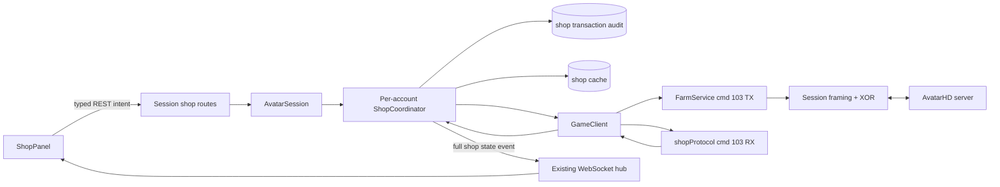

# Thiết Kế Tích Hợp Sạp Nông Sản AvatarHD Vào Avatar Web

**Ngày tạo:** 2026-08-20
**Trạng thái:** Đã duyệt (Approved)
**Phạm vi hệ thống:** `avatar-web` trong repository `learning-reverse`

## 1. Mục tiêu và bối cảnh

### 1.1. Mục tiêu

Tích hợp Sạp nông sản/Siêu thị cá nhân của AvatarHD vào Drawer vận hành tài khoản trên web, theo đúng chuỗi dữ liệu hiện có:

```text
Avatar game server
  -> Session framing/XOR
  -> decoder cmd 103
  -> GameClient event/state
  -> AvatarSession + per-account shop coordinator
  -> SQLite cache/audit + REST/WebSocket
  -> ShopPanel trong AccountOperationsDrawer
```

Người dùng cần có thể:

- Xem sạp của mình, trạng thái từng slot và khả năng mở thêm slot.
- Xem danh sách mặt hàng từ sạp khác.
- Xem danh sách nông sản đủ điều kiện đăng bán và giới hạn giá do game server trả về.
- Xem đúng nông sản đang có trong kho, không nhầm với hạt giống/vật phẩm thường.
- Đăng bán, rút hàng, mua hàng và mở slot qua các API có kiểm soát.
- Làm mới market bằng sub7 chỉ khi đã xác minh chi phí và capability tương ứng được bật.
- Theo dõi trạng thái giao dịch, kể cả trường hợp mất kết nối khiến kết quả chưa thể kết luận.
- Nhận cập nhật realtime mà không để browser giữ game socket, key XOR hoặc thông tin đăng nhập.

### 1.2. Bối cảnh code hiện tại

Hệ thống đã có các nền tảng cần thiết:

- `FarmService` đã encode phần lớn TX cmd 103.
- `GameClient` giữ TCP session, giải mã các command farm và phát event.
- `AvatarSession` quản lý reconnect, snapshot và vòng đời AutoFarm theo tài khoản.
- `SessionManager` kiểm quyền sở hữu gián tiếp qua route và phát WebSocket event theo user/account.
- SQLite đang lưu tài khoản, metrics và farm profile cache.
- `AccountOperationsDrawer` đã có pattern panel realtime cho farm, bếp và nhiệm vụ.

Các khoảng trống hiện tại:

- `GameClient.onMessage()` chưa có `case 103`; RX cmd 103 hiện bị bỏ qua.
- Không có state model cho sạp, price rules hoặc transaction.
- Không có request broker để phân biệt các response sub-type của cùng cmd 103.
- `waitForReply(cmd)` hiện chỉ so command, không đủ an toàn cho nhiều thao tác cmd 103.
- `GameClient.produce` chứa nông sản từ section 3 của cmd 70 nhưng chưa được đưa vào `AvatarSessionSnapshot`; UI chỉ thấy `inventory` là hạt giống và vật phẩm.
- Route `/:id/farm` và `/:id/raw` có thể gửi lệnh trực tiếp, nên có thể bỏ qua validation/serialization nếu không chặn riêng cmd 103.
- AutoFarm/macro và giao dịch sạp chưa có cơ chế loại trừ lẫn nhau.

## 2. Bằng chứng reverse-engineering và các hiệu chỉnh bắt buộc

Thiết kế này dùng ba tài liệu đầu vào như nguồn phân tích, sau đó đối chiếu lại với TypeScript hiện tại, C# metadata khôi phục và ARM64 disassembly của APK. Khi tài liệu và binary khác nhau, binary/call site thực tế được ưu tiên.

### 2.1. Cmd 103 là container command

Byte đầu body là sub-type `0..8`. TX và RX dùng chung số sub-type nhưng không phải lúc nào cũng có cùng ý nghĩa request/response. Framing ngoài cmd 103 vẫn do `Session` xử lý: command 1 byte, length 2 byte big-endian, body, sau đó XOR theo key phiên.

### 2.2. Hiệu chỉnh encoder `openShop`

Implementation hiện tại luôn ghi `type + step + idItem`. Native `FarmService.doOpenShop` thực tế chỉ ghi `step` và `idItem` khi `type == 1`:

| Intent | Call site native | Body logic đúng |
|---|---|---|
| Mở sạp của mình | `doOpenShop(0, -1, -1)` từ `ShopScr.IActionMyShop` | `00` |
| Mở danh sách sạp khác | `doOpenShop(1, 0, -1)` | `01 00 ff ff` |
| Refresh một listing sau mua | `doOpenShop(1, 1, idItem)` | `01 01 <idItem:i16>` |

Vì vậy, `FarmService.openShop()` phải được sửa thành encoder có điều kiện. Không được gửi body 4 byte cho `type=0`.

### 2.3. Hiệu chỉnh contract mua hàng

Metadata khôi phục khai báo:

```text
FarmService.doBuyItemShop(int id, short ver)
```

`ShopScr.IActionBuyItem` lấy trực tiếp `ItemShop.IdShop` và `ItemShop.verShop`, sau đó gọi `doBuyItemShop`. Do đó TX sub5 phải được đặt tên và validate là:

```text
i8  subType = 5
i32 idShop
i16 verShop
```

Không dùng `idItem` làm đối số thứ hai. `itemId`, `quantity` và `price` trong request web chỉ là expected snapshot fields để chống stale state; wire chỉ gửi `idShop + verShop`.

### 2.4. Các điểm vẫn chưa xác minh live

Các nội dung sau không được suy đoán trong production:

- Điều kiện áp dụng phí 10% hoặc miễn phí khi đăng bán.
- Ý nghĩa nghiệp vụ chính xác của `value` trong RX sub4/sub5.
- Công thức liên hệ giữa `price`, `quantity` và số XU thay đổi.
- Chi phí/điều kiện của refresh sạp sub7 và mở slot sub2.
- Tất cả dialog/error packet mà server có thể gửi khi giao dịch thất bại.

Thiết kế xử lý các điểm này bằng feature flag, allowlist và trạng thái `unknown`; UI không tự tính phí/tổng tiền khi chưa có bằng chứng live.

## 3. Phạm vi

### 3.1. Trong phạm vi

#### Protocol và runtime

- Sửa encoder `openShop` và đổi tên tham số mua thành `verShop`.
- Tạo decoder thuần cho RX cmd 103 sub0..8 với kiểm tra biên.
- Thêm state/event sạp vào `GameClient` mà không thay đổi handshake/reconnect hiện có.
- Đưa `produce` từ cmd 70 vào snapshot/event riêng, giữ nguyên payload event `inventory` hiện tại để tương thích ngược.
- Tạo per-account `ShopCoordinator` để serialize cmd 103, chờ đúng response, quản lý transaction và reconcile sau write.
- Ngăn write sạp chạy đồng thời với AutoFarm hoặc MacroRunner.

#### Backend và persistence

- Cache snapshot sạp, market listings, price rules và produce gần nhất trong SQLite.
- Lưu audit transaction có idempotency key và state machine.
- Tạo typed REST API cho sync, browse, listing, withdraw, purchase, unlock, paid refresh và history.
- Phát state sạp/transaction qua WebSocket subscription hiện có.
- Chặn đường bypass cmd 103 qua generic farm/raw route, trừ debug flag cục bộ không được phép bật ở production.

#### Web UI

- Tạo `ShopPanel` trong `AccountOperationsDrawer`.
- Hiển thị sạp của tôi, chợ, nông sản có thể đăng, price rules và lịch sử giao dịch.
- Modal xác nhận cho mọi write, kèm account, listing snapshot, giá, số lượng và cảnh báo không gửi lại khi đang xử lý.
- Hiển thị stale/offline/unknown rõ ràng.

#### Rollout

- P0 protocol/state không live write.
- P1 read-only.
- P2 đăng bán/rút hàng trên allowlist.
- P3 mua hàng/mở slot/paid refresh sau khi có bằng chứng live.
- P4 hardening production.

### 3.2. Ngoài phạm vi

- Không tự động mua/bán theo chiến lược, giá hoặc lịch.
- Không tích hợp sạp vào chu kỳ AutoFarm.
- Không retry tự động bất kỳ write cmd 103 nào.
- Không để frontend gửi raw cmd 103.
- Không thay đổi cmd 67 bán trực tiếp, cmd 68 cửa hàng hệ thống hoặc cmd 127 market khác.
- Không tự suy ra phí, tổng giá hoặc lợi nhuận.
- Không dùng `shop-catalog.json` làm nguồn quyết định item nào được đăng; RX sub8 mới là nguồn sự thật.
- Không thay đổi framing/XOR/session protocol hiện có.
- Không tạo test file mới nếu user chưa yêu cầu trực tiếp; verification vẫn chạy các suite hiện có và kiểm tra live có kiểm soát.

## 4. Phương án và quyết định thiết kế

### 4.1. Phương án A — Gọi thẳng `FarmService` từ route

Ưu điểm là ít file và nhanh có UI. Nhược điểm là không có correlation, lock, audit, stale-state guard hay reconcile. Route có thể trả `{ok:true}` dù server chưa chấp nhận lệnh. Phương án này không phù hợp cho giao dịch làm thay đổi hàng/XU.

### 4.2. Phương án B — Gateway phía server với coordinator theo tài khoản

Backend tiếp tục giữ game socket. `ShopCoordinator` serialize toàn bộ cmd 103, quản lý transaction, cache snapshot và phát state chuẩn hóa. UI chỉ gửi intent có expected revision/idempotency key.

Đây là phương án được chọn vì phù hợp kiến trúc session hiện tại và xử lý được đặc tính không có request ID của protocol.

### 4.3. Phương án C — Tách game socket sang service riêng

Phù hợp nếu hệ thống sau này autoscale nhiều process, nhưng tăng chi phí vận hành và phân tán transaction/session ownership. Chưa cần cho repository hiện tại vốn đang dùng một process giữ mọi phiên.

### 4.4. Quyết định rollout

Thiết kế bao phủ chức năng đầy đủ nhưng capability được bật theo pha. `SHOP_READ_ENABLED` có thể bật sau khi decoder/read flow được xác minh. Tất cả write mặc định tắt và chỉ bật cho account allowlist sau live capture tương ứng.

## 5. Kiến trúc mục tiêu



### 5.1. Ranh giới trách nhiệm

| Module | Trách nhiệm |
|---|---|
| `game/farmService.ts` | Chỉ encode và gửi TX đúng wire contract; không kết luận success |
| `game/shopProtocol.ts` | Types, pure decoder RX, validation, protocol warning/error |
| `game/client.ts` | Dispatch cmd 103, giữ state game gần nhất, phát typed `shop-protocol` event |
| `session/shopCoordinator.ts` | Correlation, serialization, transaction state, reconcile, capability guards |
| `accounts/shopRepo.ts` | Đọc/ghi cache và audit SQLite theo account |
| `session/avatarSession.ts` | Gắn coordinator vào client epoch, đưa shop/produce vào snapshot và WebSocket |
| `session/routes.ts` | Auth ownership, input validation, HTTP contract, feature policy |
| `web/types.ts` | DTO dùng chung phía UI |
| `ShopPanel.tsx` | Render state và gửi typed intent; không giữ protocol knowledge |

## 6. Wire protocol cmd 103

### 6.1. TX contract

| Intent | Body trước XOR | Ghi chú |
|---|---|---|
| `openOwnShop()` | `i8 0` | Body 1 byte |
| `browseShop(step, itemId)` | `i8 1, i8 step, i16 itemId` | `step=0,itemId=-1` mở danh sách; `step=1` refresh item sau mua |
| `requestUnlockSlot(type)` | `i8 2, i8 type` | Cost-bearing, gated |
| `addListing(slot,itemId,num,price)` | `i8 3, i8 slot, i16 itemId, i32 num, i32 price` | Body 12 byte |
| `withdrawListing(slot)` | `i8 4, i8 slot` | Body 2 byte |
| `buyListing(idShop,verShop)` | `i8 5, i32 idShop, i16 verShop` | Body 7 byte |
| `refreshMarket()` | `i8 7` | Không dùng cho read sync; có thể tốn phí |
| `requestPriceRules()` | `i8 8` | Body 1 byte |

`FarmService.openShop` chỉ nhận `type` là `0` hoặc `1`; các sub-type khác dùng method riêng. Giá trị vượt width, số âm ngoài sentinel đã biết, `num <= 0`, `price < 0` và slot ngoài snapshot phải bị chặn trước khi encode.

### 6.2. RX discriminated union

Decoder nhận toàn bộ body cmd 103, đọc byte đầu làm `subType`, rồi trả một trong các event:

```typescript
type ShopProtocolEvent =
  | { kind: 'own-snapshot'; slots: OwnShopSlot[]; numSlot: number; canOpenSlot: boolean }
  | { kind: 'market-snapshot'; status: number; listings: MarketListing[] }
  | { kind: 'slot-info'; type: number; value: number }
  | { kind: 'slot-opened'; type: number; value: number; numSlot: number; canOpenSlot: boolean }
  | { kind: 'listing-added'; slot: number; itemId: number; quantity: number; price: number }
  | { kind: 'listing-withdrawn'; slot: number; result: number; itemId?: number; value: number }
  | { kind: 'purchase-ack'; itemId: number; value: number }
  | { kind: 'refresh'; subType: 6 | 7 }
  | { kind: 'price-rules'; rules: ShopPriceRule[] };
```

Schemas sau byte sub-type:

| RX | Schema |
|---:|---|
| 0 | `i8 count`, lặp `i16 itemId, i32 num, i32 price, bool isSale`, chỉ khi `isSale=false` đọc thêm `bool isTimeOut`, cuối cùng `bool canOpenSlot` |
| 1 | `i8 status, i16 count`; nếu `status=1`, lặp `i32 idShop, i16 verShop, i16 itemId, i32 num, i32 price` |
| 2 | `i8 state, i8 type, i32 value`; nếu `state=1`, đọc thêm `i8 numSlot, bool canOpenSlot` |
| 3 | `i8 slot, i16 itemId, i32 num, i32 price` |
| 4 | `i8 slot, i8 result`; `result=0` đọc `i32 value`; `result=1` đọc `i16 itemId, i32 value` |
| 5 | `i16 itemId, i32 value` |
| 6/7 | Không có field thêm |
| 8 | `i16 count`, lặp `i16 itemId, i32 minPrice, i32 maxPrice` |

### 6.3. Quy tắc decoder

- Kiểm tra `available()` trước mọi record/field có độ dài biến đổi.
- Giới hạn count theo payload còn lại và mức trần hợp lý để tránh cấp phát bất thường.
- Không cập nhật state một phần: chỉ commit snapshot sau khi toàn packet hợp lệ.
- Sub-type/state/result không hỗ trợ tạo `ShopProtocolDecodeError` có offset và hex prefix đã giới hạn.
- Thiếu byte làm packet invalid; state cũ được giữ nguyên.
- Trailing bytes không làm lệch decoder: event hợp lệ vẫn được phát kèm `protocolWarning`, không âm thầm bỏ qua.
- Không lưu raw ciphertext, password, session token hoặc XOR key.
- Decoder và `GameClient` không tự gửi follow-up command; `ShopCoordinator` là nơi duy nhất quyết định chuỗi `sub0 -> sub8`, `sub3 -> cmd70` và `sub5 -> browse refresh`, tránh gửi lặp.

## 7. Data model và contracts

### 7.1. Runtime state

```typescript
interface OwnShopSlot {
  slot: number;
  itemId: number;
  quantity: number;
  price: number;
  isSale: boolean;
  isTimeOut: boolean;
}

interface MarketListing {
  index: number;
  idShop: number;
  verShop: number;
  itemId: number;
  quantity: number;
  price: number;
}

interface ShopPriceRule {
  itemId: number;
  minPrice: number;
  maxPrice: number;
}

interface ShopSnapshot<T> {
  revision: number;
  connectionEpoch: number;
  capturedAt: number;
  data: T;
}

interface ShopRuntimeState {
  syncStatus: 'idle' | 'syncing' | 'ready' | 'stale' | 'error';
  own: ShopSnapshot<{ numSlot: number; canOpenSlot: boolean; slots: OwnShopSlot[] }> | null;
  market: ShopSnapshot<{ status: number; listings: MarketListing[] }> | null;
  priceRules: ShopSnapshot<ShopPriceRule[]> | null;
  activeTransaction: ShopTransaction | null;
  recentTransactions: ShopTransaction[];
  lastError?: { code: string; message: string };
}
```

`revision` là số tăng đơn điệu cục bộ cho từng account state. API write phải gửi expected revision tương ứng. `connectionEpoch` ngăn response của client cũ cập nhật session mới sau reconnect.

### 7.2. Produce contract

`SessionSnapshot` thêm một snapshot riêng cho nông sản để API write có thể kiểm tra revision:

```typescript
interface ProduceSnapshot {
  revision: number;
  connectionEpoch: number;
  capturedAt: number;
  items: InventoryItem[];
}

produce: ProduceSnapshot | null;
shop: ShopRuntimeState;
```

Cmd 70 tiếp tục phát event `inventory` với payload cũ để không phá UI hiện tại, đồng thời phát event `produce` chứa toàn bộ `ProduceSnapshot`. Shop UI chỉ cho chọn item có trong cả:

1. `produce.items` với `num > 0`; và
2. `priceRules` từ RX sub8.

Catalog cây/vật nuôi/món ăn chỉ dùng để resolve tên/icon. Item chưa có tên vẫn hiển thị `#<id>` và không làm thay đổi quyền đăng bán do server quyết định.

### 7.3. Transaction state machine

```text
queued -> sending -> awaiting_response -> reconciling -> succeeded
                                      \-> failed
                                      \-> unknown
```

- `failed` chỉ dùng khi có lỗi validation/local policy hoặc server trả lỗi có thể xác định.
- Timeout, socket close hoặc process interruption sau `sending` phải thành `unknown`.
- `unknown` không được tự gửi lại. Coordinator refresh state và cố reconcile dựa trên snapshot mới.
- Idempotency replay trả transaction hiện có, không phát cmd lần hai.

`ShopTransaction` tối thiểu gồm:

```typescript
interface ShopTransaction {
  id: string;
  accountId: number;
  idempotencyKey: string;
  kind: 'list' | 'withdraw' | 'purchase' | 'unlock' | 'refresh-market';
  status: 'queued' | 'sending' | 'awaiting_response' | 'reconciling' | 'succeeded' | 'failed' | 'unknown';
  request: Record<string, unknown>;
  before: Record<string, unknown>;
  result?: Record<string, unknown>;
  errorCode?: string;
  errorMessage?: string;
  createdAt: number;
  updatedAt: number;
  completedAt?: number;
}
```

## 8. Correlation, serialization và reconcile

### 8.1. Vì sao phải serialize toàn bộ cmd 103

Protocol không có request ID. Hai request cùng chờ RX sub3/sub5 hoặc hai read cùng loại không thể được ghép chắc chắn với response nếu gửi đồng thời. Vì vậy mỗi account có đúng một cmd 103 operation đang chờ response tại một thời điểm; read và write cùng đi qua một FIFO nhỏ trong `ShopCoordinator`.

### 8.2. Account operation guard

Mọi command sạp và AutoFarm/MacroRunner không được chạy đồng thời:

- Shop sync/browse/write trả `409 OPERATION_CONFLICT` nếu `auto.running` hoặc `macro.running`; chỉ việc xem cache hiện có luôn được phép.
- `startAuto()` và `startMacro()` trả conflict nếu coordinator đang có bất kỳ shop operation in-flight nào.
- Quy tắc này tránh snapshot kho bị thay đổi bởi AutoFarm trong lúc read sync hoặc reconcile.
- Generic `/farm` không được gọi các method cmd 103; `/raw` không được gửi cmd 103 nếu protocol debug flag không được bật cục bộ.

### 8.3. Read sync

`syncOwnShop()` thực hiện:

```text
openOwnShop() -> RX sub0
requestPriceRules() -> RX sub8
getInventory() -> RX cmd70 (inventory + produce + xu)
```

Đây là read sync. Không dùng `refreshShop()` sub7 vì action đó có trạng thái time/price trong game client và chưa được chứng minh là miễn phí.

`browseMarket()` thực hiện `openShop(1,0,-1) -> RX sub1`.

### 8.4. Reconcile theo loại giao dịch

#### Đăng bán

```text
validate expected own revision + produce revision + price rule
-> persist queued/before
-> TX sub3
-> RX sub3
-> sync own shop + inventory
-> succeeded khi slot khớp và produce phản ánh số lượng đã chuyển
```

Không dùng XU delta để tính phí khi chưa xác minh. XU trước/sau vẫn được lưu làm bằng chứng.

#### Rút hàng

```text
validate expected slot
-> TX sub4
-> RX sub4
-> sync own shop + inventory
-> succeeded khi slot không còn listing và produce đã phản ánh hàng trả về
```

Nếu RX sub4 có nhánh chưa hiểu hoặc inventory không đủ bằng chứng, status là `unknown`.

#### Mua hàng

```text
validate expected market revision + idShop + verShop + itemId + quantity + price
-> TX sub5(idShop, verShop)
-> RX sub5
-> coordinator gửi đúng một lần openShop(1,1,itemId)
-> refresh market item + inventory + money
-> reconcile
```

Không có quantity trên wire; thao tác mua là mua listing được snapshot chỉ định. UI không cho nhập số lượng. Success chỉ được kết luận khi response và snapshot sau giao dịch đủ bằng chứng; nếu không, giữ `unknown` thay vì đoán từ `value`.

#### Mở slot

Chỉ bật sau khi đã xác minh `type`, `value`, số XU và điều kiện server. Reconcile bằng RX sub2 state1 và snapshot sạp mới có `numSlot` tăng.

#### Làm mới market có thể tốn phí

`refreshMarket()` sub7 là write riêng, không phải read sync. Nó chỉ bật sau khi xác minh `timeRefesh`, `priceRefesh`, XU delta và response sub6/7. Coordinator ghi transaction `refresh-market`, gửi sub7 đúng một lần, sau ack chạy `browseMarket()` và refresh money để reconcile.

## 9. Persistence

### 9.1. `avatar_shop_cache`

Một row/account, theo pattern JSON cache hiện có:

| Column | Ý nghĩa |
|---|---|
| `account_id` | PK/FK tới `avatar_accounts`, cascade delete |
| `own_snapshot_json` | Snapshot sạp của mình gần nhất |
| `market_snapshot_json` | Snapshot browse gần nhất |
| `price_rules_json` | Danh sách RX sub8 gần nhất |
| `produce_json` | Nông sản cmd70 gần nhất phục vụ offline/reconcile |
| `own_observed_at` | Thời điểm nhận RX sub0 |
| `market_observed_at` | Thời điểm nhận RX sub1 |
| `rules_observed_at` | Thời điểm nhận RX sub8 |
| `produce_observed_at` | Thời điểm nhận cmd70 |
| `updated_at` | Thời điểm row được cập nhật |

Cache chỉ phục vụ hiển thị stale state và reconcile; game server vẫn là nguồn sự thật.

### 9.2. `avatar_shop_transactions`

| Column | Ý nghĩa |
|---|---|
| `id` | UUID/string primary key |
| `account_id` | FK cascade delete |
| `idempotency_key` | Unique theo account |
| `kind`, `status` | Loại và trạng thái state machine |
| `request_json` | Intent đã validate |
| `before_json` | Snapshot/revision trước send |
| `result_json` | Ack, observed deltas và after snapshot |
| `error_code`, `error_message` | Lỗi chuẩn hóa |
| `created_at`, `updated_at`, `completed_at` | Audit timestamps |

Không lưu password, login token, key XOR hoặc raw socket ciphertext. Body hex không lưu mặc định; traffic RAM hiện có chỉ giữ 64 byte và đã redaction sensitive command.

### 9.3. Startup/reconnect recovery

- Transaction còn `queued` mà chưa từng `sending` có thể đánh dấu `failed` với `PROCESS_INTERRUPTED_BEFORE_SEND`.
- Transaction từ `sending` trở đi được đổi thành `unknown` khi process khởi động lại.
- Sau account reconnect và read sync đầu tiên, coordinator chạy reconcile cho các transaction `unknown` gần nhất.
- Không phát lại cmd write từ database.

## 10. REST API

Tất cả route dùng auth middleware và `requireOwnedAccount` hiện có.

### 10.1. Read API

```text
GET  /api/accounts/:id/shop
POST /api/accounts/:id/shop/sync
POST /api/accounts/:id/shop/browse
GET  /api/accounts/:id/shop/transactions?limit=50
```

- `GET /shop` trả cache/runtime state hiện có, capabilities và age/stale flags; không tự gửi game command.
- `POST /shop/sync` chạy read sync sạp của mình, price rules và produce.
- `POST /shop/browse` chạy `openShop(1,0,-1)` và trả market snapshot mới.
- `GET /transactions` trả audit của đúng account.

### 10.2. Write API

```text
POST /api/accounts/:id/shop/listings
POST /api/accounts/:id/shop/listings/:slot/withdraw
POST /api/accounts/:id/shop/purchases
POST /api/accounts/:id/shop/slots/unlock
POST /api/accounts/:id/shop/market/refresh
```

#### Đăng bán

```json
{
  "idempotencyKey": "client-generated-uuid",
  "expectedShopRevision": 12,
  "expectedProduceRevision": 31,
  "slot": 2,
  "itemId": 6,
  "quantity": 10,
  "price": 500
}
```

#### Rút hàng

```json
{
  "idempotencyKey": "client-generated-uuid",
  "expectedShopRevision": 13,
  "expectedItemId": 6,
  "expectedQuantity": 10,
  "expectedPrice": 500
}
```

#### Mua hàng

```json
{
  "idempotencyKey": "client-generated-uuid",
  "expectedMarketRevision": 8,
  "idShop": 123456,
  "verShop": 17,
  "expectedItemId": 6,
  "expectedQuantity": 10,
  "expectedPrice": 500
}
```

Expected fields phải khớp snapshot hiện tại; mismatch trả `409 STALE_STATE` và không gửi cmd.

### 10.3. Response và error contract

Write hợp lệ trả `202` với `ShopTransaction`. Idempotency key đã tồn tại trả transaction cũ với `200` hoặc `202` tùy trạng thái, không gửi lại.

Error codes chuẩn:

| HTTP | Code | Ý nghĩa |
|---:|---|---|
| 400 | `INVALID_SHOP_REQUEST` | Field/width/range sai |
| 403 | `SHOP_CAPABILITY_DISABLED` | Feature flag/allowlist chưa cho phép |
| 409 | `SESSION_OFFLINE` | Session chưa online |
| 409 | `STALE_STATE` | Revision/expected listing không còn đúng |
| 409 | `OPERATION_CONFLICT` | Auto, macro hoặc transaction khác đang chạy |
| 409 | `PRICE_OUT_OF_RANGE` | Giá ngoài RX sub8 |
| 504 | `SHOP_RESPONSE_TIMEOUT` | Read sync/browse timeout; write đã trả `202` và chuyển `unknown` qua transaction event nếu timeout |
| 500 | `SHOP_PROTOCOL_ERROR` | Packet invalid hoặc invariant bị phá vỡ |

## 11. WebSocket và frontend state

### 11.1. Events

Giữ pattern hiện tại: event nặng chỉ tới client đã subscribe account qua Drawer/Debug.

- `shop`: full `ShopRuntimeState` sau snapshot hoặc transaction transition.
- `produce`: full `ProduceSnapshot` sau cmd70.
- `log`: protocol warning, reconcile summary và policy conflict theo buffer hiện có.
- `snapshot`: tiếp tục chứa toàn bộ `shop` và `produce` khi subscribe/reconnect.

Không thêm `shop` vào `LIGHT_EVENTS`; dashboard card không cần nhận listing/transaction chi tiết.

### 11.2. Reducer

`reduceAccountRuntime` thêm hai nhánh độc lập:

```text
shop    -> replace current.shop bằng full state mới
produce -> replace current.produce bằng full ProduceSnapshot
```

Full-state replacement tránh patch rời đến sai thứ tự khi WebSocket reconnect.

## 12. Giao diện `ShopPanel`

Panel nằm sau `AssetsPanel` hoặc cạnh khu vực farm trong `AccountOperationsDrawer`, gồm ba tab:

### 12.1. Sạp của tôi

- Header: trạng thái sync, thời điểm snapshot, stale badge và nút `Đồng bộ`.
- Grid slot theo index, trạng thái `trống`, `đang bán`, `hết hạn`, `khóa/chưa mở`.
- Mỗi listing hiển thị item, quantity và `Giá niêm yết`; không tự nhân thành tổng tiền.
- Slot trống có action `Đăng bán` khi write capability bật.
- Slot có hàng có action `Rút hàng` khi capability bật.
- Nút mở slot chỉ xuất hiện khi capability slot đã bật và server state cho phép.

### 12.2. Chợ

- Danh sách market listing từ RX sub1.
- Filter client-side theo tên/ID và sort hiển thị; không tuyên bố là toàn bộ market nếu server chỉ trả một page/snapshot.
- Chi tiết listing giữ `idShop`, `verShop`, `itemId`, `quantity`, `price`.
- Action mua không có ô quantity; mua đúng listing/version đang xem.
- Snapshot stale làm nút mua chuyển thành `Cập nhật chợ`.
- Nút paid refresh chỉ xuất hiện khi server đã trả đủ time/price và capability refresh được bật; read-only `Cập nhật chợ` luôn dùng browse, không dùng sub7.

### 12.3. Giao dịch

- Timeline các transaction gần nhất.
- Hiển thị kind, status, thời gian, before/after deltas và error code.
- `unknown` có cảnh báo “Không gửi lại; hãy đồng bộ để đối chiếu”.
- Không có nút retry write. Chỉ có action read-only `Đồng bộ lại`.

### 12.4. Modal đăng bán/xác nhận

Modal đăng bán chỉ liệt kê các item giao nhau giữa `produce.items` và `priceRules`. Nó validate quantity theo tồn kho và price theo min/max.

Mọi modal write hiển thị:

- Nhãn account và game user.
- Slot hoặc `idShop/verShop`.
- Item, quantity, giá niêm yết.
- Snapshot age/revision.
- Cảnh báo phí/tổng XU chưa xác minh nếu capability đang ở pha controlled-live.
- Nút xác nhận bị disable khi offline, stale, AutoFarm/macro đang chạy hoặc có transaction active.

## 13. Feature policy và an toàn

### 13.1. Config

`Config` thêm policy được parse từ env:

```text
SHOP_READ_ENABLED=false
SHOP_WRITE_ENABLED=false
SHOP_PURCHASE_ENABLED=false
SHOP_SLOT_UNLOCK_ENABLED=false
SHOP_MARKET_REFRESH_ENABLED=false
SHOP_LIVE_ACCOUNT_ALLOWLIST=
SHOP_PROTOCOL_DEBUG_ENABLED=false
```

Quy tắc:

- Read chỉ khả dụng khi `SHOP_READ_ENABLED=true`.
- Listing/withdraw cần `SHOP_WRITE_ENABLED=true` và account nằm trong allowlist.
- Purchase cần cả write + purchase + allowlist.
- Unlock cần slot-unlock + allowlist và bằng chứng live đã ghi nhận.
- Paid refresh cần market-refresh + allowlist và bằng chứng live đã ghi nhận.
- Protocol debug luôn bị ép `false` ở production, kể cả env đặt `true`.

### 13.2. Safety invariants

- Backend là nơi duy nhất tạo cmd 103 cho UI production.
- Mỗi account chỉ có một cmd 103 operation in-flight.
- Không write khi snapshot stale hoặc session offline.
- Không write cùng AutoFarm/macro.
- Không auto-retry write.
- Không đánh dấu success chỉ vì `Session.send()` không ném lỗi.
- Socket close sau send luôn dẫn tới `unknown` trước khi reconcile.
- Idempotency key unique theo account.
- Game server là nguồn sự thật; SQLite chỉ là cache/audit.

## 14. Files/modules dự kiến

| File | Loại | Vai trò thay đổi |
|---|---|---|
| `avatar-web/server/src/game/shopProtocol.ts` | Create | Types và decoder cmd 103 RX |
| `avatar-web/server/src/session/shopCoordinator.ts` | Create | Queue, correlation, transaction/reconcile, operation guard |
| `avatar-web/server/src/accounts/shopRepo.ts` | Create | SQLite cache/audit repository |
| `avatar-web/web/src/accounts/panels/ShopPanel.tsx` | Create | UI ba tab và confirmation flow |
| `avatar-web/server/src/game/farmService.ts` | Modify | Conditional openShop encoder; `verShop` naming/validation seam |
| `avatar-web/server/src/game/client.ts` | Modify | case 103, shop state/event; produce event |
| `avatar-web/server/src/session/avatarSession.ts` | Modify | Bind coordinator theo epoch; snapshot/shop methods/guard |
| `avatar-web/server/src/session/manager.ts` | Modify | Inject shop repository/policy và persist events |
| `avatar-web/server/src/session/routes.ts` | Modify | Typed shop routes; block cmd103 bypass |
| `avatar-web/server/src/config.ts` | Modify | Parse shop feature policy |
| `avatar-web/server/src/db/schema.sql` | Modify | Hai bảng cache/audit và indexes |
| `avatar-web/server/src/index.ts` | Modify | Wire policy/repository vào manager/router |
| `avatar-web/web/src/types.ts` | Modify | Shop/produce DTOs trong SessionSnapshot |
| `avatar-web/web/src/accounts/accountRuntime.ts` | Modify | Reducer cho `shop` và `produce` |
| `avatar-web/web/src/accounts/AccountOperationsDrawer.tsx` | Modify | Nhúng ShopPanel |
| `avatar-web/web/src/styles.css` | Modify | Grid/tabs/status/modal styles theo hệ thống hiện có |

`ws.ts`, `api.ts` và `AccountsProvider.tsx` dự kiến không cần đổi: WebSocket hub, generic API client và light-event dashboard hiện có đã đủ.

## 15. Rủi ro ảnh hưởng

GitNexus hiện đánh giá:

- `FarmService`: LOW, direct consumer chính là `GameClient`.
- `GameClient`: HIGH vì nhiều tool/runtime tạo client trực tiếp.
- `AvatarSession`: HIGH vì ảnh hưởng bootstrap, startAuto, route và session lifecycle.
- `AccountOperationsDrawer`: LOW.

Biện pháp giới hạn blast radius:

- Decoder và coordinator nằm trong file mới, có interface hẹp.
- `GameClient` chỉ thêm state/case/event, không đổi login, keepalive hay reconnect.
- Giữ nguyên event `inventory`; thêm `produce` thay vì đổi payload cũ.
- `AvatarSession` compose coordinator theo connection epoch, không đưa DB logic trực tiếp vào GameClient.
- Shop event là heavy subscription, không tăng traffic cho dashboard card.
- Feature flags mặc định tắt nên deploy schema/code không tự phát giao dịch.

## 16. Verification Plan

### 16.1. Static/protocol verification

- Đối chiếu TX body với ARM64 call sites và `FarmService` disassembly:
  - own shop đúng `00`;
  - browse đúng `01 00 ff ff`;
  - purchase dùng `idShop + verShop`.
- Dùng packet body đã giải mã trước XOR để chạy decoder từng sub0..8 bằng một verification harness tạm thời/inline; không thêm test file nếu user chưa yêu cầu test.
- Kiểm tra packet thiếu byte không thay state, sub0 conditional `isTimeOut` không lệch cursor, trailing byte tạo warning.

### 16.2. Existing automated checks

Sau production code, chạy tối thiểu:

```bash
cd avatar-web/server && npm run typecheck && npm test && npm run build
cd avatar-web/web && npm test && npm run build
git diff --check
```

Các suite hiện có phải tiếp tục pass. Không tuyên bố decoder đúng live chỉ dựa vào typecheck/test cũ.

### 16.3. Manual read-only verification

Trên account test:

1. Bật `SHOP_READ_ENABLED`, giữ mọi write flag tắt.
2. Kết nối account, mở Drawer và subscribe snapshot.
3. Sync own shop; đối chiếu raw traffic cmd103, slot count/state và RX sub8.
4. Đối chiếu `produce` từ cmd70 với kho trong game.
5. Browse market; đối chiếu `idShop/verShop/itemId/num/price` với client game.
6. Restart backend; xác nhận cache hiển thị stale và sync mới thay đúng revision.

### 16.4. Controlled live write verification

Chỉ thực hiện sau khi user cho phép giao dịch test và account nằm trong allowlist. Mỗi lần chỉ dùng một item/số lượng nhỏ:

- Ghi snapshot sạp, produce và XU trước.
- Thực hiện đúng một write, không bật AutoFarm/macro.
- Lưu TX/RX body trước XOR và snapshot sau.
- Xác nhận UI, SQLite transaction, kho, slot và XU khớp game client.
- Ngắt socket có chủ đích sau send trong một lần thử riêng; xác nhận transaction thành `unknown` và không bị gửi lại.
- Chỉ bật capability tiếp theo sau khi schema/value/fee của capability đó đã được ghi nhận.

### 16.5. UI acceptance

- Panel hoạt động với snapshot `null`, offline, stale, ready và error.
- Không có nút write khi capability tắt.
- Price validation lấy từ RX sub8.
- Purchase không cho nhập quantity và gửi `verShop`, không gửi itemId trên wire.
- Đóng/mở Drawer hoặc reconnect WebSocket không làm mất transaction state durable.
- `unknown` không có nút retry.

### 16.6. Pre-commit guard

Nếu user yêu cầu commit sau implementation:

- Chạy `gitnexus_detect_changes(scope: staged)`.
- Kiểm tra tất cả d=1 dependents của symbol đã sửa.
- Không commit file ngoài phạm vi và không ghi đè thay đổi unrelated.
- Sau commit, refresh GitNexus index; giữ embeddings nếu meta cho thấy embeddings khác 0.

## 17. Tiêu chí hoàn thành

### P0 — Protocol foundation

- Encoder `openShop` khớp conditional wire format native.
- Purchase contract dùng `idShop + verShop`.
- RX sub0..8 decode thành discriminated union, packet lỗi không làm hỏng state cũ.
- `produce` đi từ cmd70 tới session snapshot/UI contract.

### P1 — Read-only integration

- Web xem được own shop, market listing, price rules và produce.
- Snapshot có revision/timestamp/stale state và được cache qua restart.
- WebSocket cập nhật đúng account subscription.
- Tất cả write capability vẫn tắt.

### P2 — Listing/withdraw

- Typed API validate ownership, revision, produce, slot và price range.
- Transaction được serialize/audit/idempotent.
- Listing/withdraw được reconcile trước khi success.
- Timeout/disconnect không tự retry và để lại `unknown` có thể kiểm tra.

### P3 — Purchase/unlock/paid refresh

- Purchase gửi đúng `idShop + verShop`, reconcile inventory/market/money mà không suy đoán `value`.
- Unlock chỉ bật khi đã xác minh type/cost/live response.
- Paid refresh chỉ bật khi đã xác minh time/price, XU delta và response sub6/7.
- AutoFarm/macro không thể chạy đồng thời với shop write.

### P4 — Production hardening

- Feature policy mặc định an toàn, allowlist hoạt động.
- Có audit durable, rate/operation guard, stale-state protection và startup recovery.
- UI không phơi protocol credentials/raw command và không cho retry write mù.

## 18. Tài liệu và bằng chứng tham chiếu

- `docs/Kế hoạch tích hợp giao dịch sạp AvatarHD vào web.md`
- `docs/Phân tích kỹ thuật giao thức  — cmd 103 trong AvatarHD.md`
- `docs/Sạp mua bán nông sản trong nông trại AvatarHD.md`
- `avatar-web/server/src/game/farmService.ts`
- `avatar-web/server/src/game/client.ts`
- `avatar-web/server/src/session/avatarSession.ts`
- `avatar-web/server/src/session/manager.ts`
- `avatar-web/server/src/session/routes.ts`
- `avatar-web/server/src/ws.ts`
- `avatar-re/notes/assembly-csharp.cs`
- `avatar-re/apktool_out/lib/arm64-v8a/libil2cpp.so`
