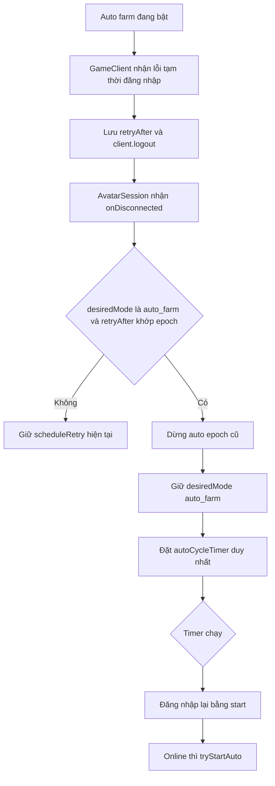

# Thiết kế: Bỏ qua vòng auto khi gặp lỗi tài khoản đang đăng nhập

## Mục tiêu & Bối cảnh

### Bối cảnh

Khi auto farm đang bật, server game có thể trả về thông báo tạm thời như:

- `Tài khoản này đang đăng nhập. Xin hãy thử đăng nhập lại.`
- `Hệ thống quá tải, xin vui lòng thử lại sau.`

Game client đã nhận diện được các thông báo này qua `parseTemporaryLoginRejection` và phát sự kiện `temporary-rejection`. Sau đó `AvatarSession` đóng client và đi vào nhánh kết nối lại chung bằng `scheduleRetry`. Luồng này không đặt auto về `off`, nhưng lại dùng cơ chế backoff của kết nối tổng quát; nếu timer vòng auto đang tồn tại hoặc transition đang xử lý, trạng thái auto có thể bị treo ở trạng thái không chạy và không tạo đúng một lịch vòng mới theo cấu hình `intervalMs`.

### Mục tiêu

- Khi bật auto và gặp lỗi tạm thời đăng nhập, **không tắt auto**, không persist `desiredMode = off`.
- **Bỏ qua vòng auto hiện tại**, dừng runner auto đang chạy nếu có.
- Đặt **đúng một lịch vòng mới** theo `intervalMs` hiện có; nếu server yêu cầu chờ lâu hơn, thời điểm bắt đầu vòng mới phải chờ ít nhất theo yêu cầu đó.
- Không thay đổi hành vi với lỗi đăng nhập vĩnh viễn (`LOGIN_FAIL` / `-35`), lỗi cấu hình auto, lỗi kết nối mạng hoặc khi người dùng chủ động tắt auto.

## Phạm vi (Scope)

### Trong phạm vi

- Điều chỉnh nhánh xử lý ngắt kết nối trong `AvatarSession` khi có `retryAfter` từ lỗi đăng nhập tạm thời.
- Ưu tiên timer vòng auto thay vì `scheduleRetry` trong trường hợp `desiredMode === 'auto_farm'`.
- Ghi log rõ ràng để người dùng biết vòng bị bỏ qua và vòng kế tiếp đã được hẹn.

### Ngoài phạm vi

- Không thay đổi protocol parser `GameClient` vì lỗi đã được nhận diện đúng.
- Không thay đổi cấu hình, UI, SQLite schema hay cơ chế bật/tắt auto.
- Không thay đổi các bước farm bên trong một vòng auto.
- Không thêm test vì người dùng không yêu cầu.

### Input / Output

**Input**

- `TemporaryLoginRejection.retryAfterMs` từ `GameClient`.
- Trạng thái automation hiện tại (`desiredMode`, `activeMode`, `wanted`, `permanentlyFailed`).
- `lastAutoConfig.intervalMs`.

**Output**

- Một `autoCycleTimer` duy nhất khi lỗi tạm thời xảy ra trong auto farm.
- `desiredMode` vẫn là `auto_farm`; `wanted` vẫn là `true`.
- Runner auto của epoch cũ được dừng; client cũ được logout.

### Edge cases

1. **Lỗi tạm thời khi đang chạy vòng auto**: hủy runner, bỏ qua phần còn lại của vòng và hẹn vòng mới.
2. **Lỗi tạm thời khi đang đăng nhập cho vòng kế tiếp**: không backoff như lỗi thường; giữ lịch vòng mới và đăng nhập lại khi timer chạy.
3. **Server yêu cầu chờ dài hơn interval**: timer vòng mới dùng `max(intervalMs, retryAfterMs)`.
4. **Timer vòng cũ còn tồn tại**: chỉ được giữ một timer; timer mới thay thế timer cũ.
5. **Người dùng tắt auto sau khi gặp lỗi tạm thời**: `stopAuto()`/`stopAutomation()` vẫn hủy timer và tắt auto như hiện tại.
6. **Lỗi vĩnh viễn**: nhánh `failPermanently` vẫn tắt auto và không tạo timer mới.

## Thiết kế kiến trúc & Giải pháp kỹ thuật

### Files / modules liên quan

| File | Vai trò |
| --- | --- |
| `avatar-web/server/src/game/client.ts` | Đã parse và phát `temporary-rejection`; không sửa. |
| `avatar-web/server/src/session/avatarSession.ts` | Điều phối vòng đời kết nối, timer vòng auto và automation. |
| `avatar-web/server/src/session/avatarSession.test.ts` | Harness giả lập timer/client đang có; chỉ dùng để kiểm chứng thủ công nếu cần chạy test hiện có. |

### Flow xử lý



### Thay đổi kỹ thuật

Trong `AvatarSession.onDisconnected`, sau khi đã dừng runner và kiểm tra `wanted`, `permanentlyFailed`, epoch, tách trường hợp lỗi tạm thời:

```ts
const rejection = this.retryAfter?.epoch === epoch ? this.retryAfter : undefined;
if (this.desiredMode === 'auto_farm' && rejection) {
  const intervalMs = normalizeAutoInterval(this.lastAutoConfig.intervalMs);
  const waitMs = Math.max(
    intervalMs,
    Math.max(0, rejection.notBefore - this.now()),
  );
  this.scheduleAutoCycle(waitMs);
  this.pushLog(
    `bỏ qua vòng auto hiện tại vì lỗi đăng nhập tạm thời; đặt lịch vòng mới sau ${Math.round(waitMs / 1000)}s`,
  );
  return;
}
this.scheduleRetry(epoch);
```

Chuẩn hóa interval phải dùng đúng logic hiện có của `onAutoCycleComplete`: giá trị không hợp lệ sẽ fallback về `DEFAULT_AUTO_INTERVAL_MS`, giá trị hợp lệ không nhỏ hơn `0`.

Không gọi `setWanted(false)`, không gán `desiredMode = 'off'`, không gọi `onPermanentFailure`, không rollback trạng thái auto trong DB.

### Đánh giá tác động GitNexus

- `AvatarSession.scheduleAutoCycle`: **LOW**; ảnh hưởng trực tiếp `onAutoCycleComplete` và chuỗi khởi động lại auto.
- `AvatarSession.onDisconnected`: **HIGH**; là điểm điều phối chung của wire, teardown, reconnect và chu kỳ auto. Do đó thay đổi chỉ thêm một nhánh có điều kiện sau các bước cleanup hiện tại, không tái cấu trúc lifecycle.

## Verification Plan

1. **Build / test hiện có**
   - Run: `npm run test --workspace avatar-web/server` hoặc lệnh test tương đương trong `avatar-web/server/package.json`.
   - Expected: các test session hiện tại vẫn pass; không có timer thừa sau khi disconnect.
2. **Kiểm chứng thủ công lỗi tạm thời**
   - Bật auto với `intervalMs` biết trước.
   - Giả lập/thực tế phát `temporary-rejection` kèm `retryAfterMs`, sau đó client logout.
   - Expected: `desiredMode` vẫn là `auto_farm`, chỉ có một timer vòng auto, log ghi rõ bỏ qua vòng hiện tại.
3. **Kiểm chứng đăng nhập lại**
   - Khi timer vòng mới chạy, session tạo client mới và đăng nhập lại.
   - Expected: nếu online, `tryStartAuto()` được gọi và auto chạy vòng kế tiếp.
4. **Kiểm chứng tắt auto**
   - Gọi tắt auto khi timer vòng mới đang chờ.
   - Expected: timer bị hủy, auto tắt hoàn toàn theo hành vi hiện có.
