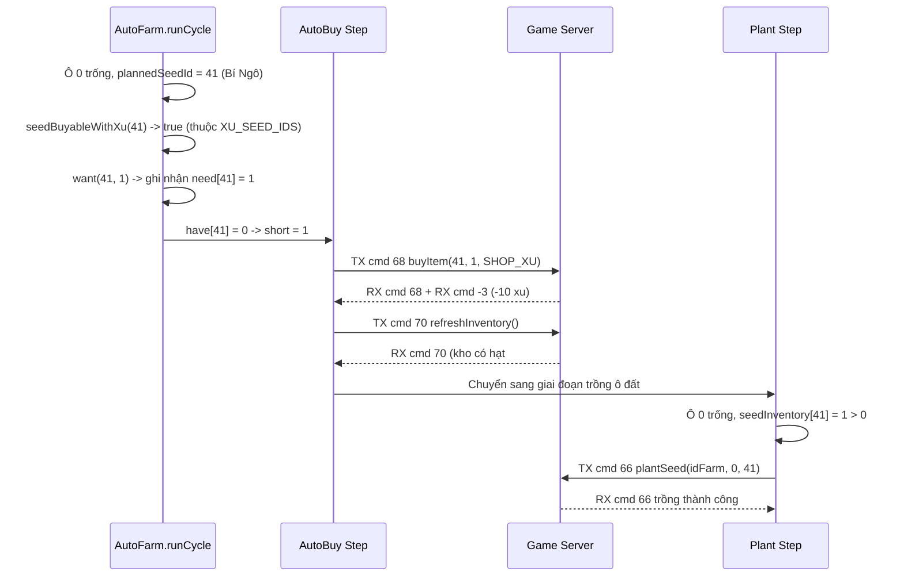

# Design Document: Sửa Lỗi Không Tự Mua Hạt Giống Bí Ngô (#41) Và Các Hạt Trong Catalog

- **Ngày tạo:** 2026-09-15
- **Trạng thái:** Chờ User duyệt (Pending Review)
- **Chủ đề:** Sửa lỗi AutoFarm bỏ qua trồng hạt #41 do thiếu hạt trong kho, khắc phục logic nhận diện hạt mua bằng Xu (`seedBuyableWithXu`).

---

## 1. Mục tiêu & Bối cảnh

### 1.1 Vấn đề
Khi chạy AutoFarm, người dùng gặp log:
```
14:44:28 [cây] ô 0: bỏ qua trồng #41 — kho=0
14:44:28 [cây] ô 0: trống -> bỏ qua — thiếu hạt #41 trong kho
```
Dù đã bật `autoBuy: true` và có đủ ngân sách xu (`buyBudgetXu`), AutoFarm không tự mua bù hạt giống Bí Ngô (#41) và bỏ trống ô 0 liên tục qua các vòng lặp.

### 1.2 Nguyên nhân gốc rễ (Root Cause)
1. **Phân loại nhầm `category: 'premium'`**:
   - Khi giải mã gói 76 (`decodeAllTreeInfo` trong `farmData.ts`), 15 loại cây mở rộng (Bí Ngô #41, Bắp #30, Nha đam #31, Dưa leo #43, Cà tím #32, Tỏi #34, Dâu tây #35, Chuối #36, Cúc #39, Khoai tây #42, Ớt #44, Cải thảo #45, Nhân sâm #46, Hoa tam giác mạch #47, Cây dừa #48) được đánh dấu `category: 'premium'` để phân biệt với 11 cây ở khối đầu gói 76.
   - Thực tế trong game Avatar, toàn bộ các cây này đều là nông sản thường và được mua bằng **Xu** tại Cửa hàng Nông trại với giá từ 10 đến 1440 xu. Thuộc tính `s(4)` trong gói tin của tất cả các cây này đều mang giá trị `1` (`typeShop = 1` = Xu).
2. **Loại trừ sai trong `seedBuyableWithXu`**:
   - Trong `src/autoFarm.ts:754-758`:
     ```ts
     const seedBuyableWithXu = (id: number): boolean => {
       const tree = this.client.trees.find((t) => t.id === id);
       if (tree !== undefined) return tree.category !== 'premium';
       return XU_SEED_IDS.has(id);
     };
     ```
     Do Bí Ngô #41 có `tree.category === 'premium'`, `tree.category !== 'premium'` trả về `false`.
   - Fallback `XU_SEED_IDS` trong `src/accounts/defaultSeedCatalog.ts` cũng chỉ chứa cứng `Set([0, 1, 2, 3, 4, 5, 6, 7, 8, 9, 10])`.
   - Kết quả: `seedBuyableWithXu(41)` luôn trả về `false`. Bước tính toán nhu cầu mua bù (`need`) loại bỏ hạt #41, `autoBuy` không gửi lệnh mua hạt, dẫn đến kho luôn bằng 0 và giai đoạn trồng cây bị bỏ qua.
3. **Bằng chứng kiểm chứng thực tế (Live Proof)**:
   - Đã kiểm tra trực tiếp gửi lệnh `c.farm.buyItem(41, 1, SHOP_XU)` (cmd 68) tới server game thật:
     - Server phản hồi trừ 10 xu (`RX cmd=-3: delta = -10, type = 1`).
     - Server gửi dialog `RX cmd=-40: "Bạn đã mua vật phẩm thành công."`.
     - Kho nhận được hạt `{ id: 41, num: 1 }`.
   - Khẳng định 100%: Bí Ngô (#41) và các hạt trong catalog hoàn toàn mua được bằng Xu.

---

## 2. Phạm vi (Scope)

### 2.1 In-scope
1. **`src/accounts/defaultSeedCatalog.ts`**:
   - Cập nhật `XU_SEED_IDS` chứa tất cả các id hạt giống trong `DEFAULT_SEED_CATALOG` (bao gồm toàn bộ 26 loại hạt giống hiện có).
2. **`src/autoFarm.ts`**:
   - Sửa hàm `seedBuyableWithXu(id)`:
     - Kiểm tra `XU_SEED_IDS.has(id)` trước: mọi hạt giống trong catalog mặc định đều hợp lệ mua bằng xu.
     - Nếu là cây động trong `client.trees`, kiểm tra thuộc tính `s(4) === 1` (loại tiền là Xu) hoặc `tree.category !== 'premium_luong'`.

### 2.2 Out-of-scope
- Không thay đổi opcode hay wire protocol mua vật phẩm (giữ nguyên `buyItem(id, num, SHOP_XU)`).
- Không thay đổi logic chăm sóc hoặc thu hoạch cây trồng.

---

## 3. Thiết kế Kiến trúc & Giải pháp Kỹ thuật

### 3.1 Danh sách File thay đổi

| File | Vai trò | Thay đổi cụ thể |
| --- | --- | --- |
| [defaultSeedCatalog.ts](file:///Users/devios/learning-reverse/avatar-web/server/src/accounts/defaultSeedCatalog.ts) | Định nghĩa catalog hạt giống mặc định | Khởi tạo `XU_SEED_IDS` từ `DEFAULT_SEED_CATALOG.map((s) => s.id)` |
| [autoFarm.ts](file:///Users/devios/learning-reverse/avatar-web/server/src/autoFarm.ts) | Engine tự động hóa nông trại | Cập nhật `seedBuyableWithXu(id)` để không loại trừ các hạt giống trong catalog |

### 3.2 Luồng xử lý sau khi sửa



---

## 4. Verification Plan

1. **Automated Unit Tests**:
   - Bổ sung ca test trong `src/autoFarm.test.ts`: cấu hình ô trống với `seedId = 41` (Bí Ngô), bật `autoBuy: true`, xác minh `buyItem` được gọi cho hạt #41 và ô đất được trồng thành công với hạt #41.
   - Chạy `npx tsx --test src/autoFarm.test.ts` đảm bảo tất cả 42+ test cases đều pass.
2. **Typecheck & Build**:
   - `npm run typecheck`
   - `npm run build`
