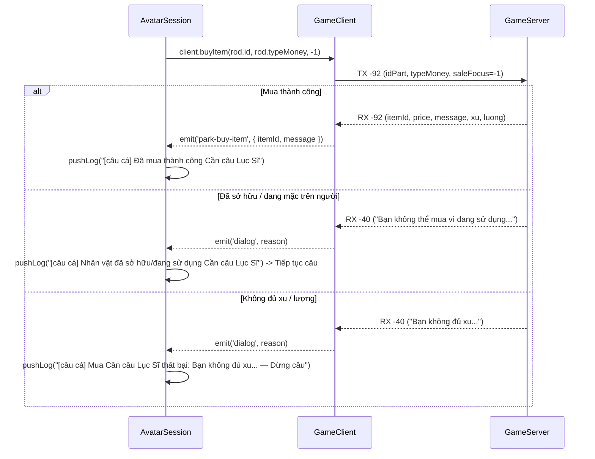

# Design Document: Fix lỗi mua Cần câu Lục Sĩ (TX-92 CMD_AVATAR_BUY_ITEM)

- **Ngày tạo:** 2026-09-15
- **Trạng thái:** Chờ User duyệt (Pending Review)
- **Chủ đề:** Sửa lỗi server không phản hồi gói mua Cần câu Lục Sĩ và các loại cần câu trong auto câu cá AvatarHD.

---

## 1. Mục tiêu & Bối cảnh

### 1.1 Vấn đề
Khi bật tính năng auto câu cá với cấu hình tự mua cần câu (ví dụ Cần câu Lục Sĩ `id: 4874` hoặc các cần câu khác trong `FISHING_RODS`), bot di chuyển sang Khu sinh thái (Map 13) và gửi lệnh mua nhưng sau 4 giây luôn thất bại với log:
```
[câu cá] Mua Cần câu Lục Sĩ thất bại: server không phản hồi gói mua vật phẩm — Dừng câu
```

### 1.2 Nguyên nhân gốc rễ (Root Cause)
1. **Sai Opcode & Payload Protocol**:
   - Cần câu trong AvatarHD là **vật phẩm trang bị (Avatar Part / Equipment)**, không phải vật phẩm số lượng lớn xếp chồng (Stackable Item).
   - Trong [avatarSession.ts:2763](avatar-web/server/src/session/avatarSession.ts#L2763), bot đang gọi:
     ```ts
     client.buyItemStack(rod.id, 1, rod.typeMoney);
     ```
     Lệnh này gửi opcode **TX-43 (`CMD_AVATAR_BUY_ITEM_STACK`)** với payload `i16 idPart, i32 num, i8 typeMoney`.
   - Server AvatarHD **hoàn toàn bỏ qua / im lặng** khi nhận TX-43 cho các item thuộc nhóm trang bị như Cần câu Lục Sĩ (4874).
2. **Khảo sát mã nguồn AvatarHD gốc (Reverse Engineering)**:
   - Trong `AvatarService.doBuyItem` (RVA 0x9610B0), game client gốc gửi **TX-92 (`CMD_AVATAR_BUY_ITEM`)** với payload:
     `writeShort(idPart).writeByte(typeMoney).writeByte(saleFocus)` (trong đó `saleFocus = -1` nghĩa là không dùng thẻ giảm giá).
   - Gói TX-43 (RVA 0x96125C) chỉ được gọi từ `DialogBuyManyItems` khi `follow == -2` (vé câu, mồi câu).
3. **Kiểm chứng thực tế (Live Probe Evidence)**:
   - Test 1: Gửi TX-43 cho item 4874 -> Server im lặng, không phản hồi (0 packet phản hồi).
   - Test 2: Gửi TX-92 `writeShort(4874).writeByte(1).writeByte(-1)` -> Server lập tức phản hồi gói **RX-92** (len 83):
     `"Bạn đã mua vật phẩm Cần Câu Lục Sĩ thành công."`
   - Test 4: Gửi lại TX-92 khi đã có cần trên người -> Server lập tức phản hồi dialog **RX-40**:
     `"Bạn không thể mua vì đang sử dụng vật phẩm này trên người"`.

---

## 2. Phạm vi (Scope)

### 2.1 In-scope
1. Thêm constant `CMD_AVATAR_BUY_ITEM = -92` vào [parkService.ts](avatar-web/server/src/game/parkService.ts).
2. Thêm hàm `doBuyItem(id: number, typeMoney: number, saleFocus?: number): void` vào `ParkService` để gửi TX-92 theo đúng wire format của AvatarService @0x9610B0.
3. Expose `buyItem(id: number, typeMoney: number, saleFocus?: number): void` trên `GameClient` ([client.ts](avatar-web/server/src/game/client.ts)).
4. Cập nhật `doParkBuyItem` trong `ParkService` gọi `doBuyItem` thay vì `doBuyItemStack`.
5. Cập nhật nhánh mua cần câu (`missingType === 'rod'`) trong [avatarSession.ts](avatar-web/server/src/session/avatarSession.ts):
   - Đổi `client.buyItemStack(...)` thành `client.buyItem(rod.id, rod.typeMoney, -1)`.
   - Bổ sung listener dọn dẹp khi `signal.aborted`.
   - Bổ sung xử lý dialog server từ chối (ví dụ: `"không đủ"`, `"hết tiền"`) để báo lỗi ngay lập tức, không để timeout 4s vô ích.

### 2.2 Out-of-scope
- Không thay đổi luồng mua vé câu (`missingType === 'ticket'`) hay mua mồi câu (`missingType === 'bait'`) vì đây là stackable items vẫn sử dụng đúng TX-43.
- Không thay đổi các logic câu cá, quăng cần hay bán cá.

---

## 3. Thiết kế kiến trúc & Giải pháp kỹ thuật

### 3.1 Danh sách file thay đổi

| File | Vai trò | Thay đổi cụ thể |
| --- | --- | --- |
| [avatar-web/server/src/game/parkService.ts](avatar-web/server/src/game/parkService.ts) | Service quản lý packet Park/Khu giải trí | Thêm `CMD_AVATAR_BUY_ITEM = -92`, implement `doBuyItem(id, typeMoney, saleFocus = -1)`, sửa `doParkBuyItem` |
| [avatar-web/server/src/game/client.ts](avatar-web/server/src/game/client.ts) | Client facade cho avatar session | Expose `buyItem(...)` gọi `this.park.doBuyItem(...)` |
| [avatar-web/server/src/session/avatarSession.ts](avatar-web/server/src/session/avatarSession.ts) | Runtime điều phối auto câu cá | Gọi `client.buyItem(...)`, hoàn thiện event listeners & rejection dialog |

### 3.2 Data Contract & Flow

#### Wire Contract TX-92:
```
Opcode: -92 (CMD_AVATAR_BUY_ITEM)
Payload:
  - i16 idPart     (ví dụ: 4874 cho Cần câu Lục Sĩ, 442 cho Cần tre)
  - i8  typeMoney  (1 = Xu, 2 = Lượng)
  - i8  saleFocus  (-1 = không có giảm giá)
```

#### Wire Contract RX-92 (đã được implement sẵn trong GameClient):
```
Opcode: -92 (AVATAR_BUY_ITEM)
Payload:
  - i16 itemId
  - i32 price (nếu available >= 5)
  - i8  typeMoney
  - utf message (nếu available >= 2)
  - i32 xu, i32 luong, i32 luongKhoa
Emits: 'park-buy-item' & 'metrics'
```

#### Flow mua cần câu trong `avatarSession.ts`:


---

## 4. Verification Plan

1. **Static verification**:
   - Chạy `npm run typecheck` trong `avatar-web/server` đảm bảo không lỗi kiểu dữ liệu.
2. **Automated / Probe verification**:
   - Khởi động một chu kỳ mua cần câu giả lập hoặc kiểm tra thực tế với account 3 (tài khoản hiện đã sở hữu Cần câu Lục Sĩ):
   - Khi bot chạy qua bước kiểm tra cần câu, server gửi RX-40 `"Bạn không thể mua vì đang sử dụng vật phẩm này trên người"`, bot nhận diện ngay lập tức `alreadyOwned = true` mà không bị timeout 4s.
   - Kiểm tra log session hiển thị đúng: `[câu cá] Nhân vật đã sở hữu/đang sử dụng Cần câu Lục Sĩ` hoặc `[câu cá] Đã mua thành công Cần câu Lục Sĩ`.
