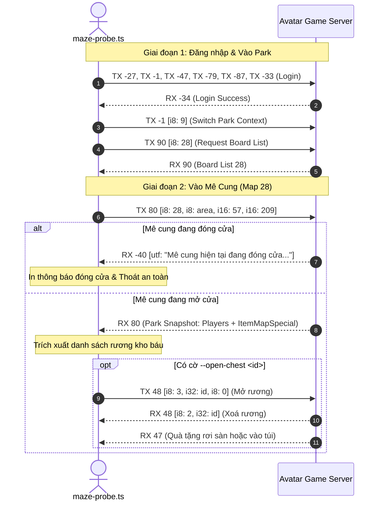

# AvatarHD Maze Chest Probe Tool Design

> **Ngày lập:** 2026-09-16  
> **Topic:** `maze-chest-probe`  
> **Trạng thái:** User đã duyệt Spec và Plan ngày 2026-09-16; đang triển khai  

---

## 1. Mục Tiêu & Bối Cảnh

Map 28 (**Mê cung** trong Avatar HD) là bản đồ sự kiện định kỳ chỉ mở cửa vào **20h45 Thứ 3 và Thứ 5 hàng tuần**.

Khi sự kiện mở:
- Tường mê cung được gán `tile type = 4` (vật cản chặn nhân vật).
- Trong mê cung xuất hiện các đối tượng `ItemMapSpecial` là **Rương kho báu**.
- Người chơi di chuyển tới rương, mở rương qua lệnh `TX 48`, nhận quà rơi sàn `RX 47 subType 0` (nhặt bằng `TX 47 subType 11`) hoặc quà trực tiếp `RX 47 subType 10`.

Mục tiêu:
Xây dựng tool `avatar-web/server/src/tools/maze-probe.ts` để:
1. Tự động kiểm tra trạng thái mở cửa của Mê cung (bắt thoại `RX -40` khi đóng).
2. Quét và ghi lại toàn bộ danh mục rương (`ItemMapSpecial`) khi Mê cung mở cửa.
3. Cung cấp cờ an toàn `--open-chest <id>` (có gate kiểm duyệt) để test mở 1 rương và ghi lại chính xác phần thưởng rơi ra (`RX 47` / `RX -62`).

---

## 2. Phạm Vi (Scope)

### In-Scope
- File công cụ mới: `avatar-web/server/src/tools/maze-probe.ts`.
- Giao thức mạng tuân thủ chuẩn Avatar HD:
  - Login → `TX -1 [i8: 9]` (Park context) → `TX 90 [i8: 28]` (Board list) → `TX 80 [i8: 28, i8: area, i16: 57, i16: 209]`.
  - Bắt thoại `RX -40`: Nhận biết Mê cung đóng cửa và in thông báo thời gian mở.
  - Khi mở cửa: Giải mã snapshot `RX 80` + cập nhật `RX 48`, lọc danh sách rương (`id`, `name`, `x`, `y`, `menuIds`).
  - Giao thức tương tác rương (tùy chọn với `--open-chest <id>`): gửi `TX 48 [i8: 3, i32: id, i8: 0]`, bắt `RX 48 subType 2` (xoá rương) và `RX 47` (quà tặng).
- Chạy bằng command line: `node --env-file=.env --import tsx src/tools/maze-probe.ts --account-id <N> [--area <A>] [--open-chest <id>]`.

### Out-of-Scope
- Không can thiệp vào logic auto farm nông trại hay câu cá.
- Không tự động giải mê cung hay tự động di chuyển đa điểm (pathfinding v1 để người dùng tự điều khiển hoặc quét tọa độ tĩnh).
- Không tạo test files mới (tuân thủ nguyên tắc KHÔNG TDD trong `CLAUDE.md`).

---

## 3. Thiết Kế Kỹ Thuật

### 3.1 Luồng Xử Lý (Sequence Flow)



### 3.2 Cấu Trúc Dữ Liệu Output JSON

```json
{
  "timestamp": "2026-09-17T20:45:00.000Z",
  "accountId": 3,
  "map": 28,
  "status": "open" | "closed",
  "message": "...",
  "chests": [
    {
      "id": 101,
      "name": "Rương kho báu",
      "x": 120,
      "y": 340,
      "menuIds": [0]
    }
  ],
  "openResult": {
    "chestId": 101,
    "removed": true,
    "gift": {
      "type": 0,
      "idGift": 205,
      "xDrop": 122,
      "yDrop": 342
    },
    "dialog": "Bạn nhận được 50.000 Xu"
  }
}
```

---

## 4. Verification Plan

1. **Kiểm tra khi đóng cửa (Hiện tại):**
   ```bash
   cd avatar-web/server && node --env-file=.env --import tsx src/tools/maze-probe.ts --account-id 3 --area 0
   ```
   *Kỳ vọng:* `status = "closed"`, hiển thị thông báo mở cửa vào 20h45 Thứ 3 & Thứ 5.

2. **Kiểm tra Typecheck & Build:**
   ```bash
   npm --prefix avatar-web/server run typecheck && npm --prefix avatar-web/server run build
   ```
   *Kỳ vọng:* 0 lỗi compilation.

3. **Kiểm tra khi mở cửa (20h45 Thứ 5):**
   - Chạy lệnh quét danh sách rương.
   - Thử nghiệm mở 1 rương và ghi nhận phần thưởng.
