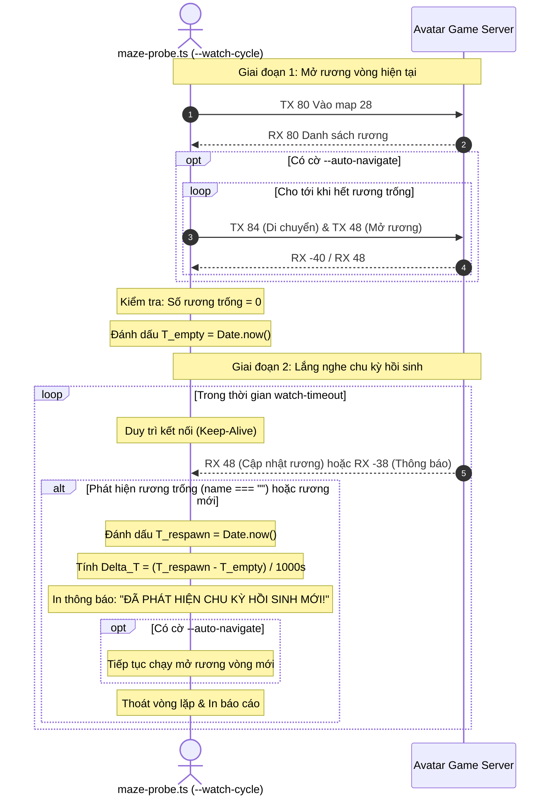

# AvatarHD Maze Chest Respawn Cycle Probe Design

> **Ngày lập:** 2026-09-17  
> **Topic:** `maze-cycle-probe`  
> **Trạng thái:** Chờ User Review & Phê duyệt  

---

## 1. Mục Tiêu & Bối Cảnh

Trong sự kiện Mê Cung (Map 28) của Avatar HD:
- Các rương kho báu (`ItemMapSpecial`, `imageIds: [1133]`, `menuIds: [1217]`) xuất hiện rải rác trên bản đồ (khoảng 31-34 rương mỗi khu).
- Khi rương chưa ai mở, thuộc tính `name` là chuỗi rỗng `""`.
- Khi rương được mở, server gán tên người chơi vào thuộc tính `name` qua gói tin broadcast `RX 48 [mode 1]`.
- Sau khi toàn bộ các rương trong khu vực đã bị người chơi mở hết (số rương có `name === ""` chạm mốc 0), server sẽ có một khoảng thời gian chờ (cooldown/delay) trước khi khôi phục hoặc sinh lại một đợt rương mới cho vòng tiếp theo.

**Vấn đề cần giải quyết:**  
Hiện tại chưa rõ cơ chế hồi sinh rương của server:
- Chu kỳ hồi sinh rương kéo dài bao nhiêu phút kể từ lúc rương cuối cùng được mở?
- Server khôi phục toàn bộ rương cùng một lúc (batch snapshot `RX 80` / hàng loạt `RX 48`) hay hồi sinh rải rác từng rương một?
- Có gói tin broadcast toàn server nào (như `RX -38` hoặc thoại `RX -40`) báo hiệu đợt rương mới bắt đầu hay không?

**Mục tiêu:**  
Bổ sung chế độ `--watch-cycle` và timeout theo dõi `--watch-timeout <seconds>` vào công cụ `maze-probe.ts` để:
1. Tự động mở các rương trống khả dụng hoặc giám sát khu vực cho đến khi số rương trống $= 0$ (ghi nhận mốc thời gian $T_0$).
2. Giữ kết nối game an toàn, liên tục lắng nghe các gói tin cập nhật rương (`RX 48`) và broadcast (`RX -38`, `RX -40`, `RX 80`).
3. Ghi nhận chính xác thời điểm xuất hiện rương trống đầu tiên hoặc đợt rương mới ($T_1$), đo lường chính xác khoảng thời gian hồi sinh $\Delta T = T_1 - T_0$.
4. Tự động kích hoạt tiếp vòng mở rương mới nếu có cờ `--auto-navigate`.

---

## 2. Phạm Vi (Scope)

### In-Scope
- Nâng cấp `avatar-web/server/src/tools/maze-probe.ts`:
  - Thêm cờ `--watch-cycle`: Kích hoạt chế độ theo dõi chu kỳ hồi sinh sau khi khu vực hết rương trống.
  - Thêm cờ `--watch-timeout <seconds>`: Thời gian tối đa chờ đợi chu kỳ mới (mặc định 600 giây = 10 phút, tối đa 1800 giây = 30 phút).
  - Thuật toán giám sát trạng thái rương:
    - Trạng thái `drained`: Tất cả rương trong khu đều có `name !== ""` (đã có người mở). Ghi nhận timestamp $T_{\text{empty}}$.
    - Trạng thái `respawned`: Phát hiện rương có `name === ""` hoặc rương mới xuất hiện. Ghi nhận timestamp $T_{\text{respawn}}$, tính $\Delta T$.
  - Cập nhật định dạng báo cáo đầu ra (cả text và json) với dữ liệu chu kỳ:
    - Thời điểm hết rương.
    - Thời điểm hồi sinh.
    - Thời gian chu kỳ (giây / phút).
    - Danh sách rương mới xuất hiện.

### Out-of-Scope
- Không can thiệp sang các bản đồ hoặc chức năng ngoài Mê cung.
- Không thay đổi các thuật toán tìm đường hay logic đăng nhập đã ổn định.
- Tuân thủ quy tắc KHÔNG TDD theo `CLAUDE.md`: Không tạo test files.

---

## 3. Thiết Kế Kỹ Thuật

### 3.1 Luồng Xử Lý (Sequence Flow)



### 3.2 Cập Nhật Giao Diện Dòng Lệnh (CLI Arguments)

- `--watch-cycle`: Cờ boolean (không nhận giá trị). Bật chế độ lắng nghe chu kỳ sau khi hết rương trống.
- `--watch-timeout <N>`: Số nguyên giây (10..1800). Mặc định 600s (10 phút).

### 3.3 Cấu Trúc Dữ Liệu Kết Quả Probe

```typescript
interface CycleObservation {
  cycleDetected: boolean;
  emptyTimestamp?: string;
  respawnTimestamp?: string;
  durationSeconds?: number;
  initialEmptyCount: number;
  respawnedCount: number;
  respawnMechanism: 'rx48-name-reset' | 'rx48-new-id' | 'rx80-snapshot' | 'unknown';
  announcements: string[];
}
```

---

## 4. Verification Plan

1. **Kiểm tra biên dịch & Typescript**:
   - `npm --prefix avatar-web/server run typecheck`
   - `npm --prefix avatar-web/server run build`
2. **Kiểm thử live**:
   - Chạy lệnh probe với cờ `--watch-cycle` và `--watch-timeout 300`:
     ```bash
     cd avatar-web/server && ./node_modules/.bin/tsx --env-file=.env src/tools/maze-probe.ts --account-id 3 --area 5 --auto-navigate --watch-cycle --watch-timeout 600
     ```
   - Đo lường và xác thực xem sau bao nhiêu giây/phút server sẽ làm mới danh mục rương.
