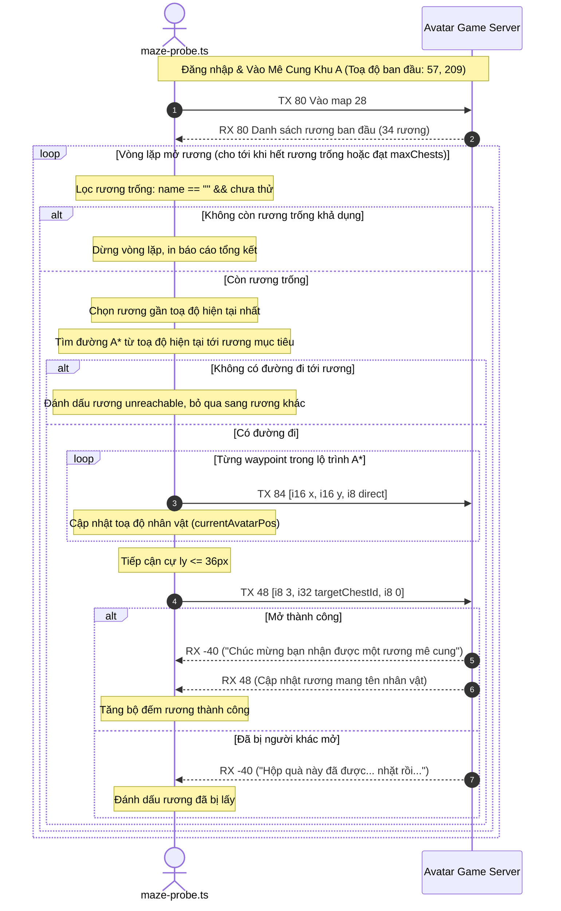

# AvatarHD Maze Multi-Chest Sequential Runner Design

> **Ngày lập:** 2026-09-17  
> **Topic:** `maze-multi-chest-runner`  
> **Trạng thái:** Chờ User Review & Phê duyệt  

---

## 1. Mục Tiêu & Bối Cảnh

Qua lượt probe live lúc 20:55 ngày 17/09/2026 trên bản đồ Mê cung (Map 28), chúng ta đã xác thực thực tế các đặc điểm giao thức:
1. Mỗi khu trong Mê cung có khoảng 34 rương (`ItemMapSpecial`, `imageIds: [1133]`, `menuIds: [1217]`).
2. Rương chưa mở có `name: ""` (chuỗi rỗng). Khi rương được mở thành công bởi một người chơi, server không xoá rương mà broadcast cập nhật `RX 48` gán tên người chơi vào thuộc tính `name` của rương.
3. Khi mở rương thành công bằng `TX 48 [i8 3, i32 chestId, i8 0]`, server phản hồi thoại `RX -40`: `"Chúc mừng bạn nhận được một rương mê cung"`, quà rơi thẳng vào rương đồ (inventory).
4. Một nhân vật có thể mở **nhiều rương liên tiếp** trong cùng một phiên mở cửa mê cung (đã xác thực mở thành công 2 rương liên tiếp trong khu 5).

**Vấn đề hiện tại:**  
Công cụ `maze-probe.ts` hiện chỉ tìm và mở đúng **1 rương duy nhất** rồi ngắt kết nối và kết thúc tiến trình. Nếu muốn mở tiếp, phải đợi login cooldown (10-15s) và chạy lại từ cổng vào `(57, 209)`.

**Mục tiêu:**  
Nâng cấp `maze-probe.ts` thành vòng lặp tự động (Sequential Multi-Chest Runner) trong cùng một phiên kết nối:
- Tự động quét và lập danh sách các rương trống (`name === ""`).
- Liên tục chọn rương trống gần nhất từ vị trí hiện tại của nhân vật.
- Dùng thuật toán tìm đường A* (`mazePathfinding.ts`) để bước tới rương.
- Gửi lệnh `TX 48` mở rương, chờ phản hồi `RX -40` hoặc broadcast `RX 48`.
- Lặp lại cho tới khi hết rương trống trong khu, hoặc đạt giới hạn cấu hình `--max-chests <N>`.

---

## 2. Phạm Vi (Scope)

### In-Scope
- Nâng cấp `avatar-web/server/src/tools/maze-probe.ts`:
  - Thêm cờ `--max-chests <N>` (mặc định mở tất cả rương khả dụng trong khu vực, hoặc dừng khi đạt N rương).
  - Thêm vòng lặp `while` điều hướng đa điểm: sau khi mở xong 1 rương, cập nhật toạ độ hiện tại `currentAvatarPos`, loại rương đó khỏi danh sách ứng viên, tiếp tục tìm rương trống gần nhất tiếp theo.
  - Xử lý các tình huống rương bị người chơi khác mở trước (server trả về `RX 48` cập nhật tên người khác hoặc thoại `Hộp quà này đã được... nhặt rồi`).
  - Báo cáo tổng hợp kết thúc: số rương đã đi qua, số rương mở thành công, danh sách phần thưởng / thoại ghi nhận.

### Out-of-Scope
- Không thay đổi thuật toán tìm đường lõi trong `mazePathfinding.ts` (thuật toán A* đã được kiểm chứng hoạt động chính xác 100%).
- Không can thiệp sang các chức năng nông trại, câu cá, khu mua sắm khác.
- Tuân thủ quy tắc `CLAUDE.md`: Không viết test trước (no TDD), không tạo test file.

---

## 3. Thiết Kế Kỹ Thuật

### 3.1 Luồng Xử Lý Tuần Tự (Multi-Chest Sequential Loop)



### 3.2 Cập Nhật Giao Diện Dòng Lệnh (CLI Arguments)

- Bổ sung cờ `--max-chests <N>`:
  - Giá trị: Số nguyên dương (1..50).
  - Mặc định: `34` (quét và mở toàn bộ rương trong khu).
  - Tương thích ngược: Nếu `--open-chest <id>` được chỉ định đơn lẻ, tool chỉ mở rương đó rồi dừng.

### 3.3 Dữ Liệu Báo Cáo Kết Quả

```typescript
interface MultiChestReport {
  timestamp: string;
  accountId: number;
  map: number;
  area: number;
  status: 'open' | 'closed';
  chestsTotal: number;
  chestsOpenedByMe: number;
  chestsTakenByOthers: number;
  chestsUnreachable: number;
  history: Array<{
    chestId: number;
    targetPos: { x: number; y: number };
    stepsWalked: number;
    result: 'success' | 'taken_by_other' | 'unreachable' | 'failed';
    message?: string;
  }>;
}
```

---

## 4. Verification Plan

1. **Kiểm tra cú pháp & biên dịch**:
   - `npm --prefix avatar-web/server run typecheck`
   - `npm --prefix avatar-web/server run build`
2. **Kiểm thử thực tế (Live Execution)**:
   - Chạy trực tiếp trên Mê cung đang mở cửa (hoặc khu vực chưa bị quét hết rương):
     ```bash
     cd avatar-web/server && ./node_modules/.bin/tsx --env-file=.env src/tools/maze-probe.ts --account-id 3 --area 5 --auto-navigate --max-chests 5
     ```
   - Kỳ vọng: Nhân vật tự động di chuyển liên tục từ rương 1 sang rương 2, rương 3..., mở lần lượt các rương khả dụng trong cùng 1 phiên mà không bị ngắt kết nối.
