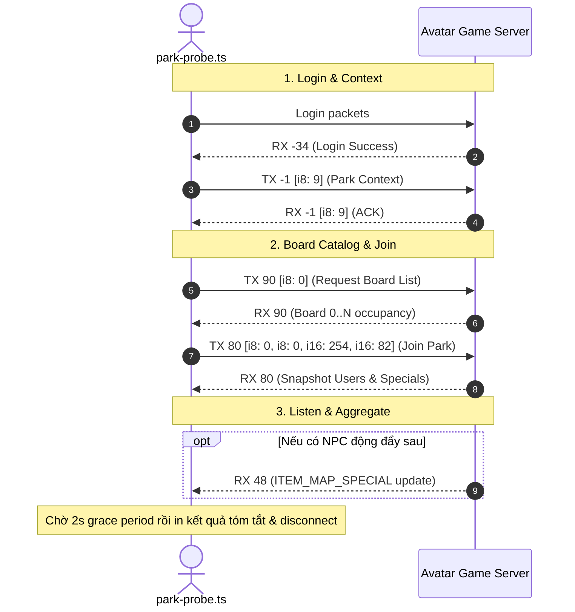

# AvatarHD Central Park Probe Tool Design

> **Ngày lập:** 2026-09-22  
> **Topic:** `central-park-probe`  
> **Trạng thái:** Chờ User Review  

---

## 1. Mục Tiêu & Bối Cảnh

Người dùng cần một công cụ probe để kết nối vào khu **Công viên trung tâm** (`LoadMap.T_PARK = 0`, board 0) trong AvatarHD để quét và hiển thị danh sách tất cả:
1. **Người chơi (User / Players)** hiện diện trong khu vực.
2. **NPC và các thực thể sự kiện (Specials / ItemMapSpecial)** trong khu vực.

Hiện tại:
- `avatar-web/server/src/game/parkService.ts` có bảng `NATIVE_PARK_JOIN_POSITIONS` nhưng chưa có key `0` (mới có key `5` do nhầm lẫn với CityMap node 5 trước đây).
- Các probe trước đây (`npc-map-probe.ts`, `maze-probe.ts`, `mining-probe.ts`) hoặc siết cứng map 5/17/28, hoặc bỏ qua danh sách người chơi (`skipListPlayer`).

Mục tiêu là tạo tool chuyên dụng `avatar-web/server/src/tools/park-probe.ts` phục vụ quét nhanh, hiển thị tóm tắt tên và vị trí cơ bản của toàn bộ user và NPC trong khu vực chỉ định.

---

## 2. Phạm Vi (Scope)

### In-Scope
- **File công cụ mới:** `avatar-web/server/src/tools/park-probe.ts`.
- **Bổ sung toạ độ native:** Thêm key `0: { x: 254, y: 82 }` vào `NATIVE_PARK_JOIN_POSITIONS` trong `avatar-web/server/src/game/parkService.ts`.
- **Giao thức mạng:**
  - Login tài khoản game qua `GameClient`.
  - Chuyển sang ngữ cảnh Park: gửi `TX -1 [i8: 9]`, chờ ACK `RX -1 [i8: 9]`.
  - Xin sĩ số các khu: gửi `TX 90 [i8: map]` (`PARK_BOARD_LIST`).
  - Gửi lệnh vào khu: gửi `TX 80 [i8: map, i8: board, i16: 254, i16: 82]`.
  - Bắt gói `RX 80`: giải mã `listPlayer` (User ID, Tên, Toạ độ x/y) và `specials` (NPC ID, Tên, Toạ độ x/y, Menu options).
  - Lắng nghe sự kiện bổ sung trong 2 giây grace period: bắt `RX 48` (`ITEM_MAP_SPECIAL` cập nhật thêm NPC hoặc đối tượng map).
- **CLI Arguments:**
  - `--account-id <number>`: ID tài khoản trong SQLite DB (bắt buộc).
  - `--map <number>`: ID phòng/map (mặc định: `0` - Công viên trung tâm).
  - `--board <number>`: ID khu/board (mặc định: `0`).
- **Định dạng Output:**
  - In tóm tắt ngắn gọn ra terminal gồm:
    - Thông tin phòng và số lượng người chơi / NPC.
    - Danh sách User: `[ID] Tên (x, y)`.
    - Danh sách NPC/Special: `[ID] Tên (x, y, menus)`.

### Out-of-Scope
- Không can thiệp vào logic tự động hóa farm, câu cá, mê cung hay đào quặng.
- Không tạo test files (tuân thủ nghiêm ngặt nguyên tắc **KHÔNG TDD** của project trong `CLAUDE.md`).
- Không thực hiện tương tác click/menu với NPC (đây là công cụ probe đọc).

---

## 3. Thiết Kế Kỹ Thuật

### 3.1 Bổ sung Toạ độ Native trong `parkService.ts`

Trong `avatar-web/server/src/game/parkService.ts`:
```typescript
export const NATIVE_PARK_JOIN_POSITIONS: Readonly<Record<number, NativeParkJoinPosition>> =
  Object.freeze({
    0: Object.freeze({ x: 254, y: 82 }), // Công viên trung tâm (LoadMap.T_PARK = 0)
    1: Object.freeze({ x: 473, y: 100 }),
    // ...
```

### 3.2 Cấu trúc Dữ liệu Giải mã

```typescript
export interface ParkUser {
  id: number;
  name: string;
  x: number;
  y: number;
  dir: number;
}

export interface ParkNpc {
  id: number;
  name: string;
  x: number;
  y: number;
  type: number;
  menuIds: number[];
}

export interface ParkScanResult {
  roomId: number;
  boardId: number;
  occupancy?: number;
  totalUsers: number;
  users: ParkUser[];
  totalNpcs: number;
  npcs: ParkNpc[];
}
```

### 3.3 Luồng Thực thi (Sequence Diagram)



### 3.4 Logic Giải mã Chi tiết `cmd 80`

1. **Header:** `i8 roomId`, `i8 boardId`, `i16 x`, `i16 y`.
2. **List Players (`readNativeCount`):**
   - Lặp qua từng người chơi:
     - `i32 id` (User ID).
     - `readNativeUtf` (Tên hiển thị).
     - `i8 partCount`, bỏ qua `partCount * 2` bytes.
     - Đọc 11 trường trạng thái native:
       - `i16 x`, `i16 y`, `i8 dir`, `i8 blogNews`, `i8 rankClan`, `i16 idVIP`, `i8 isWedding`, `i8 hungerPet`, `i16 idImg`, `i16 idWedding`, optional `i16 idTitle`.
   - Bỏ qua mảng `dropParts` (`count * 11` bytes).
3. **Map Items & Animations:**
   - Map marker `i16`. Nếu `mapMarker >= 1`: đọc bỏ qua `itemTypeCount` và `itemCount`.
   - Animations: đọc bỏ qua `animCount * 10` bytes.
4. **Specials (NPCs):**
   - Đọc `specialCount`. Với mỗi special:
     - `i32 id`, `readNativeUtf name`, `i32 x`, `i32 y`, `i8 type`.
     - Bỏ qua image IDs (`imageCount * 2` bytes) và 8 ints trạng thái (`8 * 4 = 32` bytes).
     - Đọc menu IDs (`menuCount * 2` bytes).

---

## 4. Verification Plan

1. **Kiểm tra biên dịch & Typecheck:**
   ```bash
   npm --prefix avatar-web/server run typecheck
   ```
   Kỳ vọng: Không có lỗi type.

2. **Chạy thử Probe thực tế:**
   ```bash
   cd avatar-web/server
   node --env-file=.env --import tsx src/tools/park-probe.ts --account-id 1 --map 0 --board 0
   ```
   Kỳ vọng:
   - Đăng nhập thành công và vào Công viên trung tâm map 0 khu 0.
   - In ra danh sách User và NPC tóm tắt rõ ràng.

3. **Kiểm tra Scope Git:**
   - Sử dụng `gitnexus_detect_changes()` xác nhận chỉ thay đổi đúng các file liên quan.
