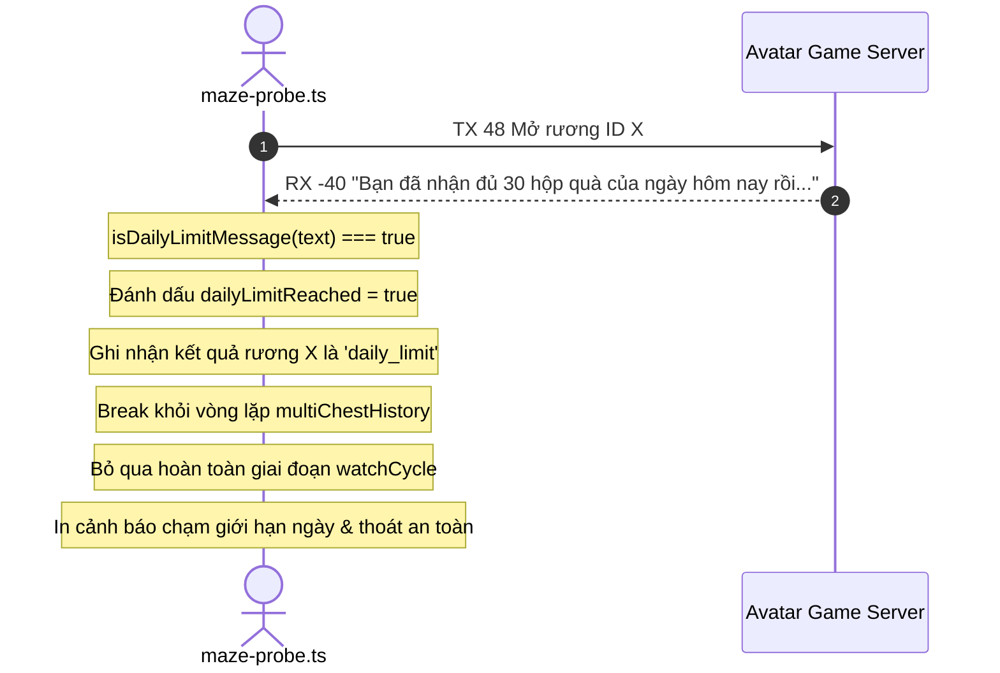

# AvatarHD Maze Chest Daily Limit Handling Design

> **Ngày lập:** 2026-09-22  
> **Topic:** `maze-daily-limit-handling`  
> **Trạng thái:** Chờ User Review & Phê duyệt  

---

## 1. Mục Tiêu & Bối Cảnh

Trong sự kiện Mê Cung (Map 28) của Avatar HD, server giới hạn tối đa mỗi nhân vật chỉ được nhận **30 hộp quà mỗi ngày**.
Khi một nhân vật đã mở đủ 30 rương trong ngày mà tiếp tục gửi lệnh mở rương (`TX 48`), server sẽ không trao quà và phản hồi gói thoại `RX -40` với nội dung:
> *"Bạn đã nhận đủ 30 hộp quà của ngày hôm nay rồi. Quay lại vào ngày khác nhé"*

**Vấn đề hiện tại:**
- Hiện tại `maze-probe.ts` chưa nhận diện thông báo giới hạn ngày này.
- Khi nhận thông báo trên, công cụ vẫn coi đây là mở rương thất bại bình thường và tiếp tục tìm đường sang các rương khác trong khu vực, hoặc tiếp tục chờ chu kỳ hồi sinh (`--watch-cycle`), gây tốn thời gian, lãng phí tài nguyên và tạo các request thừa không cần thiết lên server game.

**Mục tiêu:**
Bổ sung cơ chế nhận diện thông báo chạm giới hạn 30 hộp quà ngày vào `maze-probe.ts` để:
1. Nhận biết chính xác gói thoại `RX -40` (hoặc `RX -62`) chứa thông báo giới hạn 30 hộp quà.
2. Dừng ngay lập tức toàn bộ quá trình điều hướng mở rương tiếp theo (`break` khỏi vòng lặp `while` mở rương).
3. Huỷ bỏ luôn chế độ chờ chu kỳ mới (`--watch-cycle`) nếu đang bật, vì nhân vật không thể mở thêm rương nào trong ngày hôm đó.
4. Ghi nhận trạng thái `dailyLimitReached: true` vào kết quả đầu ra (text/json) và in thông báo rõ ràng cho người dùng.

---

## 2. Phạm Vi (Scope)

### In-Scope
- Nâng cấp `avatar-web/server/src/tools/maze-probe.ts`:
  - Hàm nhận diện thông điệp: `isDailyLimitMessage(text: string): boolean`.
  - Nhận diện khi mở rương ở cả 2 chế độ: `--auto-navigate` (mở tuần tự) và `--open-chest <id>` (mở đơn lẻ).
  - Đánh dấu trạng thái `dailyLimitReached = true`.
  - Ngắt vòng lặp di chuyển mở rương ngay lập tức khi phát hiện chạm giới hạn.
  - Ngắt/bỏ qua khối `--watch-cycle` nếu đã đạt giới hạn 30 hộp quà.
  - Cập nhật kiểu `MazeProbeResult` thêm trường `dailyLimitReached?: boolean`.
  - Cập nhật format in kết quả: hiển thị cảnh báo `[DAILY LIMIT]` khi chạm mốc 30 hộp quà.

### Out-of-Scope
- Không thay đổi logic của các tính năng khác (nông trại, câu cá, đào khoáng).
- Không can thiệp sang các bản đồ khác.
- Tuân thủ quy tắc KHÔNG TDD theo `CLAUDE.md`: Không tạo test files.

---

## 3. Thiết Kế Kỹ Thuật

### 3.1 Hàm Nhận Diện Thông Báo
```typescript
function isDailyLimitMessage(text: string): boolean {
  const lower = text.toLowerCase();
  return (
    lower.includes('đủ 30 hộp quà') ||
    (lower.includes('30 hộp quà') && lower.includes('hôm nay'))
  );
}
```

### 3.2 Luồng Xử Lý Khi Chạm Giới Hạn



### 3.3 Dữ Liệu Kết Quả Probe (MazeProbeResult)
- `dailyLimitReached`: boolean (`true` nếu server phản hồi đã nhận đủ 30 hộp quà).
- `multiChestHistory[i].result`: `'success' | 'taken_by_other' | 'unreachable' | 'daily_limit' | 'failed'`.

---

## 4. Verification Plan

1. **Kiểm tra biên dịch Typescript**:
   - `npm --prefix avatar-web/server run typecheck`
   - `npm --prefix avatar-web/server run build`
2. **Kiểm thử logic**:
   - Kiểm tra hàm `isDailyLimitMessage` với chuỗi server trả về: `"Bạn đã nhận đủ 30 hộp quà của ngày hôm nay rồi. Quay lại vào ngày khác nhé"`.
   - Kiểm tra luồng ngắt khi `dailyLimitReached = true` (không bước sang rương tiếp theo, không chạy watchCycle).
