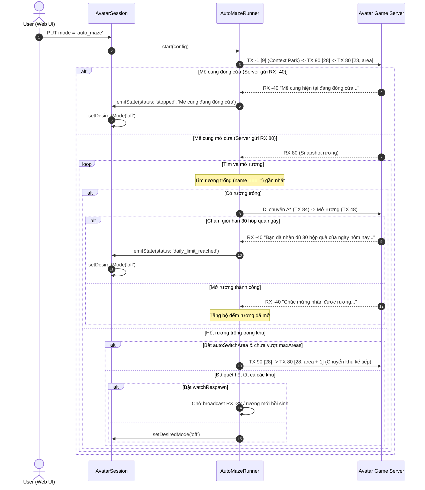

# Thiết Kế Tích Hợp Chế Độ "Mê Cung" Vào Web Automation (Auto Maze)

> **Ngày lập:** 2026-09-22  
> **Topic:** `tich-hop-me-cung-web-auto`  
> **Trạng thái:** Chờ User Review & Phê duyệt  

---

## 1. Mục Tiêu & Bối Cảnh

Sự kiện Mê Cung (Map 28) trong Avatar HD mở định kỳ vào **20h45 Thứ 3 và Thứ 5 hàng tuần**, cho phép người chơi nhận tối đa **30 hộp quà rương kho báu mỗi ngày**.
Hiện tại hệ thống đã có công cụ CLI probe (`maze-probe.ts`) và thuật toán tìm đường né tường A* (`mazePathfinding.ts`) đã được kiểm chứng hoạt động chính xác 100% trong thực tế.

**Vấn đề:**
Người dùng hiện phải chạy script qua terminal bằng tay, chưa có giao diện web trực quan để:
- Bật/Tắt chế độ Mê cung cho từng tài khoản avatar.
- Cấu hình khu vực xuất phát, tự động chuyển khu khi hết rương.
- Theo dõi tiến độ mở rương trong ngày (số rương đã mở / 30), vị trí rương đang tiếp cận và trạng thái hồi sinh rương theo thời gian thực (live WebSocket).

**Mục tiêu:**
Tích hợp chế độ tự động **"Mê cung" (`auto_maze`)** vào hệ thống `avatar-web` (cả Backend Server và Frontend Web UI), biến việc đi Mê cung thành một chế độ vận hành chính thức tương tự như Nông trại (`auto_farm`), Câu cá (`auto_fishing`) và Khai thác (`auto_mining`).

---

## 2. Phạm Vi (Scope)

### In-Scope
1. **Database & Migrations (`server/src/db/`):**
   - Mở rộng ràng buộc `CHECK` của `avatar_automation_state.desired_mode` bổ sung `'auto_maze'`.
   - Bổ sung cột `maze_config_json TEXT` trong bảng `avatar_automation_state`.
   - Tự động chạy migration an toàn khi khởi động server.
2. **Kiểu dữ liệu Automation (`server/src/session/automationTypes.ts` & `web/src/types.ts`):**
   - Định nghĩa `MazeConfig`, `DEFAULT_MAZE_CONFIG`, `StoredMazeConfigState`.
   - Định nghĩa trạng thái thời gian thực `MazeStatus`, `MazeRuntimeState`, `idleMazeRuntime()`.
3. **Bộ điều phối Mê Cung (`server/src/maze/autoMaze.ts`):**
   - Xây dựng `AutoMazeRunner` gắn liền với `AvatarSession`:
     - Vào Map 28 khu chỉ định (`startArea`).
     - **Nếu Mê cung đóng cửa:** Ghi log thông báo và tự động dừng bot, đưa `mode` về `'off'` (theo User Option B).
     - **Nếu Mê cung mở cửa:** Tìm đường A* tới rương trống (`name === ""`) gần nhất, di chuyển từng bước (250ms delay) và gửi `TX 48` mở rương.
     - **Khi nhận thông báo đạt giới hạn ngày 30 rương:** Đánh dấu `daily_limit_reached`, dừng runner và tự động chuyển `mode` về `'off'`.
     - **Khi khu vực hết rương trống:** Nếu bật `autoSwitchArea: true`, tự động chuyển sang khu kế tiếp (`area + 1` đến `maxAreasToScan`, theo User Option A).
     - **Khi tất cả các khu đều hết rương:** Nếu bật `watchRespawn: true`, chuyển sang trạng thái chờ chu kỳ hồi sinh rương mới; nếu không thì dừng.
4. **API Routes & Session Lifecycle (`server/src/session/`):**
   - API `GET /api/accounts/:id/automation/maze/config`: Lấy cấu hình Mê cung.
   - API `PUT /api/accounts/:id/automation/maze/config`: Cập nhật cấu hình Mê cung.
   - API `PUT /api/accounts/:id/automation/mode`: Cho phép kích hoạt `mode: 'auto_maze'`.
   - Tích hợp vòng đời `AutoMazeRunner` vào `AvatarSession` và phát sóng runtime snapshot qua WebSocket.
5. **Giao diện người dùng Web (`web/src/accounts/`):**
   - Bổ sung nút chọn mode "🗝️ Mê cung" trong `StatusPanel.tsx` và nhãn hiển thị trong `AccountStatus.tsx`.
   - Bổ sung tab và Panel chuyên biệt `MazePanel.tsx` (trong `AccountOperationsDrawer.tsx`):
     - Form cấu hình: Khu xuất phát, Tự động chuyển khu, Số khu tối đa, Tự động chờ chu kỳ, Giới hạn rương mỗi phiên.
     - Bảng trạng thái Live: Khu hiện tại, Trạng thái hoạt động, Rương mục tiêu, Tiến độ mở rương trong ngày, Cảnh báo giới hạn 30 hộp quà.
     - Nút Bật/Tắt chế độ Mê cung nhanh.

### Out-of-Scope
- Không can thiệp sang logic các chế độ Nông trại, Câu cá, Khai thác đá/gỗ.
- Tuân thủ quy tắc KHÔNG TDD theo `CLAUDE.md`: Không tạo test files.

---

## 3. Thiết Kế Kiến Trúc & Kỹ Thuật

### 3.1 Luồng Điều Phối Runner (`AutoMazeRunner`)



### 3.2 Data Contracts

#### Cấu hình Mê Cung (`MazeConfig`)
```typescript
export interface MazeConfig {
  readonly startArea: number;             // Khu vực bắt đầu (mặc định: 0)
  readonly autoSwitchArea: boolean;        // Tự động chuyển khu khi hết rương trống (mặc định: true)
  readonly maxAreasToScan: number;         // Quét tối đa bao nhiêu khu (mặc định: 20)
  readonly watchRespawn: boolean;          // Chờ hồi sinh rương nếu tất cả khu đều hết (mặc định: true)
  readonly maxChestsPerSession: number;    // Dừng phiên khi đạt số rương này (mặc định: 30)
}
```

#### Trạng thái Runtime (`MazeRuntimeState`)
```typescript
export type MazeStatus =
  | 'idle'
  | 'entering'
  | 'navigating'
  | 'opening'
  | 'switching_area'
  | 'waiting_respawn'
  | 'daily_limit_reached'
  | 'stopped';

export interface MazeRuntimeState {
  status: MazeStatus;
  currentArea: number | null;
  targetChestId: number | null;
  targetChestPos: { x: number; y: number } | null;
  sessionChestsOpened: number;
  dailyLimitReached: boolean;
  lastMessage: string | null;
}
```

---

## 4. Verification Plan

1. **Kiểm tra biên dịch Typescript toàn bộ dự án:**
   - Server: `npm --prefix avatar-web/server run typecheck && npm --prefix avatar-web/server run build`
   - Web: `npm --prefix avatar-web/web run build`
2. **Kiểm tra cơ chế Migration cơ sở dữ liệu:**
   - Khởi động server và kiểm tra cấu trúc bảng `avatar_automation_state`: xác nhận cột `maze_config_json` và giá trị `desired_mode: 'auto_maze'` được chấp nhận.
3. **Kiểm tra API Routes:**
   - Gọi `GET /api/accounts/3/automation/maze/config` xác nhận trả về cấu hình mặc định.
   - Gọi `PUT /api/accounts/3/automation/maze/config` cập nhật tham số.
   - Gọi `PUT /api/accounts/3/automation/mode` với `mode: 'auto_maze'`.
4. **Kiểm tra giao diện Web:**
   - Mở giao diện Web, kiểm tra hiển thị nút "🗝️ Mê cung" trong `StatusPanel`.
   - Kiểm tra hiển thị panel `MazePanel`, cấu hình khu vực và kích hoạt Bật/Tắt chế độ Mê cung.
