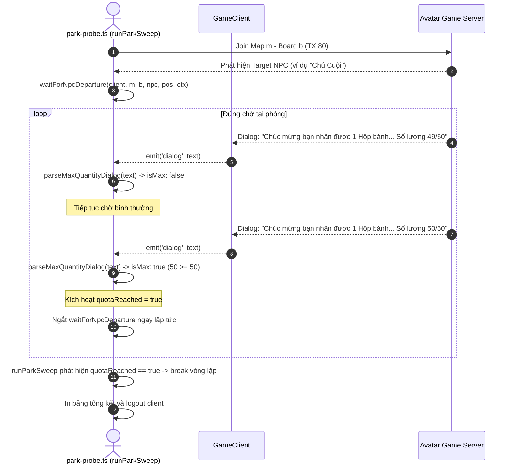

# AvatarHD Park Probe Max Quantity Auto-Exit Design

> **Ngày lập:** 2026-09-23  
> **Topic:** `park-probe-max-quantity-exit`  
> **Trạng thái:** Chờ User Review  

---

## 1. Mục Tiêu & Bối Cảnh

Trong quá trình chạy công cụ `park-probe.ts` (đặc biệt khi kết hợp với chế độ quét tìm target NPC như "Chú Cuội", "Chức Nữ", "Ngưu Lang"), nhân vật đứng lại tại phòng để nhận quà sự kiện từ NPC.

Server game định kỳ gửi các thông báo dialog dạng:
`[GAME DIALOG] Chúc mừng bạn đã nhận được 1 Hộp bánh Trung Thu. Số lượng 1/50`
...
`[GAME DIALOG] Chúc mừng bạn đã nhận được 1 Hộp bánh Trung Thu. Số lượng 50/50`

Khi số lượng quà nhận được đã đạt giới hạn tối đa trong ngày (`current >= max`, ví dụ `50/50`):
- Việc tiếp tục đứng chờ tại phòng hiện tại hay quét các phòng/khu tiếp theo là không cần thiết, làm lãng phí thời gian và tăng nguy cơ tài khoản bị disconnect hoặc server game hạn chế.
- Người dùng hiện phải canh log thủ công trên terminal để dừng process bằng tay (`kill` hoặc `Ctrl+C`).

**Mục tiêu:** Tự động phát hiện khi server game gửi thông báo dạng `Số lượng max/max` (ví dụ `Số lượng 50/50`), lập tức in log cảnh báo, ngắt trạng thái chờ của NPC, dừng vòng lặp quét phòng, đóng kết nối an toàn và thoát `park-probe.ts`.

---

## 2. Phạm Vi (Scope)

### In-Scope
- **Cập nhật `avatar-web/server/src/tools/park-probe.ts`**:
  1. **Hàm helper `parseMaxQuantityDialog(text: string)`**:
     - Phân tích chuỗi dialog từ server game bằng biểu thức chính quy (regex) nhận diện mẫu:
       `[sS]ố lượng\s*[:]?\s*(\d+)\s*\/\s*(\d+)`
     - Bóc tách `current` và `max`.
     - Xác định trạng thái đã đạt tối đa khi: `max > 0 && current >= max`.
     - Trả về `{ current: number; max: number; isMax: boolean } | null`.
  2. **Cơ chế ngắt `waitForNpcDeparture`**:
     - Bổ sung listener lắng nghe sự kiện `'dialog'` của `GameClient` trong lúc đang đứng chờ NPC rời đi.
     - Nếu nhận được dialog đạt mức tối đa (`isMax === true`):
       - Ghi log: `[ĐẠT GIỚI HẠN] Số lượng quà sự kiện đã đạt tối đa (current/max). Dừng chờ NPC.`
       - Giải phóng timers/listeners và kết thúc promise `waitForNpcDeparture` với tín hiệu ngắt (flag `quotaReached = true`).
  3. **Ngắt vòng lặp quét `runParkSweep`**:
     - Duy trì cờ trạng thái `quotaReached: boolean` trong suốt phiên quét.
     - Nếu cờ này được kích hoạt (từ dialog bắt được trong lúc chờ NPC hoặc trong lúc đang ở bất kỳ board nào):
       - In log thông báo dừng quét: `🛑 [ĐẠT GIỚI HẠN SỰ KIỆN] Đã nhận đủ số lượng tối đa (${current}/${max}). Tự động kết thúc quét.`
       - Lập tức ngắt (`break`) cả 2 vòng lặp (map và board).
       - Tiến hành in bảng tổng kết quét và thoát.
  4. **Hỗ trợ chế độ probe đơn lẻ (`!args.sweep`)**:
     - Cũng nhận diện dialog đạt tối đa để kết thúc probe sớm thay vì chờ hết grace period.
  5. **Dọn dẹp kết nối an toàn**:
     - Logout client và đóng database sạch sẽ trước khi process kết thúc.

### Out-of-Scope
- Không làm thay đổi logic các dịch vụ lõi (`client.ts`, `farmService.ts`, `parkService.ts`).
- Không tạo file test unit mới (tuân thủ nguyên tắc **KHÔNG TDD** của project).
- Không can thiệp vào các loại dialog không liên quan đến giới hạn số lượng.

---

## 3. Thiết Kế Kỹ Thuật & Kiến Trúc

### 3.1 Hàm nhận diện `parseMaxQuantityDialog`

```typescript
export interface MaxQuantityCheck {
  current: number;
  max: number;
  isMax: boolean;
}

export function parseMaxQuantityDialog(text: string): MaxQuantityCheck | null {
  const match = text.match(/số lượng\s*[:]?\s*(\d+)\s*\/\s*(\d+)/i);
  if (!match) return null;
  const current = Number(match[1]);
  const max = Number(match[2]);
  if (!Number.isFinite(current) || !Number.isFinite(max) || max <= 0) {
    return null;
  }
  return {
    current,
    max,
    isMax: current >= max,
  };
}
```

### 3.2 Luồng xử lý sự kiện (Sequence Flow)



### 3.3 Chi tiết các thay đổi trong `park-probe.ts`

1. **Interface ngữ cảnh hủy / ngắt `ProbeAbortContext`**:
   ```typescript
   interface ProbeContext {
     quotaReached: boolean;
     quotaMessage?: string;
   }
   ```
2. **Cập nhật `waitForNpcDeparture`**:
   - Nhận thêm tham số `ctx: ProbeContext`.
   - Bổ sung listener:
     ```typescript
     const onDialog = (text: string): void => {
       const check = parseMaxQuantityDialog(text);
       if (check?.isMax) {
         ctx.quotaReached = true;
         ctx.quotaMessage = text;
         finish(`Đạt giới hạn số lượng tối đa (${check.current}/${check.max})`);
       }
     };
     client.on('dialog', onDialog);
     ```
   - Trong hàm `cleanup()`, gọi `client.off('dialog', onDialog)`.
3. **Cập nhật `runParkSweep`**:
   - Khởi tạo `const ctx: ProbeContext = { quotaReached: false };`.
   - Truyền `ctx` vào `waitForNpcDeparture(client, m, b, match, pos, ctx)`.
   - Trong vòng lặp quét map/board, kiểm tra:
     ```typescript
     if (ctx.quotaReached) {
       console.log(
         `\n🛑 [DỪNG QUÉT] Đã đạt giới hạn số lượng tối đa (${ctx.quotaMessage}). Kết thúc sớm phiên probe.\n`,
       );
       break;
     }
     ```
   - Sau khi kết thúc vòng lặp, hiển thị lý do dừng trong phần tổng kết sweep.

---

## 4. Verification Plan

1. **Typecheck dự án**:
   ```bash
   npm --prefix avatar-web/server run typecheck
   ```
   Kỳ vọng: Không có bất kỳ lỗi compile nào.

2. **Kiểm thử logic `parseMaxQuantityDialog` qua Node CLI**:
   - `Số lượng 1/50` $\rightarrow$ `{ current: 1, max: 50, isMax: false }`
   - `Số lượng 50/50` $\rightarrow$ `{ current: 50, max: 50, isMax: true }`
   - `Số lượng: 40/40` $\rightarrow$ `{ current: 40, max: 40, isMax: true }`
   - `Số lượng 51/50` $\rightarrow$ `{ current: 51, max: 50, isMax: true }`

3. **Chạy thực tế với `park-probe.ts`**:
   Chạy probe với tài khoản vừa đạt 50/50 bánh (account 3):
   ```bash
   (cd avatar-web/server && node --env-file=.env --import tsx src/tools/park-probe.ts --account-id 3 --map 1 --board 1 --target-npc "Chú cuội")
   ```
   Kỳ vọng: Khi nhận được dialog báo đã nhận tối đa hoặc khi nhận tin nhắn 50/50, tool sẽ tự động ngắt và thoát sạch sẽ.
