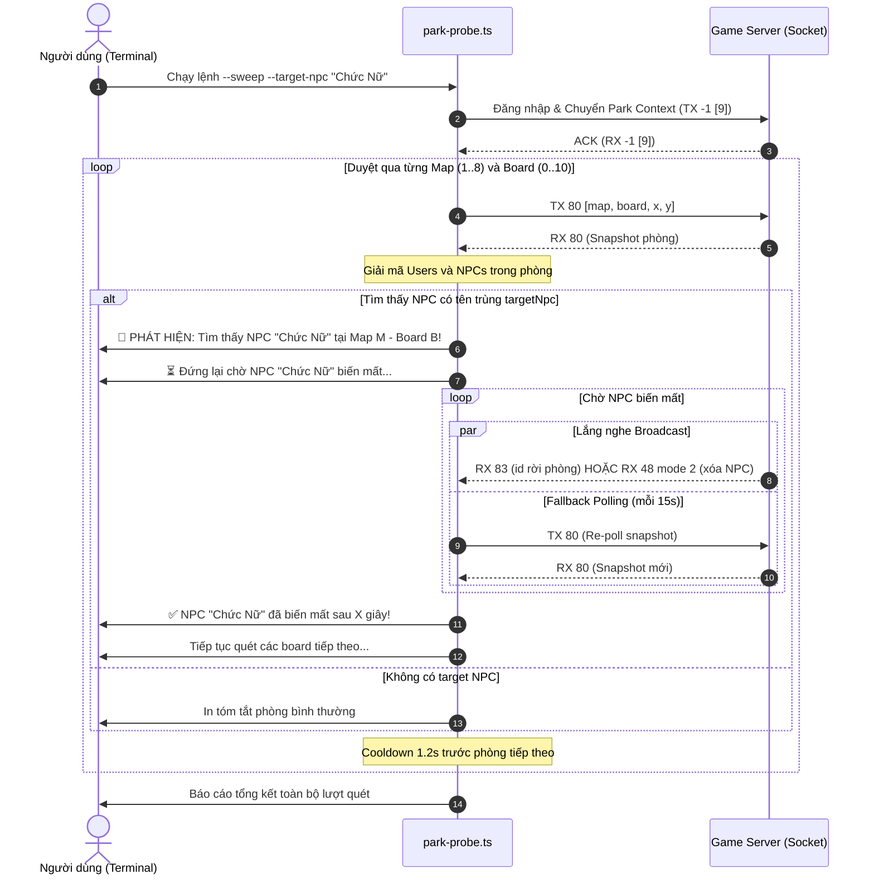

# AvatarHD Park Probe Target NPC Monitoring Design

> **Ngày lập:** 2026-09-23  
> **Topic:** `park-probe-target-npc`  
> **Trạng thái:** Chờ User Review  

---

## 1. Mục Tiêu & Bối Cảnh

Người dùng muốn nâng cấp công cụ `park-probe.ts` để hỗ trợ tìm kiếm và theo dõi một NPC cụ thể theo tên:
- **Nhận vào tên NPC mục tiêu** qua tham số dòng lệnh (ví dụ `--target-npc "Chức Nữ"` hoặc `--target-npc "Ngưu Lang"`).
- **Khi quét (sweep qua các map/board) tìm thấy NPC trùng tên**:
  1. Dừng quét, đứng lại ngay tại map và board đó.
  2. Báo cáo vị trí, ID, toạ độ của NPC tìm được.
  3. Lắng nghe và chờ đến khi NPC này biến mất khỏi phòng/board.
  4. Sau khi NPC biến mất, tự động tiếp tục quét các board tiếp theo.

---

## 2. Phạm Vi (Scope)

### In-Scope
- **Cập nhật công cụ `avatar-web/server/src/tools/park-probe.ts`**:
  - Mở rộng giao diện CLI `ProbeArgs` nhận thêm tùy chọn `--target-npc <tên NPC>`.
  - Cập nhật hàm `parseArgs`:
    - Cho phép key `--target-npc` nhận giá trị chuỗi (string).
    - So khớp tên không phân biệt hoa thường và tự động chuẩn hoá khoảng trắng (`trim().toLowerCase()`).
  - Xây dựng module/hàm giám sát `waitForNpcDeparture`:
    - **Lắng nghe gói broadcast `RX 83` (`PLAYER_LEAVE_PARK`)**:
      - Đã reverse từ native `ParkMsgHandler.onMessage` @0x718DC8 (jump-table entry 4 -> 0x7193d0 `MapScr.onPlayerLeave`).
      - Payload gồm 4 byte: `i32 id`.
      - Khi `id === targetNpc.id`, xác nhận Avatar NPC đã rời khỏi khu vực.
    - **Lắng nghe gói `RX 48` mode 2 (`ITEM_MAP_SPECIAL` remove)**:
      - Đã reverse từ native `GlobalMessageHandler.onMessage` @0x5EDDDC (mode 2 gọi `removeItemDataMapSpecial` @0xA0C704).
      - Payload gồm 1 byte `mode = 2`, 4 byte `id: i32`.
      - Khi `id === targetNpc.id`, xác nhận Special NPC đã bị xóa khỏi map.
    - **Cơ chế Re-poll dự phòng (Presence Fallback Polling)**:
      - Định kỳ mỗi 15 giây (sau thời gian cooldown chống spam của server), gửi lại `TX 80` với toạ độ map/board hiện tại để lấy snapshot mới.
      - Nếu snapshot trả về không còn chứa `targetNpc.id`, xác nhận NPC đã biến mất ngay cả khi broadcast bị trễ hoặc thất lạc.
    - **Heartbeat logging**:
      - In log định kỳ mỗi 5 giây thông báo thời gian đã đứng chờ: `[WAITING] Đã chờ NPC "<Tên>" biến mất: Xs...`.
  - Tích hợp vào quy trình `runParkSweep`:
    - Khi duyệt qua từng phòng `(map, board)`, sau khi decode danh sách NPC:
    - Nếu có NPC trùng tên với `targetNpc`:
      - Dừng tiến trình quét tiếp.
      - Gọi `waitForNpcDeparture`.
      - Khi hàm trả về (NPC đã biến mất): ghi nhận tổng thời gian tồn tại và tiếp tục vòng lặp sang board kế tiếp `board + 1`.
  - Hỗ trợ cả chế độ quét đơn (`--map`, `--board`, `--target-npc`) để đứng theo dõi NPC tại 1 phòng cố định nếu người dùng muốn.

### Out-of-Scope
- Không thực hiện hành động tương tác (menu/đánh NPC) trong bước này.
- Không tạo unit test files (tuân thủ nghiêm ngặt nguyên tắc **KHÔNG TDD** của project trong `CLAUDE.md`).
- Không làm thay đổi logic các dịch vụ game khác (`client.ts`, `farmService.ts`, `parkService.ts`).

---

## 3. Thiết Kế Kỹ Thuật

### 3.1 Giao diện Dữ liệu CLI

```typescript
export interface ProbeArgs {
  accountId: number;
  map: number;
  board: number;
  sweep?: boolean;
  fromMap?: number;
  toMap?: number;
  fromBoard?: number;
  toBoard?: number;
  targetNpc?: string; // Tên NPC cần tìm và theo dõi
}
```

### 3.2 Giao Thức Nhận Biết NPC Rời Phòng / Biến Mất

| Gói tin | Opcode | Cấu trúc Body | Ý nghĩa trong game |
|---|---|---|---|
| `PLAYER_LEAVE_PARK` | `RX 83` | `[i32 id]` | Người chơi hoặc Avatar NPC (`id >= 2_000_000_000`) rời khỏi phòng/board. |
| `ITEM_MAP_SPECIAL` | `RX 48` (mode 2) | `[i8 mode=2][i32 id]` | Đối tượng/NPC bản đồ tĩnh (`ItemMapSpecial`) bị xóa khỏi phòng. |
| `AVATAR_JOIN_PARK` | `TX 80` -> `RX 80` | `[i8 room][i8 board][i16 x][i16 y]` | Re-poll dự phòng kiểm tra snapshot thực tế của phòng mỗi 15s. |

### 3.3 Sequence Diagram: Luồng Quét & Đứng Chờ NPC



---

## 4. Kế Hoạch Kiểm Tra & Verification Plan

1. **Static Analysis & Typecheck:**
   - Chạy `npm --prefix avatar-web/server run typecheck` xác nhận không có lỗi kiểu dữ liệu trong TypeScript.
2. **Kiểm tra CLI Args:**
   - Chạy `--help` hiển thị cờ `--target-npc <tên NPC>`.
   - Chạy thử không có `--target-npc` để đảm bảo tương thích ngược 100% với luồng sweep cũ.
3. **Chạy Thử Nghiệm Thực Tế:**
   - Chạy lệnh quét sweep kèm `--target-npc "Chức Nữ"` hoặc `--target-npc "Ngưu Lang"`:
     ```bash
     node --env-file=avatar-web/server/.env --import tsx avatar-web/server/src/tools/park-probe.ts --account-id 1 --sweep --from-map 1 --to-map 3 --from-board 0 --to-board 5 --target-npc "Chức Nữ"
     ```
   - Xác nhận:
     + Khi quét qua board không có target NPC: tiếp tục bình thường.
     + Khi gặp target NPC: in log phát hiện, dừng sweep, in log đếm thời gian.
     + Khi NPC biến mất (qua `RX 83`, `RX 48`, hoặc fallback snapshot): in log xác nhận và tiếp tục sang board tiếp theo.
