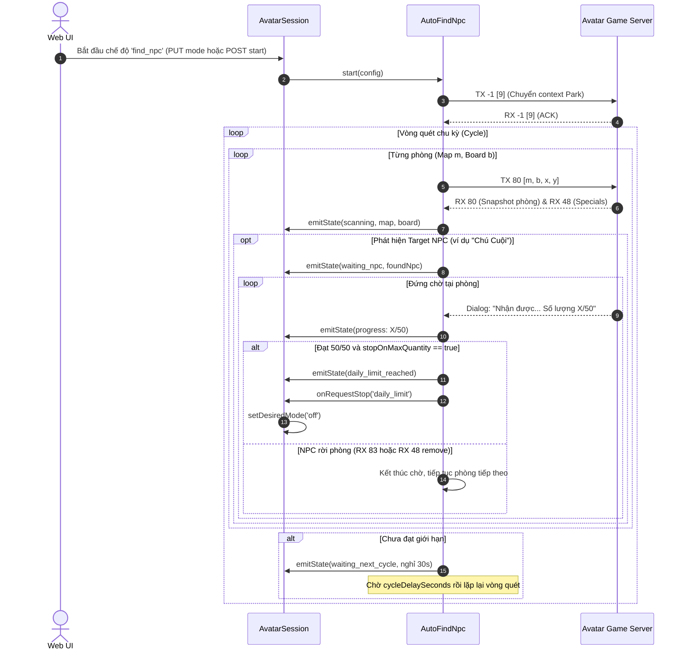

# Thiết Kế Tích Hợp Chế Độ "Tìm NPC" Vào Web Automation (Auto Find NPC)

> **Ngày lập:** 2026-09-23  
> **Topic:** `tich-hop-tim-npc-web-auto`  
> **Trạng thái:** Chờ User Review & Phê duyệt  

---

## 1. Mục Tiêu & Bối Cảnh

Trong các sự kiện theo mùa của Avatar HD (như sự kiện Trung Thu, Tết, Valentine, Giáng sinh), các NPC sự kiện (như **Chú Cuội**, **Chị Hằng**, **Chức Nữ**, **Ngưu Lang**,...) sẽ xuất hiện ngẫu nhiên tại các khu vực trong Công viên (Map 1 đến 8, các khu từ 0 đến 19). Người chơi đứng trong phòng cùng NPC sẽ được tặng quà định kỳ (ví dụ Hộp bánh Trung Thu, tối đa 50 hộp/ngày).

Công cụ CLI `park-probe.ts` đã hoàn thiện và kiểm chứng thành công 100% trong thực tế:
- Quét tự động qua các map và khu vực công viên với toạ độ native chuẩn xác.
- Nhận diện NPC mục tiêu theo tên (không phân biệt hoa thường).
- Đứng chờ trong phòng, nhận quà sự kiện, tự động lắng nghe broadcast `RX 83` / `RX 48 remove` để biết khi nào NPC rời đi và tiếp tục quét.
- Tự động nhận diện tin nhắn `Số lượng max/max` (ví dụ `50/50`) để dừng sớm khi đã đạt giới hạn ngày.

**Vấn đề:**
Hiện tại tính năng chỉ chạy được bằng lệnh terminal thủ công (`park-probe.ts`). Người dùng muốn tích hợp tính năng này trực tiếp vào Web UI của hệ thống `avatar-web` dưới tên gọi chính thức là **"Tìm NPC"**, tương tự như các chế độ Auto Farm, Auto Fishing, Khai thác và Mê cung.

**Mục tiêu:**
Mở lại và hoàn thiện chế độ tự động **"🎯 Tìm NPC" (`find_npc`)** trên cả Backend Server (`avatar-web/server`) và Frontend Web UI (`avatar-web/web`):
1. Cho phép bật/tắt chế độ Tìm NPC cho từng tài khoản avatar từ giao diện web.
2. Cấu hình tên NPC cần tìm, dải Map (mặc định 1..8), dải Khu (mặc định 0..19), thời gian nghỉ giữa các vòng quét và tùy chọn dừng khi đạt giới hạn quà trong ngày.
3. Theo dõi tiến độ quét live qua WebSocket: Map & Khu đang quét, vị trí tìm thấy NPC, thời gian đang đứng chờ, tiến độ quà sự kiện (`current/max`) và thông báo hoàn thành giới hạn ngày.

---

## 2. Phạm Vi (Scope)

### In-Scope

1. **Feature Flag & Routing (`avatar-web/server/src/session/`):**
   - Mở khóa kill-switch: đặt `FIND_NPC_DISABLED = false` trong `featureFlags.ts`.
   - Bỏ qua rào chắn kiểm tra `FIND_NPC_DISABLED` trong `manager.ts` khi bootstrap và trong `routes.ts` khi nhận API start.
   - Loại bỏ phụ thuộc vào catalog cũ chưa verify (`catalog-unverified`).

2. **Kiểu dữ liệu & Contracts (`server/src/session/automationTypes.ts` & `web/src/types.ts`):**
   - Mở rộng `FindNpcConfig`:
     - `npcName`: Tên NPC cần tìm (chuỗi, mặc định `"Chú Cuội"`).
     - `fromMap` / `toMap`: Khoảng map quét (mặc định `1` đến `8`).
     - `fromBoard` / `toBoard`: Khoảng khu quét (mặc định `0` đến `19`).
     - `stopOnMaxQuantity`: Tự động ngắt khi nhận đủ quà max (mặc định `true`).
     - `cycleDelaySeconds`: Thời gian nghỉ giữa các chu kỳ quét (mặc định `30`s).
   - Mở rộng `AutoFindNpcState` hiển thị live:
     - `currentMap`, `currentBoard`, `foundNpc`, `waitingSeconds`, `eventRewardProgress`, `lastRewardMessage`, `dailyLimitReached`, `cycleCount`.

3. **Bộ Runner Tìm NPC (`avatar-web/server/src/autoFindNpc.ts`):**
   - Xây dựng lại `AutoFindNpc` kế thừa toàn bộ engine từ `park-probe.ts`:
     - Chuyển ngữ cảnh Công viên bằng `enterParkContext()` (TX -1 [9] / RX -1 [9]).
     - Quét tuần tự từng phòng theo toạ độ native `NATIVE_PARK_JOIN_POSITIONS`.
     - Lắng nghe cập nhật phòng `cmd 80` và các NPC động `cmd 48`.
     - Khi tìm thấy target NPC: đứng lại tại phòng, cập nhật trạng thái `waiting_npc`, gửi `onFound`.
     - Lắng nghe broadcast `RX 83` (NPC rời phòng) và `RX 48 remove` để tiếp tục quét phòng kế tiếp.
     - Lắng nghe sự kiện `'dialog'`: dùng `parseMaxQuantityDialog` bóc tách tiến độ `current/max`. Nếu đạt max (`current >= max`) và `stopOnMaxQuantity === true`:
       - Đánh dấu `dailyLimitReached = true`.
       - Dừng runner và yêu cầu chuyển mode về `'off'`.
     - Khi hoàn thành 1 vòng quét hết các phòng mà chưa đạt max: nghỉ `cycleDelaySeconds` (trạng thái `waiting_next_cycle`), sau đó lặp lại vòng quét tiếp theo.
     - Xử lý dọn dẹp listener và ngắt an toàn khi user bấm Dừng Auto.

4. **Tích hợp vào Session Coordinator (`avatar-web/server/src/session/avatarSession.ts`):**
   - Kết nối `AutoFindNpc` vào vòng đời `AvatarSession` (`startFindNpc`, `stopFindNpc`, switch mode, disconnect).
   - Phát sóng `findNpcRuntime` qua WebSocket tới web client.

5. **Giao diện Web Frontend (`avatar-web/web/`):**
   - **`StatusPanel.tsx`**:
     - Bổ sung nút chọn chế độ `"🎯 Tìm NPC"` vào thanh selector.
     - Hiển thị tóm tắt trạng thái live: `tìm NPC: Map X - Khu Y · [found/waiting] · 🎁 số lượng 45/50`.
   - **`AccountOperationsDrawer.tsx`**:
     - Mở lại tab `"🎯 Tìm NPC"` (đặt `FIND_NPC_TAB_HIDDEN = false`).
     - Bổ sung tab vào nhóm `operations`.
   - **`FindNpcPanel.tsx`**:
     - Form cấu hình đầy đủ: Tên NPC, dải Map quét, dải Khu quét, switch dừng khi đạt giới hạn, thời gian nghỉ giữa các vòng.
     - Bảng trạng thái Live: Khu vực đang quét, NPC đã phát hiện, thời gian đứng chờ, thanh tiến độ quà sự kiện, cảnh báo khi hoàn thành giới hạn ngày.
     - Nút Bắt đầu / Dừng nhanh.

### Out-of-Scope
- Không can thiệp sang logic các chế độ Nông trại, Câu cá, Khai thác, Mê cung.
- Không sửa đổi DB schema vì bảng `avatar_automation_state` đã có sẵn cột `find_npc_config_json` và enum `desired_mode` đã chấp nhận `'find_npc'`.
- Không tạo unit test files (tuân thủ nguyên tắc **KHÔNG TDD** của project trong `CLAUDE.md`).

---

## 3. Thiết Kế Kỹ Thuật & Kiến Trúc

### 3.1 Cấu trúc Dữ liệu & State Contracts

#### 3.1.1 Cấu hình `FindNpcConfig`
```typescript
export interface FindNpcConfig {
  readonly npcName: string;
  readonly fromMap?: number;
  readonly toMap?: number;
  readonly fromBoard?: number;
  readonly toBoard?: number;
  readonly stopOnMaxQuantity?: boolean;
  readonly cycleDelaySeconds?: number;
}

export const DEFAULT_FIND_NPC_CONFIG: FindNpcConfig = Object.freeze({
  npcName: 'Chú Cuội',
  fromMap: 1,
  toMap: 8,
  fromBoard: 0,
  toBoard: 19,
  stopOnMaxQuantity: true,
  cycleDelaySeconds: 30,
});
```

#### 3.1.2 Trạng thái thời gian thực `AutoFindNpcState`
```typescript
export type AutoFindNpcPhase =
  | 'idle'
  | 'entering_park'
  | 'scanning'
  | 'waiting_npc'
  | 'waiting_next_cycle'
  | 'daily_limit_reached'
  | 'scan_backoff'
  | 'stopping';

export interface AutoFindNpcState {
  phase: AutoFindNpcPhase;
  running: boolean;
  targetName: string;
  cursor: number;
  total: number;
  timeoutStreak: number;
  currentMap?: number | null;
  currentBoard?: number | null;
  foundNpc?: { id: number; name: string; map: number; board: number } | null;
  waitingSeconds?: number;
  eventRewardProgress?: { current: number; max: number } | null;
  lastRewardMessage?: string | null;
  dailyLimitReached?: boolean;
  cycleCount?: number;
  backoffUntil?: number;
  lastError?: string;
  updatedAt?: number;
}
```

### 3.2 Luồng Hoạt Động Của `AutoFindNpc` Runner



### 3.3 Chi tiết các file thay đổi

| STT | File | Hành động | Vai trò |
|---|---|---|---|
| 1 | `avatar-web/server/src/session/featureFlags.ts` | Sửa | Đổi `FIND_NPC_DISABLED = false` để mở lại tính năng. |
| 2 | `avatar-web/server/src/session/automationTypes.ts` | Sửa | Bổ sung các trường vào `FindNpcConfig`, `DEFAULT_FIND_NPC_CONFIG`, `AutoFindNpcState`. |
| 3 | `avatar-web/server/src/autoFindNpc.ts` | Viết lại | Runner hoàn chỉnh áp dụng engine của `park-probe.ts` (Native join, Target NPC waiting, Departure detection, Max quantity auto-exit, Periodic cycles). |
| 4 | `avatar-web/server/src/session/avatarSession.ts` | Sửa | Nối runner vào `startFindNpc`, `stopFindNpc`, gỡ bỏ kiểm tra catalog cũ. |
| 5 | `avatar-web/server/src/session/manager.ts` | Sửa | Xóa bỏ đoạn lọc bỏ `find_npc` khi bootstrap sau khởi động server. |
| 6 | `avatar-web/server/src/session/routes.ts` | Sửa | Xóa bỏ 503 check trong route `/automation/start`, hỗ trợ route GET/PUT config. |
| 7 | `avatar-web/web/src/types.ts` | Sửa | Đồng bộ types `FindNpcConfig`, `AutoFindNpcState`. |
| 8 | `avatar-web/web/src/accounts/AccountOperationsDrawer.tsx` | Sửa | Bật lại tab Tìm NPC (`FIND_NPC_TAB_HIDDEN = false`). |
| 9 | `avatar-web/web/src/accounts/panels/StatusPanel.tsx` | Sửa | Thêm nút chọn mode `"🎯 Tìm NPC"` và format dòng text progress. |
| 10 | `avatar-web/web/src/accounts/panels/FindNpcPanel.tsx` | Cập nhật | Giao diện form cấu hình dải map/khu, live monitor tiến độ quà `XX/50`, nút start/stop. |

---

## 4. Verification Plan

1. **Kiểm tra biên dịch & Typecheck toàn dự án:**
   ```bash
   npm --prefix avatar-web/server run typecheck
   npm --prefix avatar-web/web run build
   ```
   Kỳ vọng: Cả server và frontend build thành công 100%, không có lỗi type.

2. **Khởi động server & Kiểm tra API:**
   ```bash
   (cd avatar-web/server && npm run dev)
   ```
   - Gọi `GET /api/accounts/3/automation` kiểm tra `findNpcConfig` và `findNpcRuntime` trả về đúng cấu trúc.
   - Bật mode `find_npc` trên giao diện web hoặc qua API.

3. **Kiểm chứng chạy thực tế trên Web UI:**
   - Mở Drawer tài khoản $\rightarrow$ Tab `"🎯 Tìm NPC"`.
   - Cấu hình: NPC `"Chú Cuội"`, Map `1..2`, Khu `0..5`.
   - Bấm **Bắt đầu**:
     - Quan sát log và panel: Bot vào map, quét từng khu vực.
     - Khi tìm thấy "Chú Cuội": trạng thái đổi thành "Đang chờ NPC", hiển thị tiến độ quà sự kiện.
     - Khi đạt giới hạn 50/50: tự động dừng bot và chuyển chế độ sang `off`.
