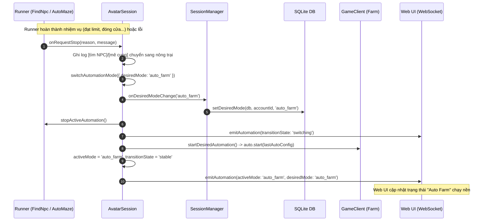

# Thiết Kế: Tự Động Chuyển Sang Mode Nông Trại Sau Khi Dừng Auto NPC Và Mê Cung

> **Ngày lập:** 2026-09-26  
> **Topic:** `auto-switch-farm-after-npc-maze`  
> **Trạng thái:** Chờ User Review & Phê duyệt  

---

## 1. Mục Tiêu & Bối Cảnh

### 1.1. Bối cảnh
Trong hệ thống `avatar-web`:
- Chế độ **Tìm NPC (`find_npc`)** và **Mê Cung (`auto_maze`)** là các hoạt động sự kiện/hàng ngày có giới hạn (tìm NPC nhận quà sự kiện cho đến khi đạt giới hạn ngày; đi Mê Cung mở rương kho báu cho đến khi đạt 30 hộp quà hoặc hết rương/đóng cửa).
- Chế độ **Nông Trại (`auto_farm`)** là chế độ vận hành nền tảng (chăm sóc cây trồng, vật nuôi, thu hoạch) chạy 24/7 của tài khoản Avatar.

### 1.2. Vấn đề
Hiện tại trong `AvatarSession` (`avatar-web/server/src/session/avatarSession.ts`):
- Khi `AutoFindNpc` hoàn thành hoặc gặp lỗi, callback `onRequestStop` hoặc `onTerminalFailure` chuyển `desiredMode` về `'off'`.
- Khi `AutoMazeRunner` hoàn thành (mở đủ 30 rương, hết rương, mê cung đóng cửa) hoặc gặp lỗi, callback `onRequestStop` cũng chuyển `desiredMode` về `'off'`.
- Hậu quả: Sau khi xong sự kiện NPC hoặc Mê Cung, bot dừng hoạt động hoàn toàn (`off`), nhân vật đứng im trong công viên hoặc map mê cung, không tự quay lại nông trại để tiếp tục cày cuốc.
- Ngoài ra, việc chuyển mode nội bộ trong session trước đây không kích hoạt cập nhật lại cơ sở dữ liệu (`setDesiredMode`), dẫn đến nguy cơ lệch trạng thái nếu reconnect hoặc khởi động lại server.

### 1.3. Mục tiêu
1. Khi Auto NPC hoặc Mê Cung hoàn thành (đạt giới hạn ngày, mở đủ rương, hết rương, đóng cửa) hoặc gặp lỗi trong quá trình chạy, hệ thống sẽ **tự động chuyển sang chế độ Nông Trại (`auto_farm`)** và bắt đầu chu kỳ chăm sóc nông trại ngay lập tức.
2. Nếu người dùng bấm nút **"Dừng Auto"** bằng tay trên giao diện web, hệ thống vẫn **dừng hẳn (`off`)** theo đúng ý muốn của người dùng.
3. Khi người dùng bấm dừng bằng tay trên web lúc đang ở mode `find_npc` hoặc `auto_maze`, giao diện chuyển chọn sẵn tab/mode `auto_farm` để thuận tiện cho lần bấm bắt đầu tiếp theo.
4. Đồng bộ trạng thái `desired_mode: 'auto_farm'` xuống cơ sở dữ liệu SQLite thông qua callback `onDesiredModeChange` để đảm bảo tính bền vững khi reconnect hoặc restart server.

---

## 2. Phạm Vi (Scope)

### In-Scope
1. **`avatar-web/server/src/session/avatarSession.ts`:**
   - Bổ sung `onDesiredModeChange?: (mode: AutomationMode) => void` vào `AvatarSessionOptions`.
   - Trong `switchAutomationMode`, gọi `this.opts.onDesiredModeChange?.(intent.desiredMode)` mỗi khi chuyển `desiredMode`.
   - Trong `startFindNpc`: Cập nhật `onRequestStop` và `onTerminalFailure` chuyển sang `desiredMode: 'auto_farm'` thay vì `'off'`. Ghi log rõ ràng: `[tìm NPC] chuyển sang chế độ tự động nông trại.`.
   - Trong `startDesiredAutomation` cho `auto_maze`: Cập nhật `onRequestStop` chuyển sang `desiredMode: 'auto_farm'` thay vì `'off'`. Ghi log rõ ràng: `[mê cung] chuyển sang chế độ tự động nông trại.`.
2. **`avatar-web/server/src/session/manager.ts`:**
   - Truyền `onDesiredModeChange: (mode) => setDesiredMode(db, accountId, mode)` vào options của `AvatarSession` khi khởi tạo session trong `getOrCreate`.
3. **`avatar-web/web/src/accounts/panels/StatusPanel.tsx`:**
   - Trong hàm `stopAuto()`: Khi người dùng bấm dừng bằng tay và mode trước đó là `find_npc` hoặc `auto_maze`, tự động cập nhật `selectedMode` về `'auto_farm'`.
   - Khi nhận WebSocket automation state cập nhật `desiredMode === 'auto_farm'`, giao diện tự động đồng bộ `selectedMode` về `'auto_farm'`.

### Out-of-Scope
- Không thay đổi hành vi của các chế độ khác (`auto_fishing`, `auto_fisherman_quest`, `auto_mining`).
- Không tự động chuyển sang mode khác nếu người dùng bấm nút Dừng bằng tay (giữ nguyên dừng hẳn `off`).
- Tuân thủ quy định `CLAUDE.md`: Không viết test trước khi viết code (no TDD).

---

## 3. Thiết Kế Kiến Trúc & Giải Pháp Kỹ Thuật

### 3.1. Luồng Chuyển Đổi Tự Động (Sequence Diagram)



### 3.2. Chi Tiết Thay Đổi Các Module

#### Module 1: `avatar-web/server/src/session/avatarSession.ts`
1. Cập nhật `AvatarSessionOptions`:
   ```ts
   export interface AvatarSessionOptions {
     accountId: number;
     loadCredentials: () => Promise<AvatarCredentials>;
     onEvent: (type: string, payload: unknown) => void;
     onPermanentFailure: (reason: string) => void;
     onAutomationFailure?: (reason: string) => void;
     onAutomationLocation: (location: NpcMapLocation | null) => void;
     onDesiredModeChange?: (mode: AutomationMode) => void;
     // ...
   }
   ```
2. Trong `switchAutomationMode(intent: LoadedAutomationIntent)`:
   Sau khi gán `this.desiredMode = intent.desiredMode`:
   ```ts
   try {
     this.opts.onDesiredModeChange?.(intent.desiredMode);
   } catch {
     /* bỏ qua lỗi callback persistence */
   }
   ```
3. Trong `startFindNpc`:
   - `onRequestStop`:
     ```ts
     onRequestStop: (_reason, message) => {
       if (this.findNpc !== finder) return;
       if (message) this.pushLog(`[tìm NPC] ${message}`);
       this.pushLog('[tìm NPC] chuyển sang chế độ tự động nông trại.');
       void this.switchAutomationMode({
         desiredMode: 'auto_farm',
         findNpcConfig: this.findNpcConfig,
         fishingConfig: this.fishingConfig,
         miningConfig: this.miningConfig,
         mazeConfig: this.mazeConfig,
         location: this.automationLocation,
       });
     },
     ```
   - `onTerminalFailure`:
     ```ts
     onTerminalFailure: (error) => {
       if (
         this.findNpc !== finder
         || !this.isAutomationGenerationCurrent(generation)
         || !this.isCurrent(client, epoch)
       ) return;
       this.findNpc = undefined;
       this.pushLog(`[tìm NPC] lỗi: ${error.message} — chuyển sang chế độ tự động nông trại.`);
       void this.switchAutomationMode({
         desiredMode: 'auto_farm',
         findNpcConfig: this.findNpcConfig,
         fishingConfig: this.fishingConfig,
         miningConfig: this.miningConfig,
         mazeConfig: this.mazeConfig,
         location: null,
       });
     },
     ```
4. Trong `startDesiredAutomation` cho `auto_maze`:
   - `onRequestStop`:
     ```ts
     onRequestStop: (_reason, message) => {
       if (message) this.pushLog(`[mê cung] ${message}`);
       this.pushLog('[mê cung] chuyển sang chế độ tự động nông trại.');
       void this.switchAutomationMode({
         desiredMode: 'auto_farm',
         findNpcConfig: this.findNpcConfig,
         fishingConfig: this.fishingConfig,
         miningConfig: this.miningConfig,
         mazeConfig: this.mazeConfig,
         location: this.automationLocation,
       });
     },
     ```

#### Module 2: `avatar-web/server/src/session/manager.ts`
Trong `SessionManager.prototype.getOrCreate`:
Bổ sung handler `onDesiredModeChange`:
```ts
      onDesiredModeChange: (mode: AutomationMode) => {
        try {
          setDesiredMode(db, accountId, mode);
        } catch {
          /* bỏ qua lỗi persist */
        }
      },
```

#### Module 3: `avatar-web/web/src/accounts/panels/StatusPanel.tsx`
Trong hàm `stopAuto()`:
```ts
    try {
      const loaded = await apiPost<AutomationSnapshot>(
        `/api/accounts/${accountId}/automation/stop`,
        {},
      );
      if (loaded) onAutomationChange?.(loaded);
      if (selectedMode === 'find_npc' || selectedMode === 'auto_maze') {
        setSelectedMode('auto_farm');
      }
      onChanged();
    }
```

---

## 4. Edge Cases & Safety Guards

1. **Tài khoản đang offline hoặc mất kết nối:**
   `switchAutomationMode` tự động xử lý kết nối lại (`beginAutomationConnection`) nếu client chưa online khi chuyển sang `auto_farm`.
2. **Persistence an toàn:**
   Callback `onDesiredModeChange` được bọc `try / catch` để không gây gián đoạn chu trình chuyển mode nếu có lỗi database.
3. **Log minh bạch:**
   Mỗi khi chuyển tự động sang nông trại, log hệ thống đều ghi rõ nguyên nhân để người dùng theo dõi trong tab Log của Web UI.
4. **Không làm hỏng luồng Dừng thủ công:**
   Nút "Dừng Auto" gửi request `POST /automation/stop` lên server -> server đặt `setDesiredMode(db, id, 'off')` và gọi `sessions.stopAutomation(id)`. Quá trình này không đi qua `onRequestStop` của runner, đảm bảo bot dừng hoàn toàn khi người dùng bấm dừng.

---

## 5. Verification Plan

### Automated Checks
- Kiểm tra build TypeScript cho server:
  `cd avatar-web/server && npm run build` (hoặc `bun run build`)
- Kiểm tra build TypeScript cho frontend web:
  `cd avatar-web/web && npm run build`
- Chạy unit tests hiện có của server để đảm bảo không hồi quy:
  `cd avatar-web/server && npm test`

### Manual Verification Flow
1. Khởi động backend và frontend web.
2. Kiểm tra chế độ Tìm NPC:
   - Bật mode "🎯 Tìm NPC".
   - Giả lập hoặc đợi callback `onRequestStop` (khi đạt limit hoặc hoàn thành chu kỳ).
   - Xác nhận: Log hiển thị `[tìm NPC] chuyển sang chế độ tự động nông trại.`, trạng thái tự động chuyển sang "Auto Farm" và bắt đầu chu kỳ farm.
3. Kiểm tra chế độ Mê Cung:
   - Bật mode "🗝️ Mê cung".
   - Khi có thông báo đóng cửa hoặc hoàn thành, xác nhận log hiển thị `[mê cung] chuyển sang chế độ tự động nông trại.` và bot chuyển sang Auto Farm.
4. Kiểm tra nút Dừng thủ công:
   - Khi đang chạy Tìm NPC hoặc Mê Cung, bấm "Dừng Auto".
   - Xác nhận bot dừng hẳn (`off`), không tự bật lại Auto Farm, và nút chọn mode trên giao diện được đổi về `Auto Farm`.
