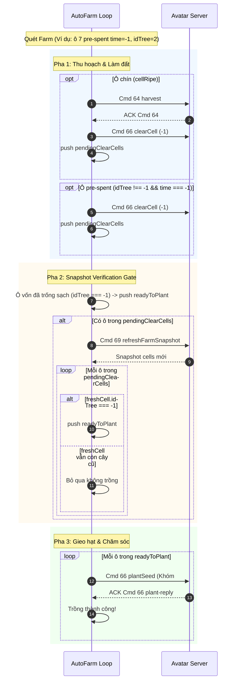

# Thiết kế: Tự Động Làm Đất Cho Ô Đất Đã Thu Hoạch Từ Trước (Pre-spent Cells) Trong AutoFarm

## 1. Mục tiêu & Bối cảnh

### Hiện tượng lỗi
- Trong quá trình chạy AutoFarm, log hiển thị:
  ```
  07:54:39 [quét] 48 ô: 0 chín, 0 trống, 2 vừa thu (time=-1) · 14 con: ...
  07:54:44 [cây] ô 7: server im lặng — trồng Khóm chưa nhận xác nhận, bỏ qua
  07:54:47 [cây] ô 10: server im lặng — trồng Khóm chưa nhận xác nhận, bỏ qua
  ```
- Bot không trồng được cây mới lên các ô 7 và 10, liên tục bị timeout chờ xác nhận từ server game.

### Nguyên nhân gốc rễ (Root Cause)
1. **Ô đất có gốc cây cũ (`c.idTree !== -1`, `c.time === -1`)**:
   - Ô 7 và 10 đã ở trạng thái đã thu hoạch từ trước (`time = -1`, `isCellSpent(c) = true`), nhưng vẫn còn gốc cây cũ chưa được cuốc dọn (`idTree !== -1`).
2. **Pha 1 bỏ qua làm đất cho ô pre-spent ([autoFarm.ts:1067](avatar-web/server/src/autoFarm.ts#L1067))**:
   - Vòng lặp Pha 1 chỉ duyệt các ô chín: `if (!cellRipe(c)) continue;`.
   - Vì ô 7 và 10 có `time = -1` (không phải ô chín `cellRipe`), Pha 1 bỏ qua không gửi lệnh làm đất `clearCell` (Cmd 66, idSeed = -1) và không đưa vào danh sách `pendingClearCells`.
3. **Pha 2 nhận nhầm ô sẵn sàng trồng ([autoFarm.ts:1099](avatar-web/server/src/autoFarm.ts#L1099))**:
   - Điều kiện lọc: `if (c.idTree === -1 || isCellSpent(c) || c.time === -1)`.
   - Pha 2 coi ô `isCellSpent(c)` là đã sẵn sàng trồng và đẩy thẳng vào `readyToPlant` mà không qua bước làm đất.
4. **Pha 3 gửi lệnh trồng đè lên gốc cây cũ ([autoFarm.ts:1158](avatar-web/server/src/autoFarm.ts#L1158))**:
   - Gửi lệnh `plantSeed(idFarm, cellIndex, seedId)` lên ô vẫn còn gốc cây cũ (`idTree !== -1`).
   - Server Avatar HD không cho phép gieo hạt lên ô chưa dọn gốc, lờ gói tin đi và không gửi phản hồi xác nhận. Sau 2.5s timeout, AutoFarm ghi nhận lỗi `server im lặng`.

---

## 2. Phạm vi (Scope)

### In-scope
1. **AutoFarm Controller ([autoFarm.ts](avatar-web/server/src/autoFarm.ts))**:
   - **Pha 1 (Làm đất ô pre-spent)**:
     - Sau khi duyệt thu hoạch các ô chín, duyệt tiếp các ô còn lại đang ở trạng thái pre-spent (`c.idTree !== -1 && (isCellSpent(c) || c.time === -1)`).
     - Gửi lệnh `clearCell(idFarm, c.index)` (Cmd 66, seedId = -1) để dọn gốc cây cũ.
     - Thêm ô vào `pendingClearCells` với `previousTreeId = c.idTree`.
     - Ghi nhận log: `[cây] ô ${c.index}: làm đất dọn cây cũ (${treeName})`.
   - **Pha 2 (Snapshot Verification Gate)**:
     - Sửa điều kiện thu thập `readyToPlant` có sẵn: **chỉ nhận ô vốn đã thực sự trống sạch** (`c.idTree === -1`).
     - Mọi ô có gốc cây cũ (`c.idTree !== -1`) bắt buộc phải đi qua `pendingClearCells` và được snapshot xác nhận `freshCell.idTree === -1` mới được đưa vào `readyToPlant`.

### Out-of-scope
- Không thay đổi wire protocol của `plantSeed` hay `clearCell`.
- Không thay đổi logic tính toán mua bù hạt giống (vốn đã tính đúng `willBeEmpty` cho cả `isCellSpent`).

### Edge Cases
1. **Ô vừa thu hoạch trong vòng hiện tại**: Đã được Pha 1 gửi `clearCell` và thêm vào `pendingClearCells` -> không bị gửi trùng.
2. **Ô đã trống sạch từ trước (`c.idTree === -1`)**: Pha 2 đưa thẳng vào `readyToPlant` không cần snapshot làm đất.
3. **Snapshot báo ô làm đất không thành công (`freshCell.idTree !== -1`)**: Pha 2 bỏ qua không đưa vào `readyToPlant`, log rõ `snapshot cho thấy chưa trống`.
4. **Cấu hình `harvest: false` nhưng ô có cây tàn**: Vẫn thực hiện làm đất để ô sạch và gieo trồng lại theo đúng kế hoạch.

---

## 3. Thiết kế Kiến trúc & Giải pháp Kỹ thuật

### A. Luồng Xử Lý 3 Pha Được Chuẩn Hoá



### B. Thay đổi chi tiết trong Code

1. **[autoFarm.ts](avatar-web/server/src/autoFarm.ts)**:
   - Trong Pha 1:
     ```typescript
     // Dọn các ô đã spent từ trước (thu hoạch thủ công hoặc từ vòng trước bị ngắt)
     for (const initialCell of farm.cells) {
       guard();
       if (this.client.status !== 'online' || this.client.farmState?.idFarm !== idFarm) {
         throw new Error('farm hoặc kết nối đã thay đổi — dừng vòng');
       }
       const currentCell = this.client.farmState.cells.find(cell => cell.index === initialCell.index);
       if (!currentCell) continue;
       const c = currentCell;
       if (c.idTree !== -1 && (isCellSpent(c) || c.time === -1) && !pendingClearCells.some(p => p.index === c.index)) {
         if (this.client.farm.clearCell) this.client.farm.clearCell(idFarm, c.index);
         else this.client.farm.plantSeed(idFarm, c.index, -1);
         sent += 1;
         const treeName = c.idTree !== -1 ? nameOf(c.idTree) : '';
         note(`[cây] ô ${c.index}: làm đất dọn cây cũ${treeName ? ` (${treeName})` : ''}`);
         pendingClearCells.push({ index: c.index, previousTreeId: c.idTree });
         await tick();
       }
     }
     ```
   - Trong Pha 2:
     ```typescript
     // Chỉ thu thập ô VỐN ĐÃ TRỐNG THỰC SỰ (không còn gốc cây)
     const readyToPlant: PendingClearCell[] = [];
     for (const c of farm.cells) {
       if (c.idTree === -1) {
         if (!pendingClearCells.some(p => p.index === c.index)) {
           readyToPlant.push({ index: c.index, previousTreeId: -1 });
         }
       }
     }
     ```

---

## 4. Verification Plan

### Automated Verification
- Chạy toàn bộ test suite của server:
  `cd avatar-web/server && npm test`
- Đảm bảo typecheck pass:
  `cd avatar-web/server && npm run build`
- Thêm unit test mới trong `autoFarm.test.ts`:
  - Mô phỏng ô đất pre-spent (`idTree: 2`, `time: -1`).
  - Chạy `runOneCycle`:
    - Xác minh gọi `clearCell:index` (hoặc `plantSeed:index:-1`).
    - Sau khi snapshot xác nhận `idTree = -1`, xác minh gọi `plantSeed:index:seedId` thành công.
    - Không bị tình trạng gửi `plantSeed` khi chưa gọi `clearCell`.

### Manual Verification
- Kiểm tra log chạy thực tế khi có ô vừa thu (`time = -1`):
  - Xuất hiện log `[cây] ô X: làm đất dọn cây cũ...`
  - Snapshot xác nhận ô sạch.
  - Trồng hạt giống mới thành công với ACK xác nhận, không còn log `server im lặng — trồng Khóm chưa nhận xác nhận, bỏ qua`.
